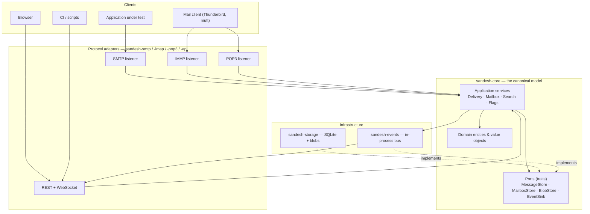
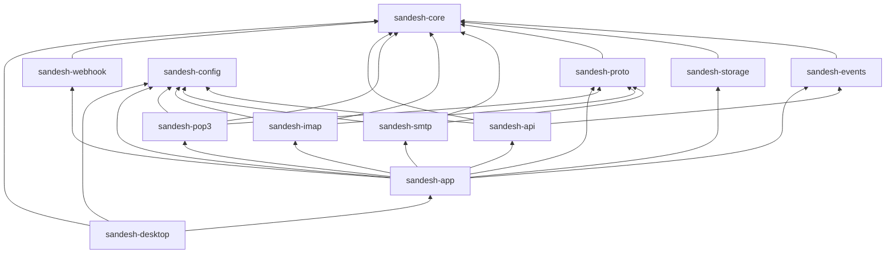
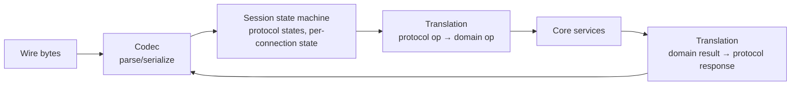
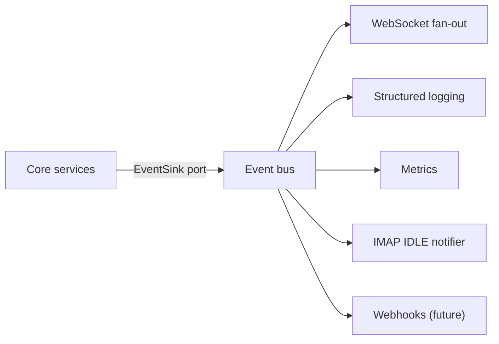
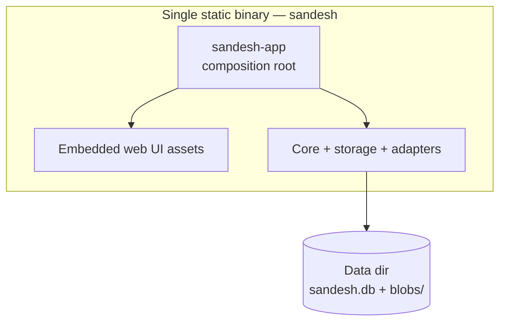
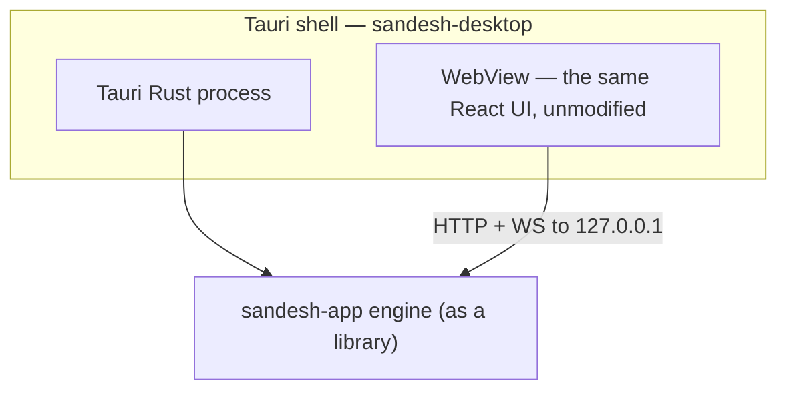

# Sandesh — Architecture

**Status:** Implemented through Phase 9. Every crate in §3 exists, including
`sandesh-imap` (Phase 5), `sandesh-pop3` (Phase 6), `sandesh-webhook` (ADR-085) and `sandesh-desktop` (Phase 9). The dependency rules in §12 are enforced
mechanically by `tests/architecture.rs`.

---

## 1. The governing principle

> **Mail Core first. Protocols are adapters. UI is a client.**

SMTP, IMAP and POP3 are three different *views* onto one body of mail state. If each protocol owns
its own data path, they will diverge — and the single most valuable property of this product (send
via SMTP, read the identical bytes back via IMAP) is lost. So the canonical model lives in one place,
knows nothing about any protocol, and every protocol is a translation layer on top of it.

This is not a stylistic preference. It is what makes the cross-protocol test in
[TESTING_STRATEGY.md](TESTING_STRATEGY.md) possible at all.

## 2. System architecture



Note the direction of the dotted arrows. `sandesh-core` **defines** the storage and event traits;
`sandesh-storage` and `sandesh-events` **implement** them. Dependencies point inward, always.

## 3. Crate structure

```text
sandesh/
├── Cargo.toml                  # workspace root; shared dependency versions
├── crates/
│   ├── sandesh-core/           # domain model, services, ports. Zero infra deps.
│   ├── sandesh-storage/        # SQLite (sqlx) + filesystem blob store
│   ├── sandesh-events/         # in-process event bus
│   ├── sandesh-config/         # config model, file/env/CLI layering
│   ├── sandesh-proto/          # shared protocol-server scaffolding (see §3.1)
│   ├── sandesh-smtp/           # SMTP adapter
│   ├── sandesh-imap/           # IMAP adapter
│   ├── sandesh-pop3/           # POP3 adapter
│   ├── sandesh-api/            # Axum REST + WebSocket
│   ├── sandesh-webhook/        # outbound webhook HTTP client + retry worker
│   ├── sandesh-app/            # composition root + CLI binary
│   └── sandesh-desktop/        # Tauri desktop shell over sandesh-app
├── web/                        # React + TypeScript UI
├── migrations/                 # SQL migrations (sqlx)
├── tests/                      # workspace-level cross-protocol tests
├── testdata/                   # shared .eml corpus
└── Dockerfile
```

### 3.1 Deviations from the proposed structure, and why

Two changes from the structure suggested in the brief:

**Added `sandesh-proto`.** Three TCP line-protocol servers share a great deal: TCP accept loops,
connection lifecycle and limits, line/command framing with byte caps, STARTTLS upgrade over an
established stream, a SASL implementation (`PLAIN`, `LOGIN`), idle timeouts, and
per-connection protocol tracing for the Logs view. Because we are implementing all three protocols
ourselves (§6), duplicating that machinery three times is the single largest avoidable cost in the
project. `sandesh-proto` holds the transport-and-session substrate; each protocol crate holds only
its own grammar and state machine.

**Added `testdata/` as a first-class directory.** The `.eml` corpus (valid, malformed, exotic
encodings, deep MIME nesting) is shared by unit, protocol, and end-to-end tests, and is an asset in
its own right rather than a fixture inside one test module.

`sandesh-app` is retained as the only crate permitted to know about all the others.
`sandesh-desktop` is the one crate that depends on `sandesh-app` (ADR-092).

### 3.2 Dependency direction



There are no cycles and no sibling edges between adapters. `sandesh-smtp` cannot see
`sandesh-imap`; neither can see `sandesh-storage`.

**Permitted dependencies per crate:**

This table lists the *declared runtime* dependencies of each crate, excluding
dev-dependencies. It is kept in step with the manifests; the "Must NOT" column is what
`tests/architecture.rs` asserts against the resolved graph, so a violation fails CI rather
than merely contradicting this table.

| Crate | May depend on | Must NOT depend on |
| --- | --- | --- |
| `sandesh-core` | `mail-parser`, `thiserror`, `uuid`, `time`, `sha2`, `hmac`, `hex`, `subtle`, `async-trait` | sqlx, axum, tokio, rustls, any protocol crate, any sibling |
| `sandesh-config` | `thiserror` | everything else — it is a leaf beside the core |
| `sandesh-storage` | `sandesh-core`, `sqlx`, `tokio`, `uuid`, `time`, `sha2`, `async-trait`, `thiserror` | axum, protocol crates |
| `sandesh-events` | `sandesh-core`, `tokio`, `async-trait`, `thiserror`, `tracing` | axum, tungstenite, protocol crates |
| `sandesh-proto` | `sandesh-core`, `tokio`, `tokio-util`, `rustls`, `tokio-rustls`, `rustls-pemfile`, `rcgen`, `argon2`, `subtle`, `base64`, `sha2`, `async-trait`, `thiserror`, `tracing` | sqlx, axum, sibling protocol crates |
| `sandesh-smtp/-imap/-pop3` | `sandesh-core`, `sandesh-proto`, `sandesh-config`, `tokio`, `tokio-rustls`, `thiserror`, `tracing` (SMTP also `tokio-util`, `async-trait`) | sqlx, axum, each other, `sandesh-storage`, own codec crates from crates.io (ADR-002) |
| `sandesh-api` | `sandesh-core`, `sandesh-events`, `sandesh-config`, `axum`, `tower-http`, `utoipa`, `rust-embed`, `mime_guess`, `image`, `argon2`, `serde`, `serde_json`, `futures-util`, `tokio`, `tokio-util`, `time`, `uuid`, `async-trait`, `thiserror`, `tracing` | sqlx, protocol crates |
| `sandesh-webhook` | `sandesh-core`, `hyper`, `hyper-util`, `http-body-util`, `tokio`, `tokio-util`, `tracing`, `async-trait` | every other `sandesh-*` crate |
| `sandesh-app` | everything except `sandesh-desktop` | — |
| `sandesh-desktop` | `sandesh-app`, `sandesh-config`, `sandesh-core`, `tauri`, `notify-rust`, `tokio`, `tokio-util`, `tracing` | — |

`sandesh-proto` carries the security primitives (`argon2`, `subtle`, `base64`, rustls and
certificate handling) precisely so the three protocol adapters cannot each grow their own;
`tests/architecture.rs` bans them as *direct* dependencies of the adapters (ADR-034).

Two entries look surprising and are deliberate. `sandesh-api` depends on `argon2` because it
verifies API credentials, not because it re-implements hashing — it calls into the same
`sandesh-proto` primitives. `sandesh-proto` depends on `sandesh-core` because the `Transcript`
recorder names domain types (ADR-066); the direction is still inward, so no rule is broken.

`sandesh-core` depending on `mail-parser` deserves justification: MIME parsing is domain logic, not
infrastructure. Producing a `ParsedMessage` from raw bytes is a pure, dependency-free transformation
central to the model. `mail-parser` has no I/O, no async runtime, and no transitive infrastructure.
Enforced in CI with `cargo-deny` bans plus a dependency-direction test (§11).

## 4. The core domain

Full detail in [CORE_SPEC.md](CORE_SPEC.md). Architecturally, `sandesh-core` contains three layers:

1. **Entities and value objects** — `Message`, `RawMessage`, `Mailbox`, `Account`, `EmailAddress`,
   `MessageFlags`, `Uid`, `UidValidity`. Pure data plus invariants. No async, no I/O.
2. **Ports** — the traits the outside world must satisfy:
   `MessageStore`, `MailboxStore`, `AccountStore`, `BlobStore`, `EventSink`, `SearchIndex`, `Clock`.
3. **Application services** — `DeliveryService`, `MailboxService`, `MessageService`, `SearchService`,
   `AccountService`. These express every operation any protocol or the API can perform, in domain
   terms. They take ports as constructor arguments.

Adapters call services. Adapters never touch ports directly, and never construct entities that
bypass invariants.

## 5. Protocol adapter architecture

Every adapter has the same shape:



The **translation layer is the entire point**. IMAP `STORE 5 +FLAGS (\Seen)` becomes
`MessageService::set_flags(account, mailbox, uid_set, add, remove)`. POP3 `DELE 3` becomes a
delete-marking call on the same service. Neither adapter writes SQL, and neither knows the other exists.

Where protocol semantics do not map cleanly onto the domain (POP3's session-scoped deletion, IMAP's
`\Recent`), the mismatch is resolved **inside the adapter's session state**, not by contorting the
core. This is a hard rule; see [CORE_SPEC.md §9](CORE_SPEC.md).

Each adapter exposes a uniform lifecycle to `sandesh-app`:

```rust
#[async_trait]
pub trait ProtocolServer: Send + Sync {
    fn name(&self) -> &'static str;
    async fn bind(&mut self) -> Result<SocketAddr, ServerError>;
    async fn serve(self, shutdown: CancellationToken) -> Result<(), ServerError>;
    fn status(&self) -> ServerStatus;
}
```

This is what lets the Servers/Diagnostics UI show uniform status, and lets tests start one protocol
in isolation on an ephemeral port.

## 6. The pivotal decision: implement the protocol servers ourselves

Research finding, and the most consequential decision in this document.

**There is no production-quality Rust crate for a server-side implementation of SMTP, IMAP, or POP3.**

| Protocol | Best candidate | Verdict |
| --- | --- | --- |
| SMTP | `mailin` / `mailin-embedded` 0.8.3 | Last release 2024-08, 3 reverse dependencies, sync-first design, minimal AUTH/TLS story |
| SMTP | `samotop` 0.13.2 | Last release **January 2022**, built on `async-std` (wrong runtime for us) |
| IMAP | — | **No server crate exists.** `imap`/`async-imap` are clients |
| POP3 | — | **No server crate exists at all** |

What *does* exist, and is excellent, is the layer below: `imap-codec`/`imap-types` (rock-solid,
misuse-resistant IMAP grammar, actively maintained, MIT/Apache-2.0) and `mail-parser` (RFC-conformant
MIME parsing, 3.3M downloads, zero dependencies).

**Decision:** implement the protocol *servers* ourselves on top of `sandesh-proto`, using
`imap-codec` for IMAP grammar and hand-written parsers for SMTP and POP3 (both are small, stable,
line-oriented grammars — SMTP's verb set is roughly a dozen commands; POP3's is eleven).

Rationale:
- Adopting an unmaintained crate for the product's core competency is a larger long-term risk than
  writing a well-scoped, well-tested state machine.
- A *development* mail server has requirements a general MTA library actively fights: it must accept
  malformed mail rather than reject it, must never relay, and must expose protocol-level tracing to
  the UI. Control over the state machine is a feature.
- SMTP and POP3 are genuinely small. IMAP is not — which is exactly why we take `imap-codec` for it
  rather than writing a parser.

Recorded as ADR-002 in [DECISIONS.md](DECISIONS.md); full evaluation in [DEPENDENCIES.md](DEPENDENCIES.md).

## 7. Storage boundary

`sandesh-core` defines storage as traits. `sandesh-storage` implements them over SQLite via `sqlx`,
plus a filesystem blob store for raw message bodies and attachments above a size threshold.

```rust
#[async_trait]
pub trait MessageStore: Send + Sync {
    async fn insert(&self, msg: &NewMessage) -> Result<MessageId, StoreError>;
    async fn get(&self, id: MessageId) -> Result<Option<Message>, StoreError>;
    async fn raw(&self, id: MessageId) -> Result<Bytes, StoreError>;
    // ...
}
```

No SQL type, connection, transaction handle, or `sqlx` error ever appears in a core signature. This
is what keeps a future PostgreSQL backend — or an in-memory test double — a drop-in substitution.

Schema, indexes, migrations and the blob threshold are specified in [STORAGE_DESIGN.md](STORAGE_DESIGN.md).

## 8. Event architecture

The core emits domain events through an `EventSink` port. `sandesh-events` provides an in-process
broadcast bus. WebSocket is **one subscriber among several** — logging, metrics and webhooks
are peers, not special cases.



`sandesh-events` does not depend on any WebSocket library — the translation from domain event to
wire frame lives in `sandesh-api`. The IMAP IDLE subscriber is the proof that this decoupling was
worth it: IDLE is a protocol feature driven by the same events that drive the UI.

Payloads, ordering and delivery guarantees: [EVENT_MODEL.md](EVENT_MODEL.md).

## 9. API and UI boundaries

`sandesh-api` exposes `/api/v1` over Axum and serves the built React SPA from the same listener
(embedded in the binary via `rust-embed`, so distribution stays a single file).

The UI's only contracts are the REST API and the WebSocket stream. It has no database access, no
filesystem access, and no protocol knowledge. TypeScript types are generated from the Rust API types
(`ts-rs`) so the contract cannot silently drift.

Consequence: the UI is replaceable (a CLI, a TUI, a different framework) and the API is independently
testable without a browser.

### As built (Phase 4)

The UI is a **client**, with no mail-domain logic of its own. Two properties enforce that rather
than merely asserting it:

* it reads the domain only through generated types, so it cannot invent a field the API does not
  expose;
* it does not parse MIME. The tree it draws is the backend's `MimePart` list, and the byte ranges it
  highlights are the backend's ranges. A second parser in TypeScript would eventually disagree with
  `mail-parser`, at which point the tool would be lying about the message.

Static assets are served by `sandesh-api`, not by a new crate and not by `sandesh-core`,
`-storage`, `-events` or `-smtp`, none of which learn that a UI exists.

## 10. Deployment architecture



- **Native:** one binary, one data directory. No runtime, no external services.
- **Docker:** `scratch`/`distroless` image over the static binary; data directory is the only volume.
  Both are first-class targets from Phase 1; neither is a wrapper around the other.
- **Headless:** ~~`--no-web` runs the engine with protocols and API only~~ — **struck** (ADR-076).
  No such flag exists and none is planned. It is unnecessary rather than missing: the UI is embedded
  at compile time and served only from the router's fallback, so an API-only deployment already gets
  API-only behaviour from every request it makes, and since ADR-075 the fallback is behind
  authentication too.

## 11. Desktop architecture



The desktop application embeds the identical engine and identical UI. The single architectural
requirement that makes this possible is imposed **now**: `sandesh-app` must expose an embeddable
engine type, with `main()` being a thin CLI wrapper over it.

**Built in Phase 9** (ADR-092), with two corrections this section earned:

- The type is **`Application`**, not `Engine`, and `Application::start(AppConfig) -> Application` is
  the shape this paragraph specified — construct-and-bind, then `run`, then cancel a shutdown token.
  The name here predates the type. `src/main.rs` is eight lines over `run_cli`, so "a thin CLI
  wrapper" holds.
- The **configurable base URL is not required** and is not built. That sentence assumed a shell
  bundling its own assets and calling the engine cross-origin. `crates/sandesh-desktop` instead
  points the WebView at `http://127.0.0.1:<port>` — the transport this section's own diagram draws —
  so same-origin is correct rather than limiting, and the UI is unchanged. A bundled-asset shell
  would need it; none exists.

## 12. Architectural invariants

Violating any of these is a bug, regardless of test status.

1. `sandesh-core` compiles without any protocol, HTTP, or database crate in its dependency tree.
2. No adapter crate depends on `sandesh-storage` or on another adapter crate.
3. All mutations flow through core services. No adapter issues SQL.
4. Raw message bytes are stored verbatim and are byte-identical on retrieval.
5. SMTP, IMAP and POP3 read and write the same mail state through the same services.
6. Domain events are emitted by the core, never by an adapter.
7. The Web UI reaches the system only via `/api/v1` and the WebSocket.
8. Every protocol operation is reachable in an integration test without starting the UI.
9. Storage is addressed through traits; no `sqlx` type crosses the core boundary.
10. The engine runs headlessly and identically in native and Docker deployments.

CI enforces 1, 2 and 9 mechanically via `cargo-deny` and a `tests/architecture.rs` test that parses
`cargo metadata` and asserts the dependency graph. The rest are enforced by review and integration tests.

## 13. Anti-patterns to avoid

- **The convenience shortcut.** An adapter reaching for the store "just for this one query" because
  the service lacks a method. Add the method to the service.
- **A UI-shaped domain.** Modelling `Message` around what the inbox list renders. IMAP FETCH and POP3
  UIDL have requirements the UI never surfaces; the domain must serve the protocols first.
- **Parsed-as-canonical.** Treating the parsed representation as the message and reconstructing raw
  bytes on demand. Reconstruction is never byte-exact. Raw is authoritative, always.
- **Protocol leakage into the core.** An `is_recent` field or a `\Deleted`-only-in-POP3 concept in
  `Message`. Protocol-specific session state lives in the adapter's session.
- **WebSocket-shaped events.** Designing event payloads around what the UI wants to render. Events
  are domain facts; the API layer projects them.
- **`mailbox_id` on `messages`.** A single-owner column cannot express IMAP COPY, where one message
  exists in several mailboxes with distinct UIDs and flags. See [STORAGE_DESIGN.md](STORAGE_DESIGN.md).
- **Premature distribution.** Clustering, queues, multi-tenancy, horizontal scale. This is a local
  developer tool.
- **Dependency accumulation.** Every crate is justified in [DEPENDENCIES.md](DEPENDENCIES.md).
