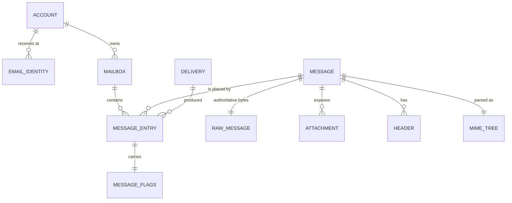
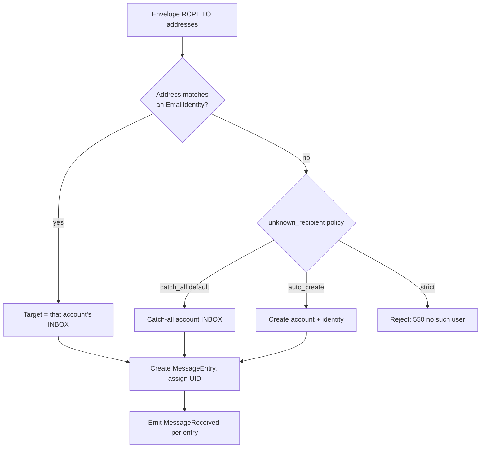

# Sandesh — Core Domain Specification

**Status:** Implemented (Phase 1 onward). The Rust shown is illustrative of shape and
invariants, not a transcript of the code — `crates/sandesh-core` is authoritative.

---

## 1. Scope and method

This document defines the canonical mail model in `sandesh-core`. It was derived by working backwards
from **protocol requirements**, not from UI needs — a model that satisfies IMAP will satisfy the UI,
but the reverse is emphatically not true.

The three requirements that shaped the model:

| Requirement | Source | Consequence |
| --- | --- | --- |
| A message may exist in several mailboxes with **independent** UIDs and flags | IMAP `COPY` (RFC 9051 §6.4.7) | Message content and mailbox membership are separate entities |
| UIDs are per-mailbox, monotonic, never reused; `UIDVALIDITY` invalidates the space | RFC 9051 §2.3.1.1 | UID assignment is a mailbox-owned counter, not a global one |
| POP3 deletion is session-scoped until `QUIT` | RFC 1939 §5 (UPDATE state) | Deletion is a two-stage operation; staging is adapter-local |

## 2. Entity overview



The pivotal structure is **`MessageEntry`** — the association between a `Message` (immutable content)
and a `Mailbox` (a place), carrying the UID and flags. This is the entity that makes IMAP possible.
Naming it explicitly, rather than as a join table, is deliberate: it has identity, invariants and a
lifecycle of its own.

## 3. Value objects

Immutable, validated on construction, no identity.

### `EmailAddress`
```rust
pub struct EmailAddress {
    local_part: String,     // preserved verbatim, including quoted forms
    domain: String,         // lowercased for comparison; original retained
    display_name: Option<String>,
}
```
**Invariants:** non-empty local part; a domain or a documented sentinel for address-literal forms.
Comparison is case-insensitive on domain, **case-sensitive on local part** (RFC 5321 §2.3.11 —
only the destination host may interpret the local part). The original text is retained for display
and raw fidelity.

Parsing must be lenient: Sandesh is a *testing* tool, and rejecting a malformed address at the domain
boundary would defeat its purpose. `EmailAddress::parse_lenient` yields a best-effort value plus a
diagnostic; a message is never dropped because an address failed to parse.

### `MessageId`, `MailboxId`, `AccountId`, `EntryId`
Opaque, newtyped, distinct types (`MessageId(Uuid)`). Never interchangeable, never bare integers.

### `Uid` and `UidValidity`
```rust
pub struct Uid(u32);           // 1..=u32::MAX, per-mailbox, strictly ascending
pub struct UidValidity(u32);   // changes iff the UID space is invalidated
```
`Uid(0)` is invalid (RFC 9051). `UidValidity` is assigned at mailbox creation and changed only when
a mailbox is deleted and recreated with the same name — the client-visible signal to discard cache.

### `SeqNum`
IMAP message sequence numbers: 1-based, **contiguous, recomputed per-session**, mutated by EXPUNGE.
Deliberately *not* persisted. It is derived state owned by the IMAP session, and modelling it as a
stored field would be a protocol leak.

### `MessageFlags`
```rust
pub struct MessageFlags {
    system: SystemFlags,        // bitflags: Seen Answered Flagged Deleted Draft
    keywords: BTreeSet<Keyword>,// custom \\-less atoms, e.g. $Forwarded
}
```
`\Recent` is **not** modelled. RFC 9051 deprecates it, its semantics ("first session to see this
message") are inherently session-scoped, and persisting it is a known source of bugs. The IMAP
adapter reports `\Recent`-free responses; if a legacy client requires it, the adapter synthesises it
from session state.

### `RawMessage`
```rust
pub struct RawMessage {
    bytes: Bytes,           // exact octets received, CRLF preserved
    size: u64,              // RFC822.SIZE — octets, authoritative
    sha256: [u8; 32],       // integrity + dedup key
    received_at: Timestamp,
}
```

## 4. Entities

### 4.1 `Message` — immutable content

```rust
pub struct Message {
    id: MessageId,
    raw: RawMessageRef,           // handle to authoritative bytes
    parsed: ParsedMessage,        // derived, cacheable, regenerable
    envelope: Envelope,           // SMTP-level, from the transaction
    received_at: Timestamp,
}
```

A `Message` is **immutable after creation**. Nothing that a protocol can mutate lives here — flags
and UIDs belong to `MessageEntry`. This immutability is what makes it safe for one message to appear
in many mailboxes.

**`Envelope`** captures the SMTP transaction, which is distinct from the message headers and must not
be conflated with them:
```rust
pub struct Envelope {
    mail_from: Option<EmailAddress>,   // None = null reverse-path <> (bounces)
    rcpt_to: Vec<EmailAddress>,        // actual recipients, may differ from To/Cc entirely
    helo_domain: Option<String>,
    peer_addr: Option<SocketAddr>,
    tls: Option<TlsInfo>,
    auth_identity: Option<String>,
}
```
Bcc testing is a primary use case and only works if the envelope is preserved separately.

**`ParsedMessage`** is derived state:
```rust
pub struct ParsedMessage {
    headers: Vec<Header>,          // ordered, duplicates preserved, raw values retained
    text_body: Vec<PartRef>,
    html_body: Vec<PartRef>,
    attachments: Vec<Attachment>,
    inline_resources: Vec<Attachment>,  // referenced by Content-ID
    mime_tree: MimeNode,
    parse_diagnostics: Vec<ParseDiagnostic>,
}
```
`parse_diagnostics` is a product feature, not error handling: surfacing "this Content-Type is
malformed, here is how we interpreted it" is precisely what a mail *debugging* tool exists to do.

### 4.2 `Header`
```rust
pub struct Header {
    name: HeaderName,          // case-preserved as received; compared case-insensitively
    raw_value: Bytes,          // exact bytes, folding and encoded-words intact
    decoded_value: String,     // RFC 2047 decoded, best-effort
    offset: ByteRange,         // position in the raw message
}
```
Order and duplicates are preserved (`Received:` chains and DKIM signature ordering are
semantically significant). `offset` lets the UI highlight a header in the raw source view.

### 4.3 `MimeNode` and `Attachment`
```rust
pub struct MimeNode {
    content_type: ContentType,
    disposition: Option<ContentDisposition>,
    encoding: TransferEncoding,
    content_id: Option<String>,
    headers: Vec<Header>,
    body: ByteRange,               // offset into raw — NOT a copy
    children: Vec<MimeNode>,
    diagnostics: Vec<ParseDiagnostic>,
}
```
Part bodies are **byte ranges into the raw message**, not copies. This guarantees `BODY[2.1]` returns
exactly what the sender sent, keeps memory flat, and makes the MIME tree cheap.

`Attachment` is a projection over a `MimeNode` (filename, type, size, decoded-content handle), not a
separate stored copy. Decoded bytes are materialised on demand and may be cached.

### 4.4 `Mailbox`
```rust
pub struct Mailbox {
    id: MailboxId,
    account_id: AccountId,
    name: MailboxName,          // hierarchical, '/' delimiter
    uid_validity: UidValidity,
    uid_next: Uid,              // next UID to assign; never decreases
    attributes: MailboxAttributes,  // \Noselect \HasChildren \Trash \Sent \Drafts \Junk
    subscribed: bool,
}
```

**Naming.** Hierarchy delimiter is `/`. `INBOX` is case-insensitive and reserved (RFC 9051 §5.1);
every other name is case-sensitive UTF-8 in NFC. IMAP4rev2 mandates Net-Unicode names, so we store
Unicode natively and let the IMAP adapter apply modified-UTF-7 only when a client negotiates
IMAP4rev1 without `UTF8=ACCEPT`. Encoding is a wire concern.

**`uid_next` never decreases**, even after EXPUNGE. Reuse would corrupt every client cache.

Every account is created with `INBOX`; `Sent`, `Drafts`, `Trash`, `Junk` and `Archive` are created
with the corresponding SPECIAL-USE attributes (RFC 6154), because mail clients expect them.

### 4.5 `MessageEntry` — the linchpin
```rust
pub struct MessageEntry {
    id: EntryId,
    message_id: MessageId,      // shared, immutable content
    mailbox_id: MailboxId,
    uid: Uid,                   // unique within (mailbox, uid_validity)
    flags: MessageFlags,        // per-placement, NOT shared
    internal_date: Timestamp,   // IMAP INTERNALDATE; set at placement
    added_at: Timestamp,
}
```

Two entries may reference one `Message` with different UIDs, different flags, in different mailboxes.
This is exactly IMAP `COPY`, and it is why `messages.mailbox_id` would be wrong.

**Invariants:**
1. `uid` is unique within its mailbox and strictly less than the mailbox's `uid_next` at creation.
2. UIDs ascend in placement order — for any two entries in a mailbox, `added_at` ordering matches
   `uid` ordering (RFC 9051 §2.3.1.1).
3. Deleting the last entry referencing a `Message` makes it eligible for garbage collection; the
   `Message` itself is never mutated.
4. `\Deleted` marks an entry; it does not remove it. Removal happens on EXPUNGE or explicit deletion.

### 4.6 `Account` and `EmailIdentity`
```rust
pub struct Account {
    id: AccountId,
    username: String,               // login identity
    credential: Option<Credential>, // argon2 hash; None = auth disabled for this account
    identities: Vec<EmailIdentity>, // addresses that route here
    created_at: Timestamp,
}
pub struct EmailIdentity {
    address: EmailAddress,
    is_primary: bool,
}
```

Accounts are separate from addresses because a developer routinely wants `dev@example.com`,
`dev+tag@example.com` and `noreply@example.com` in one inspectable mailbox. Address→account routing
is a domain rule (§7), not an SMTP detail.

**Auto-provisioning.** In the default `catch_all` mode, mail to an unknown address is delivered to a
catch-all account rather than rejected — a development mail server that bounces unrecognised
recipients creates friction with no benefit. Configurable to `auto_create` (create an account per
address) or `strict` (reject unknown recipients, for testing bounce handling).

### 4.7 `Delivery` — an auditable record
```rust
pub struct Delivery {
    id: DeliveryId,
    message_id: MessageId,
    source: DeliverySource,      // Smtp{..} | ImapAppend{..} | Api{..}
    envelope: Envelope,
    outcomes: Vec<DeliveryOutcome>,  // per recipient: entry created, or rejected + reason
    received_at: Timestamp,
    duration: Duration,
}
```
Delivery is a first-class entity, not a function call. "Why did this land in that mailbox?" and "what
did the SMTP transaction actually look like?" are core debugging questions, and the Diagnostics view
is built directly on this record.

## 5. Message lifecycle

```mermaid
stateDiagram-v2
    [*] --> Received: SMTP DATA / IMAP APPEND / API POST
    Received --> Stored: raw bytes persisted, sha256 computed
    Stored --> Parsed: MIME parsed (diagnostics retained, never fatal)
    Parsed --> Routed: envelope recipients → accounts
    Routed --> Placed: MessageEntry per target mailbox, UID assigned
    Placed --> Indexed: search index updated
    Indexed --> Available: MessageReceived event emitted
    Available --> Available: flags changed / copied / moved
    Available --> MarkedDeleted: \\Deleted set
    MarkedDeleted --> Available: \\Deleted cleared
    MarkedDeleted --> Expunged: EXPUNGE / POP3 QUIT / API delete
    Expunged --> [*]: entry removed; message GC'd if unreferenced
```



**Critical ordering:** raw bytes are persisted *before* parsing. A message that cannot be parsed is
still fully stored and inspectable — which is the entire point of malformed-message testing. Parse
failure is never fatal to delivery.

The `Available` event is emitted only after the message is queryable, so a client woken by
`MessageReceived` never races an empty read.

## 6. Mailbox semantics

| Operation | Semantics |
| --- | --- |
| `CREATE` | Creates parents implicitly. Fresh `uid_validity`. Fails if the name exists. |
| `DELETE` | Removes the mailbox and its entries. Fails on `\Noselect` with children. Messages GC'd if unreferenced. |
| `RENAME` | Renames the mailbox and, per RFC 9051, its descendants. Renaming `INBOX` creates a new mailbox and moves the contents. UIDs are preserved. |
| `COPY` | New `MessageEntry` in the target with a **new UID**; flags copied; `Message` shared, never duplicated. |
| `MOVE` | Atomic copy + expunge (RFC 6851). New UID in target; source entry removed. |
| `APPEND` | Creates a `Message` (source `ImapAppend`) plus an entry. Client-supplied flags and INTERNALDATE honoured. |
| `EXPUNGE` | Removes entries flagged `\Deleted`. `uid_next` unchanged. |
| `SUBSCRIBE` | Sets `subscribed`; independent of existence (RFC 9051 permits subscribing to a non-existent mailbox). |

## 6a. Where these semantics live: the service layer

The rules in §6 are implemented once, in `sandesh-core`'s `MailboxService`, and every protocol
surface calls it (ADR-068). They were previously written separately in the IMAP session and the HTTP
handlers, and the copies disagreed — about whether `INBOX` could be created, whether a mailbox could
be renamed *onto* `INBOX`, and whether a new mailbox starts subscribed.

The service owns what an operation *means*: existence, selectability, the `INBOX` refusals,
duplicate detection, and the single `Mailbox` constructor. It returns `CoreResult`, which is what
keeps "no such mailbox" distinct from "the store could not answer" — a distinction the previous
call sites lost, so a failed duplicate check read as a free name.

What stays in the adapters is set out in §9: session state and wire encodings. For mailboxes that
means modified UTF-7 decoding, the `[TRYCREATE]` response code, deselecting after a failed
`SELECT`, and updating a selected mailbox's reported name after a rename.

Where IMAP and HTTP disagreed, **IMAP's semantics are canonical**: it is the protocol these rules
are specified against.

The placement operations of §6 — `COPY`, `MOVE`, and deletion — live the same way, in
`MessageService` (ADR-069). It owns three rules that hold whoever is asking: a destination must be
able to hold messages, must belong to the **same account** as the source, and must not be the
mailbox the placement already occupies. The account rule cannot be enforced any lower —
`copy_entry` and `move_entry` allocate a UID on whatever target they are handed, and no constraint
relates the two accounts — and it is what keeps one account's mail out of another's mailboxes.

Deleting a placement means moving it to `Trash` when the account has one, removing it outright when
the placement is already there (so a second delete is permanent) or when no such mailbox exists. The
Trash mailbox is always resolved from **the placement's own account**, reached through its mailbox;
there is no fallback, because there is no correct guess about who owns a placement.

Delivery routing (§7) lives the same way, in `DeliveryService` (ADR-071). It was in the SMTP adapter
until then, which meant no other surface could route a message the way SMTP does without a second
implementation of §7. The `unknown_recipient` choice it acts on is a **domain** type,
`UnknownRecipient`, mirrored from the configuration enum and converted at the composition root — the
core may not depend on configuration, and configuration may not depend on the core, so the one crate
that sees both does the translation.

Together with `AccountService` (§4.4) these are the whole service layer: `AccountService`,
`DeliveryService`, `MailboxService`, `MessageService`. They are constructed once, at the composition
root, so no surface can assemble one over a different set of ports.

---

## 7. Delivery behaviour



Rules:
1. Routing uses **envelope recipients** (`RCPT TO`), never `To:`/`Cc:` headers. Bcc works correctly
   only this way, and testing Bcc is a core use case.
2. Multiple recipients resolving to distinct accounts produce **one `Message`, several
   `MessageEntry`s**. The bytes are stored once.
3. Two recipients resolving to the *same* mailbox produce **one entry** (idempotent placement).
4. Sandesh **never relays**. Delivery is always terminal and local. Optional explicit relay is a
   deliberate future opt-in feature, never a default.
5. Delivery is atomic per message: either all entries are created and the event is emitted, or
   nothing is persisted.

## 8. MIME and attachment handling

**The raw message is authoritative.** The parsed representation is a derived cache that may be
discarded and regenerated. Concretely:

- Raw bytes are stored verbatim, including trailing whitespace, unusual line endings and invalid
  encodings. `\n` is *not* normalised to `\r\n` in storage; the SMTP adapter records what arrived.
- `RFC822.SIZE` is computed from the stored bytes so IMAP `FETCH RFC822.SIZE` is exact.
- Any IMAP `BODY[...]` fetch is served by slicing raw bytes at parsed offsets — never by
  re-serialising the parsed tree.
- Reparsing after a parser upgrade must be possible without data loss. Parsed data carries the
  parser version; a version bump invalidates the cache.

**Attachments** are byte ranges plus metadata, decoded on demand. Above a configurable threshold
(default 256 KiB) *decoded* attachment bytes may be cached in the blob store; the raw message
remains the source. See [STORAGE_DESIGN.md](STORAGE_DESIGN.md).

**Parser leniency contract:** the parser must never panic, never reject, and never lose bytes. Every
deviation from spec produces a `ParseDiagnostic` (severity, byte range, description) surfaced in the
inspector. This is a strict requirement enforced by fuzzing (see [TESTING_STRATEGY.md](TESTING_STRATEGY.md))
and, as a second layer, by `run_parser` in `parser.rs`, which catches a panic inside `mail-parser`
so the message is stored with `parse_ok = false` and a diagnostic rather than crashing the session.

## 9. Protocol semantics that stay OUT of the core

Recording these explicitly, because each is a tempting place to leak protocol concerns inward:

| Concern | Protocol | Where it lives | Why not in core |
| --- | --- | --- | --- |
| Message sequence numbers | IMAP | IMAP session | Session-scoped, mutated by EXPUNGE, not a property of mail |
| `\Recent` | IMAP | IMAP session (synthesised) | Deprecated in RFC 9051; inherently session-scoped |
| Session-scoped DELE | POP3 | POP3 session | Staged; applied to the core only on QUIT/UPDATE |
| POP3 message numbering | POP3 | POP3 session | 1..N snapshot taken at login; stable for the session only |
| SMTP transaction state | SMTP | SMTP session | Pre-delivery; nothing is persisted until DATA completes |
| IDLE subscriptions | IMAP | IMAP session + event bus | Delivery mechanism, not a domain fact |
| UTF-7 mailbox encoding | IMAP | IMAP codec | Wire encoding; the domain stores Unicode |

The POP3 case is the sharpest test. `DELE 3` must not be visible to a concurrent IMAP session until
POP3 `QUIT`. The POP3 session holds a pending-delete set and calls the core exactly once, on entering
UPDATE state. A dropped connection discards the set — precisely as RFC 1939 requires.

## 10. Error model

```rust
pub enum CoreError {
    NotFound { entity: EntityKind, id: String },
    AlreadyExists { entity: EntityKind, key: String },
    InvalidArgument { field: String, reason: String },
    InvariantViolated { invariant: String },     // a bug; logged at error
    Conflict { reason: String },                 // concurrent modification
    QuotaExceeded { limit: String },
    Storage(StoreError),                         // opaque; no sqlx types leak
}
```

Domain errors are protocol-neutral. Each adapter maps them:

| `CoreError` | SMTP | IMAP | POP3 | REST |
| --- | --- | --- | --- | --- |
| `NotFound` | `550` | `NO` | `-ERR` | `404` |
| `AlreadyExists` | `550` | `NO [ALREADYEXISTS]` | `-ERR` | `409` |
| `InvalidArgument` | `501` | `BAD` | `-ERR` | `400` |
| `Conflict` | `451` | `NO` | `-ERR` | `409` |
| `QuotaExceeded` | `452` | `NO [OVERQUOTA]` | `-ERR` | `507` |
| `InvariantViolated` | `451` | `NO` | `-ERR` | `500` |
| `Storage` | `451` | `NO` | `-ERR` | `500` |

`CoreError` carries no protocol status codes. Mapping is the adapter's job — that is what keeps
adapters replaceable.

## 11. Concurrency model

- `Message` is immutable; concurrent reads need no coordination.
- UID assignment is serialised **per mailbox** by the storage layer (transaction + `uid_next` update).
  This is the one place a race would corrupt client state.
- Flag updates are last-write-wins per entry *unless* the caller supplies a precondition:
  `MessageStore::update_flags_conditional` implements IMAP `STORE UNCHANGEDSINCE` (CONDSTORE) by
  comparing the entry's modseq inside the writing transaction (ADR-059). Without a precondition,
  when added it requires a per-entry `mod_seq`, reserved in the schema now.
- EXPUNGE and concurrent FETCH are reconciled by the IMAP session's sequence-number bookkeeping, per
  RFC 9051 §5.5 — the core simply removes entries.

## 12. Open decisions

- **OD-1** Message deduplication by `sha256`. Identical bytes delivered to five accounts could share
  one stored `Message`. Attractive for storage, but complicates GC and lifecycle. *Leaning: dedup
  within one delivery only (already specified in §7.2); no cross-delivery dedup in v1.*
- **OD-2** CONDSTORE/QRESYNC (RFC 7162). Requires per-entry `mod_seq`. Deferred past v1; the schema
  reserves the column.
- **OD-3** Quotas. Message-count and total-size caps exist as config, but per-account quotas and the
  IMAP QUOTA extension are unscoped.

---

## 13. Implementation status (Phase 1)

The model above is implemented in `sandesh-core`. Naming and shape follow this
document; the notes below record where implementation added detail.

| Spec element | Implemented as | Note |
| --- | --- | --- |
| `EmailAddress` | `address.rs` | `parse_lenient` never fails. Domain comparison folds case, local part does not (RFC 5321 §2.3.11). |
| `MessageId`, `MailboxId`, … | `id.rs` | Eight distinct newtypes over UUID v7, generated by macro. Not interchangeable. |
| `Uid`, `UidValidity` | `uid.rs` | `Uid::new(0)` returns `None`; `next()` returns `None` at `u32::MAX` rather than wrapping into reuse. |
| `MessageFlags` | `flags.rs` | `SystemFlags` bitmask plus a `BTreeSet<Keyword>`. `\Recent` absent, as specified. |
| `RawMessage` | `message.rs` | Owns the octets and their SHA-256; `verify_integrity` detects corruption. |
| `Header` | `message.rs` | Name, raw bytes, decoded value, byte range. Order and duplicates preserved. |
| `MimeNode` | `mime.rs` as `MimePart` | Renamed for consistency with the storage table and the `PartPath` addressing. Flat list plus `PartPath` links rather than an owned tree — equivalent, and it survives a database round trip without reconstruction. |
| `ParsedMessage` | `message.rs` | `text_body`/`html_body` are `Vec<PartPath>` rather than `PartRef`. |
| `Mailbox`, `MailboxName` | `mailbox.rs` | `INBOX` case-insensitive and normalised; Unicode names accepted; hierarchy navigation implemented. |
| `MessageEntry` | `entry.rs` | As specified. |
| `Account`, `EmailIdentity` | `account.rs` | `DEFAULT_MAILBOXES` creates INBOX plus five SPECIAL-USE mailboxes. |
| `Delivery` | `delivery.rs` | Entity defined; `DeliveryStore` port defined. Persistence lands with Phase 2, which is what produces the records. |
| `CoreError` | `error.rs` | As specified, including the `EntityKind` discriminant. Carries no protocol codes — asserted by a test. |

**Deferred with reason:**

* **`ParseDiagnostic` persistence** — ADR-014.
* **`Envelope.rcpt_to` on `Message`** — recipients are multi-valued and belong to
  the delivery record (§4.7). `MessageStore::get` therefore returns an empty
  `rcpt_to`; `DeliveryStore` supplies them from Phase 2. Recorded as OD-16.
* **`Credential` verification** — Argon2 arrives in Phase 4.5; Phase 1 only
  persists the shape.

**MIME boundary semantics.** RFC 2046 §5.1.1 attaches the CRLF preceding a
boundary delimiter to the *delimiter*, not to the part body. A part body
therefore excludes its trailing CRLF, and `FETCH BODY[<part>]` must reproduce
that. Verified in `raw_fidelity.rs`.
