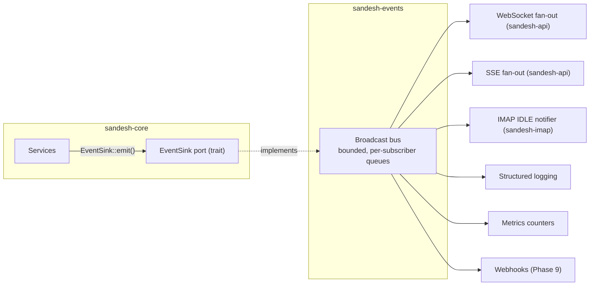

# Sandesh — Event Model

**Status:** Implemented (Phase 3). Bus, WebSocket fan-out and filtering are built and tested.

---

## 1. Purpose and principles

Events exist so that state changes in the mail core can reach interested parties without the core
knowing who they are. Three consumers already justify the mechanism: the Web UI (live inbox), the
**IMAP IDLE** implementation, and structured logging.

That second consumer is the important one. IMAP IDLE is a *protocol* feature driven by the same
facts that drive the UI. If events were designed as "WebSocket messages", IDLE would need a second
mechanism and the two would drift. Events are therefore **domain facts**, and every transport is a
projection.

1. Events describe what happened in domain terms, in the past tense.
2. Events carry identifiers, not payloads. Consumers fetch what they need.
3. The core emits; the core never subscribes.
4. `sandesh-events` depends on no transport library.
5. Emission is best-effort and never blocks or fails a domain operation.

## 2. Architecture



```rust
#[async_trait]
pub trait EventSink: Send + Sync {
    fn emit(&self, event: DomainEvent);   // non-blocking, infallible
}
```

`emit` returns `()`. A failed subscriber must never fail a mail delivery — the mail is already
committed, and an event is a notification about a fact, not part of establishing it.

## 3. Event envelope

```rust
pub struct DomainEvent {
    pub id: EventId,             // UUID v7
    pub seq: u64,                // global monotonic, assigned by the bus
    pub occurred_at: Timestamp,
    pub kind: EventKind,
    pub payload: EventPayload,
}
```

`seq` is assigned by the bus at publication, giving a single total order across all events. Consumers
detect gaps by comparing sequence numbers.

## 4. Event catalogue

### 4.1 Message events

| Event | Emitted when | Payload |
| --- | --- | --- |
| `MessageReceived` | A message is delivered and queryable | `message_id`, `entry_id`, `mailbox_id`, `account_id`, `uid`, `size` |
| `MessageDeleted` | Every entry for a message is gone; message GC'd | `message_id`, `mailbox_ids[]` |
| `EntryCreated` | A placement is created (COPY, APPEND, delivery) | `entry_id`, `message_id`, `mailbox_id`, `uid` |
| `EntryDeleted` | A placement is removed (EXPUNGE, delete) | `entry_id`, `message_id`, `mailbox_id`, `uid` |
| `EntryFlagsChanged` | Flags are modified | `entry_id`, `mailbox_id`, `uid`, `added[]`, `removed[]`, `flags_now[]`, `mod_seq` |
| `EntryMoved` | Defined, but no producer emits it: a move (IMAP `MOVE`, REST `/move`) publishes `EntryDeleted` then `EntryCreated` | `entry_id`, `message_id`, `from_mailbox_id`, `to_mailbox_id`, `old_uid`, `new_uid` |

**Naming deviates from the brief's `MessageCreated`/`MessageUpdated`/`MessageMoved`.** In the domain,
a `Message` is immutable content and cannot be updated or moved — a *placement* can. Naming events
after what actually changes keeps the event catalogue honest about the model. `MessageReceived` is
retained because delivery is genuinely a message-level fact worth its own event, and it is the one
every consumer cares about most.

Both `MessageReceived` and `EntryCreated` fire on delivery: the first is the human/UI-level fact, the
second the structural one that IMAP IDLE consumes uniformly with COPY and APPEND.

### 4.2 Mailbox and account events

| Event | Payload |
| --- | --- |
| `MailboxCreated` | `mailbox_id`, `account_id`, `name`, `uid_validity` |
| `MailboxDeleted` | `mailbox_id`, `account_id`, `name` |
| `MailboxRenamed` | `mailbox_id`, `old_name`, `new_name` |
| `MailboxSubscriptionChanged` | `mailbox_id`, `subscribed` |
| `AccountCreated` | `account_id`, `username` |
| `AccountDeleted` | `account_id`, `username` |

### 4.3 System events

| Event | Payload |
| --- | --- |
| `DeliveryFailed` | `delivery_id`, `reason` |
| `WorkspaceCreated` | `workspace_id`, `name` |
| `WorkspaceDeleted` | `workspace_id` |
| `WorkspaceSwitched` | `previous`, `current` |
| `WorkspacePurged` | `workspace_id`, `deleted_messages`, `deleted_traces`, `reclaimed_bytes` |

**Planned, not implemented** — no `EventKind` variant exists: `AccountUpdated`, `ServerStarted`,
`ServerStopped`, `ServerError`, `RetentionApplied`.

`DeliveryFailed` is significant for the product: watching a rejection arrive live is exactly what a
developer testing bounce handling needs. The variant exists but nothing emits it yet.

## 5. Delivery semantics

| Property | Guarantee |
| --- | --- |
| Ordering | **Total order by `seq` per subscriber.** Events are delivered in publication order |
| Durability | **None.** In-memory only. A restart loses undelivered events |
| Delivery | **At-most-once.** A slow subscriber is lagged, not blocked |
| Consistency | An event is published only after its transaction commits |

**Why at-most-once and non-durable.** Events are notifications about state that is already committed
and queryable. A consumer that misses one recovers by refetching — which it must be able to do anyway,
after a reconnect. Adding a durable event log would introduce a second source of truth, ordering
subtleties, and retention questions, for a local dev tool whose recovery path is a cheap refetch. The
important thing is that a consumer can *detect* it missed something, which `seq` provides.

**The commit-then-publish ordering is load-bearing.** Publishing inside a transaction would let a UI
receive `MessageReceived`, fetch the message, and get a 404. Services therefore emit after commit.

## 6. Backpressure

Each subscriber has a bounded queue (default 1000). On overflow the bus drops the **oldest** events
and marks the subscriber lagged, tracking how many were dropped.

Dropping oldest rather than newest is deliberate: a live inbox is most interested in what just
happened, and the lag notification tells it to resync anyway. Blocking the producer is not an option —
that would let a stalled browser tab throttle SMTP delivery.

A lagged subscriber receives a `Lagged { dropped }` notification and is expected to resynchronise.

## 7. WebSocket translation

Translation happens in `sandesh-api`, not in the bus.

| Domain concern | Wire concern |
| --- | --- |
| `DomainEvent` | JSON frame, `snake_case` |
| `EventKind` enum | `"kind"` string |
| Bus `seq` | Per-connection `seq` |
| Subscriber lag | `{"type":"lagged","dropped":N}` |
| Filters | Applied server-side before serialisation |

Filtering server-side matters: a UI viewing one mailbox should not receive, deserialise and discard
events for every other one.

## 8. IMAP IDLE

The subscriber that validates the design. An IDLE-ing IMAP session subscribes filtered to its selected
mailbox and translates:

| Event | IMAP untagged response |
| --- | --- |
| `EntryCreated` in selected mailbox | `* n EXISTS` |
| `EntryDeleted` in selected mailbox | `* n EXPUNGE` |
| `EntryFlagsChanged` in selected mailbox | `* n FETCH (FLAGS (...))` |

This requires mapping UIDs to session sequence numbers — done in the IMAP session, where sequence
numbers belong (CORE_SPEC §9). The bus needed no IMAP awareness whatsoever, which is the test the
architecture had to pass.

## 9. Logging and metrics

Both are ordinary subscribers, giving uniform observability with no extra instrumentation in services:

- **Logging:** each event as a structured `tracing` record; also feeds the `/api/v1/logs` ring buffer.
- **Metrics:** counters per event kind, delivery latency histograms, per-server connection gauges.

## 10. Further consumers

| Consumer | Phase | Notes |
| --- | --- | --- |
| Webhooks | 9 | **Built** (`sandesh-webhook`, ADR-085): a durable `webhook_outbox` with a retry worker |
| Message rules / auto-tagging | 9 | **Built**: rules apply keywords at delivery, recorded in `delivery_rules` |
| Relay-on-receive | Post-v1 | Explicit opt-in only |
| External queue export | Post-v1 | Only if a real use case appears |

## 11. Open decisions

- **OD-8** Whether webhooks (Phase 9) justify a durable event log. Retrying a failed webhook needs
  persistence beyond the in-memory bus. *Leaning: a webhook-local outbox table rather than making the
  whole bus durable — it confines durability to the one consumer that needs it.*
- **OD-2** (from CORE_SPEC) resolved by ADR-059: `EntryFlagsChanged` now carries `mod_seq`, so a
  CONDSTORE session can send the unsolicited `FETCH … MODSEQ` RFC 7162 §3.2 requires without a
  second read that could observe a later change.

---

## 12. Implementation status (Phase 1)

Event *types* and *emission* are implemented; the bus is not.

**Implemented in `sandesh-core`:** `DomainEvent`, `EventKind`, `EventPayload`,
the `EventSink` port, and `NullEventSink`.

**Emitted by `sandesh-storage`:** `AccountCreated`, `AccountDeleted`,
`MailboxCreated`, `MailboxDeleted`, `MailboxRenamed`,
`MailboxSubscriptionChanged`, `EntryCreated`, `EntryDeleted`,
`EntryFlagsChanged`, `MessageReceived`, `MessageDeleted`.

**Not yet emitted:** `EntryMoved` (no move operation until IMAP), and the system
events `ServerStarted`/`ServerStopped`/`ServerError`/`DeliveryFailed`/
`RetentionApplied` (no servers or retention sweep yet).

### `EventSink` is synchronous

§2 shows `emit` as infallible and non-blocking. The implementation makes it a
plain synchronous method: `fn emit(&self, event: DomainEvent)`. A synchronous
sink keeps the core free of channel types and any runtime dependency (ADR-011),
and an implementation that needs to hand off asynchronously can do so behind the
trait. Phase 3's broadcast bus will.

`seq` is present on the envelope and left at 0: it is a property of the bus's
total order, assigned at publication, and there is no bus yet.

### Verified by tests

* Delivery emits `EntryCreated` **and** `MessageReceived`, one pair per placement
* `MessageReceived` names the real owning account, not a placeholder
* `EntryFlagsChanged` reports `added`, `removed` and `flags_now` accurately
* Events are emitted **after commit** — a consumer observing `MessageReceived`
  can always read the message (§5)
* A rolled-back delivery emits **nothing**
* Payloads carry identifiers, not bodies: event size is independent of message size

---

## 13. Implementation status (Phase 3)

The bus exists. `sandesh-events::EventBus` implements `sandesh_core::EventSink`, and the
composition root hands it to every repository, so **every event listed in §4 that storage emits is
published**. `sandesh-api` subscribes and fans out to WebSocket clients.

### What was built

| §4 catalogue | Status |
| --- | --- |
| `MessageReceived`, `MessageDeleted` | Emitted and published |
| `EntryCreated`, `EntryDeleted`, `EntryFlagsChanged` | Emitted and published |
| `EntryMoved` | Type exists; never emitted — moves publish `EntryDeleted` + `EntryCreated` |
| `MailboxCreated/Deleted/Renamed/SubscriptionChanged` | Emitted and published |
| `AccountCreated`, `AccountDeleted` | Emitted and published |
| `DeliveryFailed` | Type exists; not yet emitted |
| `ServerStarted/Stopped/Error`, `RetentionApplied` | Not implemented — no `EventKind` variant exists yet |
| `Workspace{Created,Deleted,Switched,Purged}` | Added after Phase 3 with workspaces |

### Guarantees, as built and tested

| Property | Behaviour | Where tested |
| --- | --- | --- |
| **Ordering** | Total order by `seq`. Every subscriber observes the same sequence, matching publication order | `seq_is_a_gapless_total_order`, `all_subscribers_observe_the_same_order` |
| **Atomic stamping** | `seq` assignment and publication are one critical section, so concurrent publishers cannot produce out-of-order delivery | `concurrent_publishers_produce_no_duplicate_seq` |
| **Delivery** | At-most-once. A lagging subscriber is told how many events it lost and must resynchronise | `a_full_subscriber_is_lagged_not_blocking` |
| **Durability** | None. In-memory only; a restart loses undelivered events and late subscribers get no replay | `subscribing_late_does_not_replay` |
| **Replay window** | A bounded window of recent events (ADR-100) answers `resume`. Not durability: it survives no restart, and a request older than the window is refused rather than partially filled | `replay_returns_only_events_after_the_requested_seq`, `replay_reports_a_gap_once_the_requested_seq_is_evicted`, `the_replay_window_is_bounded` |
| **Backpressure** | Bounded per-subscriber queue (`HttpConfig::websocket_queue`, default 1000). On overflow the **oldest** are dropped | `a_lagged_subscriber_recovers_with_the_newest_events` |
| **Non-blocking** | `emit` never awaits and never blocks. A stalled consumer cannot slow a producer | `a_slow_websocket_client_cannot_block_smtp_delivery` |
| **Isolation** | One subscriber lagging or disconnecting does not affect another | `a_slow_subscriber_does_not_starve_a_fast_one` |
| **Commit-then-publish** | An event is published only after its transaction commits, so a consumer that fetches on `MessageReceived` never 404s | Phase 1 storage tests; end-to-end in `smtp_delivery_reaches_rest_and_websocket_and_the_bytes_survive` |

### `seq` has two meanings on the wire

The bus assigns a global `seq`. A WebSocket frame reports **both**:

* `seq` — a per-connection counter, as `API_DESIGN.md` §5 specifies. A gap means *this connection*
  missed something, which is what a reconnecting client needs to know.
* `bus_seq` — the bus's global order, for correlating what two connections saw.

### WebSocket frame format

```json
{
  "type": "event",
  "seq": 12,
  "bus_seq": 4310,
  "event": {
    "kind": "MessageReceived",
    "id": "0192f3a1-...",
    "occurred_at": "2026-09-01T12:00:00Z",
    "payload": {"message_id": "...", "entry_id": "...", "mailbox_id": "...",
                "account_id": "...", "uid": 42, "size": 4821}
  }
}
```

Other server frames: `{"type":"subscribed"}`, `{"type":"unsubscribed"}`, `{"type":"pong"}`,
`{"type":"lagged","dropped":N}`, and `{"type":"error","message":"..."}` for a frame the server
could not parse — which does **not** close the connection.

`kind` is produced by `EventKind::as_str`, not by Rust variant naming, so renaming a variant cannot
silently break a client. A core test asserts those strings are stable.

### Filtering

Client → server: `{"type":"subscribe","filters":{...}}` with any of `account_id`, `mailbox_id`,
`events` (a list of kind names). Sending it again replaces the previous filter; `unsubscribe`
returns to receiving everything.

Filters are a **fixed set of fields**, never an expression: a client must not be able to hand the
server an arbitrary predicate to evaluate. Filtering happens server-side before serialisation, so a
UI watching one mailbox does not receive and discard every other mailbox's traffic. An
`EntryMoved` matches **both** of its mailboxes, so a client watching either end of a move sees it.

### Not implemented in Phase 3

* ~~**Resume**~~ — **delivered after Phase 3** by ADR-100, which closes OD-19. `EventBus` retains a
  bounded window (`DEFAULT_REPLAY_CAPACITY`, 1024 events) appended inside the same critical section
  that stamps `seq`, so the window's order is the total order by construction. A `resume` frame
  replays from it; a request older than the window gets `resume_gap` and no events. This does **not**
  make the bus durable — the window survives no restart, and the "Durability: none" row below still
  holds. `API_DESIGN.md` §5 carries the wire contract.
* ~~**SSE mirror**~~ — **delivered after Phase 3**: `/api/v1/events/sse` (`API_DESIGN.md` §6).
* **Logging and metrics subscribers** (§9). The bus supports them; none is registered.
