# Sandesh — Master User Manual

> **Version:** 0.1.0 | **Audience:** Application developers, QA engineers, anyone testing mail flows locally.

---

## Table of Contents

1. [Introduction & Getting Started](#1-introduction--getting-started)
   - 1.1 [What is Sandesh?](#11-what-is-sandesh)
   - 1.2 [Core Services & Ports](#12-core-services--ports)
   - 1.3 [Installation — Choose Your Method](#13-installation--choose-your-method)
   - 1.4 [First Launch & Verification](#14-first-launch--verification)
2. [Interface Overview](#2-interface-overview)
   - 2.1 [Application Shell Layout](#21-application-shell-layout)
   - 2.2 [Top Header Bar](#22-top-header-bar)
   - 2.3 [Left Navigation Sidebar](#23-left-navigation-sidebar)
3. [Feature Deep-Dive & Usage](#3-feature-deep-dive--usage)
   - 3.1 [Overview Page](#31-overview-page)
   - 3.2 [Mailbox View](#32-mailbox-view)
   - 3.3 [Message Inspector](#33-message-inspector)
   - 3.4 [Composing & Replying](#34-composing--replying)
   - 3.5 [Search](#35-search)
   - 3.6 [Protocol Traces](#36-protocol-traces)
   - 3.7 [API Console](#37-api-console)
   - 3.8 [Logs](#38-logs)
   - 3.9 [Webhooks](#39-webhooks)
   - 3.10 [Import / Export](#310-import--export)
   - 3.11 [Workspaces](#311-workspaces)
   - 3.12 [Setup Guide (In-App)](#312-setup-guide-in-app)
4. [Settings & Management](#4-settings--management)
   - 4.1 [Accounts Tab](#41-accounts-tab)
   - 4.2 [Protocols Tab](#42-protocols-tab)
   - 4.3 [Appearance Tab](#43-appearance-tab)
   - 4.4 [Keyboard Shortcuts Tab](#44-keyboard-shortcuts-tab)
5. [Keyboard Shortcuts Reference](#5-keyboard-shortcuts-reference)
6. [Configuration Reference](#6-configuration-reference)
7. [Troubleshooting](#7-troubleshooting)

---

## 1. Introduction & Getting Started

### 1.1 What is Sandesh?

**Sandesh** is a local-first Mail Development Environment built for developers. It is a single, self-contained binary you run on your own machine. Point your application's SMTP client at it, then inspect, search, replay, and reply to the resulting mail through a modern browser-based developer console — all without sending a single message to the internet.

**Why Sandesh?**

| Need | Without Sandesh | With Sandesh |
| :--- | :--- | :--- |
| Test transactional email | Configure a real SMTP server; risk email leaking | Point SMTP at `localhost:1025` — done |
| Inspect MIME structure | Parse raw bytes manually | Visual interactive MIME tree in the browser |
| Assert in CI/CD | Poll an inbox; fragile timing | Query `GET /api/v1/messages` — deterministic |
| Debug mail clients | Need a live IMAP server | `localhost:1143` — any username/password |
| Check delivery path | No visibility | Full per-connection protocol transcript |

**Core capabilities at a glance:**

- 📨 **SMTP server** — captures all outgoing mail from your app; never relays externally
- 📬 **IMAP & POP3 server** — real protocol servers for testing mail client software
- 🖥️ **Browser console** — inspect headers, bodies, MIME trees, raw bytes, and delivery transcripts
- ✉️ **Composer & Reply** — send test messages directly from the UI
- 🔍 **Full-text search** — search across headers and bodies instantly
- 🔗 **Webhooks** — receive HTTP notifications when mail arrives, with retry and audit trail
- 📦 **Import / Export** — move mail corpora in and out as `mbox` or `.eml`
- 🗂️ **Workspaces** — isolated mail environments for different projects or test suites
- ⚡ **REST API & WebSocket** — automate test assertions without a browser

---

### 1.2 Core Services & Ports

| Service | Default Port | Purpose |
| :--- | :--- | :--- |
| **SMTP** | `1025` | Your application sends mail here |
| **Web UI + REST API** | `8080` | Browser console + API at `/api/v1` |
| **IMAP** | `1143` | Read mail via any email client |
| **POP3** | `1110` | Read mail via legacy clients or scripts |

> **Developer-mode credentials:** No passwords are required. IMAP and POP3 accept **any username and any password**.

> **Loopback-only by default:** Every listener binds to `127.0.0.1`. Sandesh is unreachable from the network unless you opt in via environment variables (see [Section 6](#6-configuration-reference)).

---

### 1.3 Installation — Choose Your Method

| Your artifact | Best for | Section |
| :--- | :--- | :--- |
| Docker image (`ghcr.io/heliconiaio/sandesh`) | Developers, CI, shared team setups | [Docker / Podman](#docker--podman) |
| `.tar.gz` (Linux) | Any Linux machine, no install needed | [Linux Binary](#linux-static-binary) |
| `.tar.gz` (macOS) | macOS Apple Silicon or Intel | [macOS Binary](#macos-static-binary) |
| `.zip` (Windows) | Windows 10 / 11 | [Windows Binary](#windows-static-binary) |
| `.deb` file | Debian / Ubuntu (headless server) | [Debian / Ubuntu](#debian--ubuntu-deb-package) |
| `.rpm` file | Fedora, RHEL, Rocky, AlmaLinux | [RHEL / Fedora](#rhel--fedora-rpm-package) |
| AppImage / `.deb` GUI | Desktop with tray icon + notifications | [Desktop App](#desktop-app-linux) |

---

#### Docker / Podman

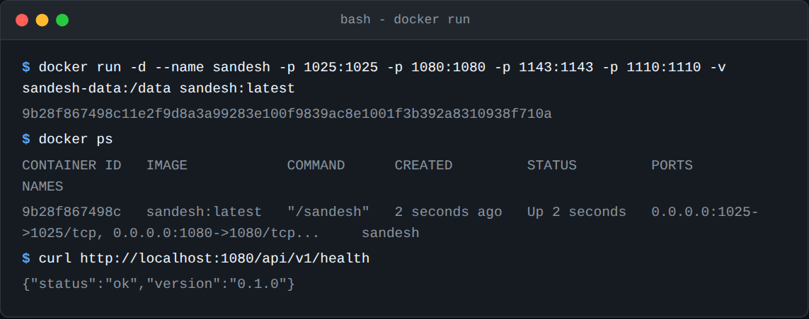

**Prerequisites:** Docker Desktop, Docker Engine, or Podman installed and running.

**Step 1 — Pull the image**

```bash
docker pull ghcr.io/heliconiaio/sandesh:latest   # or a version tag, e.g. :0.1.0
```

Offline, load a shared archive instead (`docker load -i sandesh.tar`) and use `sandesh:latest` as
the image name below.

**Step 2 — Start Sandesh**

```bash
docker run -d \
  --name sandesh \
  -p 1025:1025 \
  -p 1080:1080 \
  -p 1143:1143 \
  -p 1110:1110 \
  -v sandesh-data:/data \
  ghcr.io/heliconiaio/sandesh:latest
```

| Flag | Purpose |
| :--- | :--- |
| `-d` | Runs in the background |
| `--name sandesh` | Names the container for easy reference |
| `-p 1080:1080` | Web UI and REST API |
| `-p 1025:1025` | SMTP |
| `-p 1143:1143` | IMAP |
| `-p 1110:1110` | POP3 |
| `-v sandesh-data:/data` | Persists mail across restarts |

**Step 3 — Verify**

```bash
docker ps | grep sandesh
curl http://localhost:1080/api/v1/health
# Expected: {"status":"ok","version":"0.1.0"}
```

**Step 4 — Open the Web UI:** `http://localhost:1080`

> **Useful commands:**
> ```bash
> docker logs -f sandesh                          # view live logs
> docker stop sandesh && docker start sandesh     # restart
> docker rm sandesh && docker volume rm sandesh-data  # remove everything
> ```

---

#### Linux Static Binary

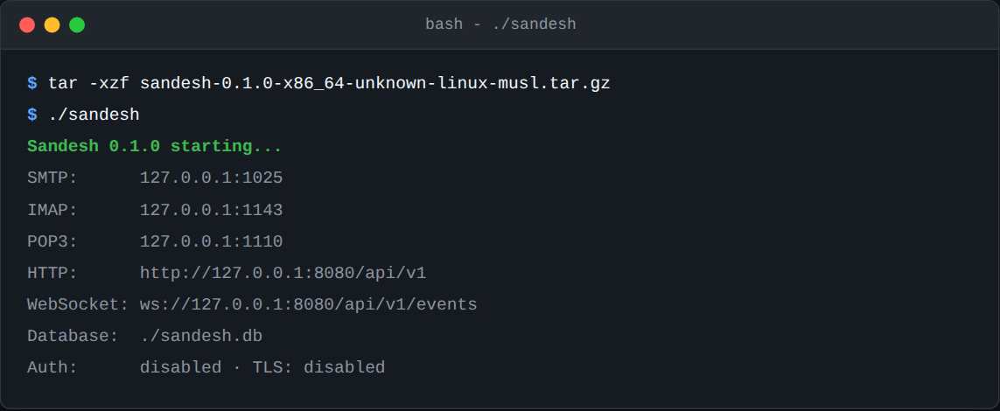

**Prerequisites:** None. Runs on any Linux distro — no runtime, no `apt install` required.

**Step 1 — Verify & extract**

```bash
sha256sum -c sandesh-0.1.0-x86_64-unknown-linux-musl.tar.gz.sha256
tar -xzf sandesh-0.1.0-x86_64-unknown-linux-musl.tar.gz
ls -lh sandesh
```

**Step 2 — Run**

```bash
./sandesh
```

Expected output:
```
Sandesh 0.1.0 starting...
SMTP:      127.0.0.1:1025
IMAP:      127.0.0.1:1143
POP3:      127.0.0.1:1110
HTTP:      http://127.0.0.1:8080/api/v1
WebSocket: ws://127.0.0.1:8080/api/v1/events
Database:  sandesh.db
Blobs:     sandesh-blobs
Auth:      disabled · TLS: disabled
```

**Step 3 — Open the Web UI:** `http://localhost:8080`  
Press **Ctrl+C** in the terminal to stop Sandesh.

> **Background process:** `SANDESH_DATA_DIR=~/.sandesh ./sandesh >> ~/.sandesh/sandesh.log 2>&1 &`  
> **Stop:** `pkill sandesh`

---

#### macOS Static Binary

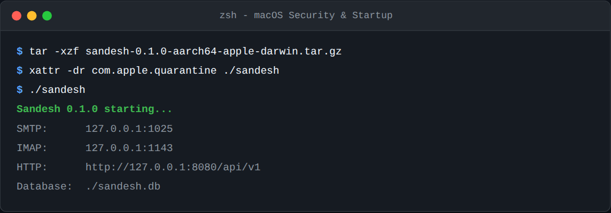

**Prerequisites:** None. Runs on macOS 12 Monterey and later.

**Step 1 — Identify your architecture**

```bash
uname -m
# arm64  → aarch64-apple-darwin binary
# x86_64 → x86_64-apple-darwin binary
```

**Step 2 — Verify & extract**

```bash
shasum -a 256 -c sandesh-0.1.0-aarch64-apple-darwin.tar.gz.sha256
tar -xzf sandesh-0.1.0-aarch64-apple-darwin.tar.gz
chmod +x sandesh
```

**Step 3 — Allow macOS Gatekeeper**

The first time you run a downloaded binary, macOS blocks it:

- **Option A (recommended):** In Finder, **right-click → Open**, then click **Open**.
- **Option B:** `xattr -dr com.apple.quarantine ./sandesh`

**Step 4 — Run:** `./sandesh`

**Step 5 — Open the Web UI:** `http://localhost:8080`

> **Auto-start with launchd:** Create `~/Library/LaunchAgents/com.sandesh.plist` — see `docs/guides/03-BINARY-MACOS.md` for the full template.

---

#### Windows Static Binary

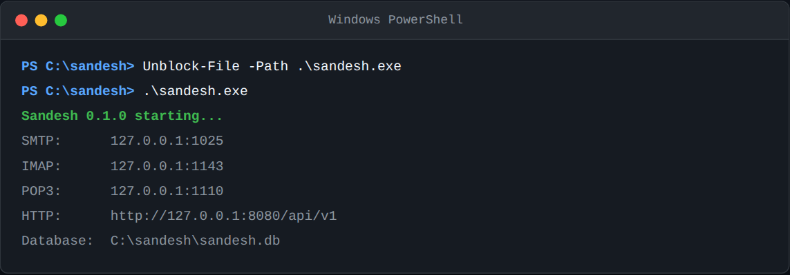

**Prerequisites:** None. Standalone `.exe` for Windows 10 / 11 (64-bit).

**Step 1 — Extract the zip**

1. Right-click the `.zip` → **Extract All...** → choose `C:\sandesh\`

**Step 2 — Allow SmartScreen**

Double-click `sandesh.exe`. If a blue dialog appears: click **More info → Run anyway**.

Or unblock permanently:
```powershell
Unblock-File -Path C:\sandesh\sandesh.exe
```

**Step 3 — Run**

```powershell
cd C:\sandesh
.\sandesh.exe
```

Keep this window open — closing it stops Sandesh.

**Step 4 — Open the Web UI:** `http://localhost:8080`

> **Background service:** Use Windows Task Scheduler, or NSSM (`winget install NSSM.NSSM`).

---

#### Debian / Ubuntu `.deb` Package

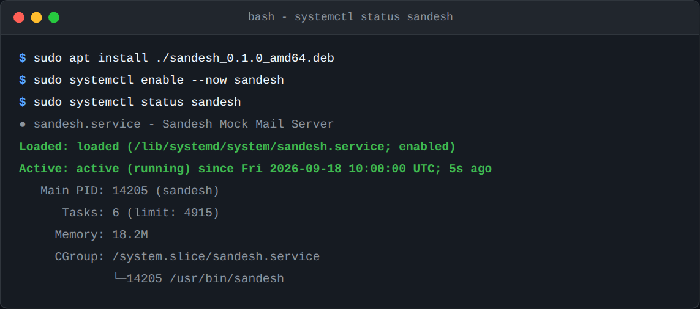

> This is the **headless server** package. For a desktop GUI with a tray icon, see [Desktop App](#desktop-app-linux).

**Step 1 — Install**

```bash
sudo apt install ./sandesh_0.1.0_amd64.deb
```

**What gets installed:**

| Path | Contents |
| :--- | :--- |
| `/usr/bin/sandesh` | The server binary |
| `/lib/systemd/system/sandesh.service` | systemd service unit |
| `/etc/sandesh/sandesh.env` | Configuration file (edit here to customise) |
| `/var/lib/sandesh/` | Mail storage, owned by the `sandesh` system user |

**Step 2 — Start**

```bash
sudo systemctl enable --now sandesh
sudo systemctl status sandesh      # confirm "active (running)"
```

**Step 3 — Open the Web UI:** `http://localhost:8080`

**Configuration:** Edit `/etc/sandesh/sandesh.env`, then `sudo systemctl restart sandesh`.

**Manage the service:**

```bash
sudo journalctl -u sandesh -f    # live logs
sudo systemctl stop sandesh
sudo systemctl restart sandesh
```

**Uninstall:**

```bash
sudo apt remove sandesh    # keeps mail in /var/lib/sandesh
sudo apt purge sandesh     # removes mail too
```

---

#### RHEL / Fedora `.rpm` Package

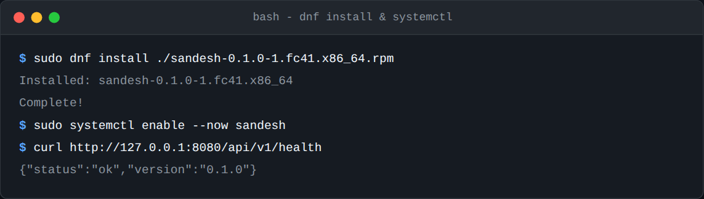

**Step 1 — Install**

```bash
sudo dnf install ./sandesh-0.1.0-1.fc41.x86_64.rpm
```

**Step 2 — Start**

```bash
sudo systemctl enable --now sandesh
```

**Step 3 — Open the Web UI:** `http://localhost:8080`

> **SELinux (RHEL / Rocky / AlmaLinux):** If Sandesh cannot bind its ports:
> ```bash
> sudo semanage port -a -t http_port_t -p tcp 1025
> sudo semanage port -a -t http_port_t -p tcp 8080
> sudo systemctl restart sandesh
> ```

**Configuration:** Edit `/etc/sandesh/sandesh.env` (preserved as `.rpmsave` across upgrades).

**Uninstall:** `sudo dnf remove sandesh` — keeps mail in `/var/lib/sandesh`.

---

#### Desktop App (Linux)

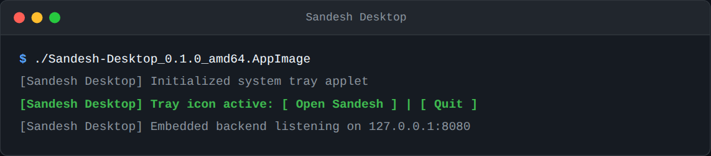

**What you need:** `Sandesh-Desktop_0.1.0_amd64.AppImage` or `sandesh-desktop_0.1.0_amd64.deb`.  
**Prerequisites:** Linux desktop (GNOME, KDE, XFCE) with GTK 3.

**Step 1 — Install**

*AppImage (any distro, no install):*
```bash
chmod +x Sandesh-Desktop_0.1.0_amd64.AppImage
./Sandesh-Desktop_0.1.0_amd64.AppImage
```

*`.deb` package:*
```bash
sudo apt install ./sandesh-desktop_0.1.0_amd64.deb
sandesh-desktop    # or find "Sandesh" in your app launcher
```

**Step 2 — Locate the tray icon**

A **tray icon** appears in your system notification area. Click it:

| Menu Item | Action |
| :--- | :--- |
| **Open Sandesh** | Opens `http://localhost:8080` in your browser |
| **Quit** | Stops Sandesh and exits |

> On GNOME, install the "AppIndicator and KStatusNotifierItem Support" extension if the tray icon is not visible.

**Step 3 — Desktop notifications**

When a new email arrives, Sandesh fires a **native OS notification** showing the subject and sender. Click the notification to jump directly to that message in the browser.

**Step 4 — Auto-start with your session**

```bash
mkdir -p ~/.config/autostart
cat > ~/.config/autostart/sandesh-desktop.desktop <<'EOF'
[Desktop Entry]
Type=Application
Name=Sandesh
Exec=sandesh-desktop
Hidden=false
X-GNOME-Autostart-enabled=true
EOF
```

| Feature | Desktop App | Headless `.deb`/`.rpm` |
| :--- | :--- | :--- |
| Tray icon | ✅ | ❌ |
| Native OS notifications | ✅ | ❌ |
| Runs as systemd service | ❌ | ✅ |
| Requires desktop environment | ✅ | ❌ |

---

### 1.4 First Launch & Verification

Regardless of installation method, run this end-to-end test to confirm everything works.

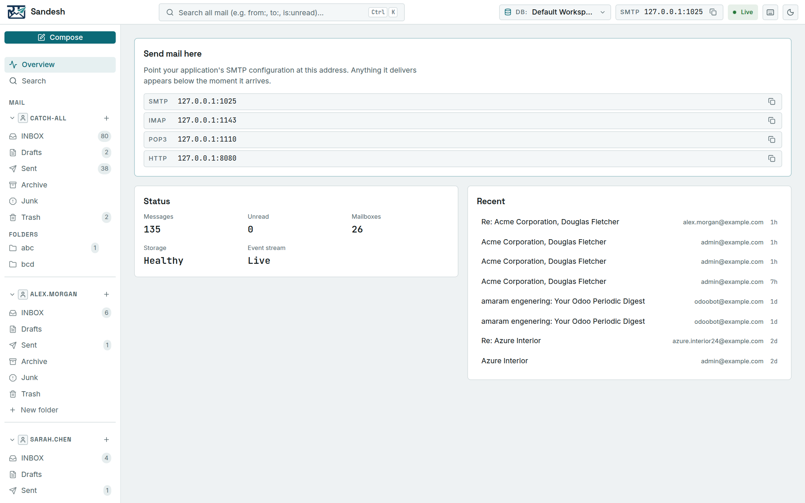

**Step 1 — Open the Web UI**

Navigate to `http://localhost:8080` (or `http://localhost:1080` for Docker). The console will be empty.

**Step 2 — Configure your application's SMTP settings**

| Setting | Value |
| :--- | :--- |
| SMTP Host | `localhost` or `127.0.0.1` |
| SMTP Port | `1025` |
| Security | None (no TLS) |
| Authentication | None |

**Step 3 — Send a test email**

```python
import smtplib
from email.message import EmailMessage

msg = EmailMessage()
msg["From"]    = "myapp@example.com"
msg["To"]      = "developer@example.com"
msg["Subject"] = "Hello from Sandesh!"
msg.set_content("This is a test message.")

with smtplib.SMTP("localhost", 1025) as s:
    s.send_message(msg)
    print("Sent!")
```

**Step 4 — Confirm delivery in the browser**

Switch to your browser. The message appears **instantly** in the message list — no refresh required. Click it to open the inspector.

**Step 5 — Verify via the REST API**

```bash
curl http://localhost:8080/api/v1/health
# {"status":"ok","version":"0.1.0"}

curl -s http://localhost:8080/api/v1/messages | jq .
```

---

## 2. Interface Overview

### 2.1 Application Shell Layout


The Sandesh Web UI is a single-page application (React 19 + TypeScript) divided into three persistent regions:

```
┌─────────────────────────────────────────────────────────────────┐
│  HEADER  [☰] [Logo · Sandesh] [Search Bar]  [SMTP] [●] [⌨] [☀] │
├──────────────────┬──────────────────────────────────────────────┤
│                  │                                              │
│  LEFT SIDEBAR    │            MAIN CONTENT AREA                │
│                  │          (route-specific view)              │
│  [Compose]       │                                              │
│                  │                                              │
│  Overview        │                                              │
│  Search          │                                              │
│  ─── Mail ───    │                                              │
│  📥 Inbox (3)    │                                              │
│  📤 Sent         │                                              │
│  📝 Drafts       │                                              │
│  🗑  Trash        │                                              │
│  ─── System ──   │                                              │
│  Traces          │                                              │
│  Setup Guide     │                                              │
│  API Console     │                                              │
│  Logs            │                                              │
│  Webhooks        │                                              │
│  Import / Export │                                              │
│  Workspaces      │                                              │
│  Settings        │                                              │
│  About           │                                              │
└──────────────────┴──────────────────────────────────────────────┘
```

---

### 2.2 Top Header Bar

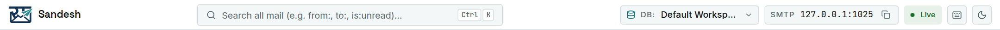

| Element | Description |
| :--- | :--- |
| **☰ Menu button** | Visible only on narrow/mobile screens; opens the sidebar as a slide-in drawer |
| **Sandesh logo + name** | Brand mark; not a navigation link |
| **Search bar** (centre) | Global search input. Accepts plain text and token syntax (`from:`, `is:unread`, etc.). Press `Enter` to search, `Ctrl+K` / `⌘K` to focus from anywhere |
| **Workspace Switcher** | Dropdown showing the active workspace name. Click to switch to another workspace |
| **SMTP address badge** | Displays the live SMTP address (e.g. `127.0.0.1:1025`) with a one-click **copy** button — always visible |
| **Fault Indicator** | An orange badge that appears when active SMTP fault injections are configured |
| **Connection status dot (●)** | 🟢 `Live` — WebSocket connected; 🟡 `Connecting`; 🔴 `Offline` |
| **Keyboard shortcuts (⌨)** | Opens the shortcuts reference modal |
| **Theme toggle (☀️/🌙)** | Toggles instantly between light and dark theme |

---

### 2.3 Left Navigation Sidebar

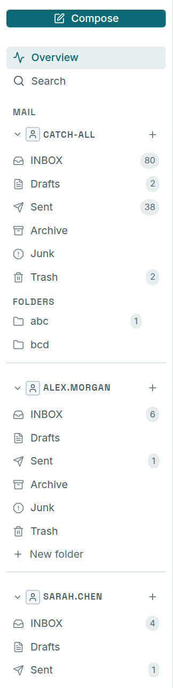

The sidebar is always visible on desktop. On mobile it slides in as a drawer.

**Compose button**

| Element | Action |
| :--- | :--- |
| **Compose** | Opens the message composer modal. Keyboard shortcut: `c` |

**Top-level**

| Item | Route | Purpose |
| :--- | :--- | :--- |
| **Overview** | `/` | Dashboard: connection info, live status, and recent messages |
| **Search** | `/search` | Full-text search across all mail |

**Mail section** — Lists every mailbox (folder) for the active account:

| Element | Behaviour |
| :--- | :--- |
| Mailbox name (e.g. Inbox, Sent) | Navigates to that folder's message list |
| Blue unread count badge | Updates in real time as new mail arrives |

**System section**

| Item | Route | Purpose |
| :--- | :--- | :--- |
| **Traces** | `/traces` | Protocol transcripts for SMTP, IMAP, and POP3 connections |
| **Setup Guide** | `/guide` | In-app walkthrough for connecting apps and clients |
| **API Console** | `/api` | Live, executable REST API reference |
| **Logs** | `/logs` | Real-time server log stream |
| **Webhooks** | `/webhooks` | Manage HTTP delivery notifications and view the outbox |
| **Import / Export** | `/transfer` | Move mail corpora in and out as `mbox` or `.eml` |
| **Workspaces** | `/workspaces` | Create and manage isolated mail environments |
| **Settings** | `/settings` | Accounts, protocols, appearance, and shortcuts |
| **About** | `/about` | Version and build information |

---

## 3. Feature Deep-Dive & Usage

### 3.1 Overview Page


**Purpose:** The landing page. Answers: *Where do I send mail? Is Sandesh healthy? What just arrived?*

#### UI Map

| Element | Type | Description |
| :--- | :--- | :--- |
| **Send mail here** panel | Info panel | Displays the live SMTP address with a copy button |
| **Connection Details** block | Read-only display | Shows host, port, security mode, and auth status for SMTP |
| **Status** panel | Live metrics | Real-time health indicators |
| **Messages** stat | Counter | Total messages stored |
| **Unread** stat | Counter | Messages without the `\Seen` flag |
| **Mailboxes** stat | Counter | Total number of folders |
| **Storage** stat | Status badge | `Healthy` (green) — database reachable; `Unreachable` (red) — database error |
| **Event stream** stat | Status badge | `Live` (green) — WebSocket active; `Connecting` or `Offline` otherwise |
| **Recent** panel | Message list | The 8 most recently received messages |
| Recent message row | Clickable link | Navigates directly to that message in its mailbox |

#### Workflow: Check if Sandesh is healthy

1. Open `http://localhost:8080`.
2. In the **Status** panel confirm **Storage** = `Healthy` and **Event stream** = `Live`.
3. If either shows an error, check the **Logs** page for details.

---

### 3.2 Mailbox View

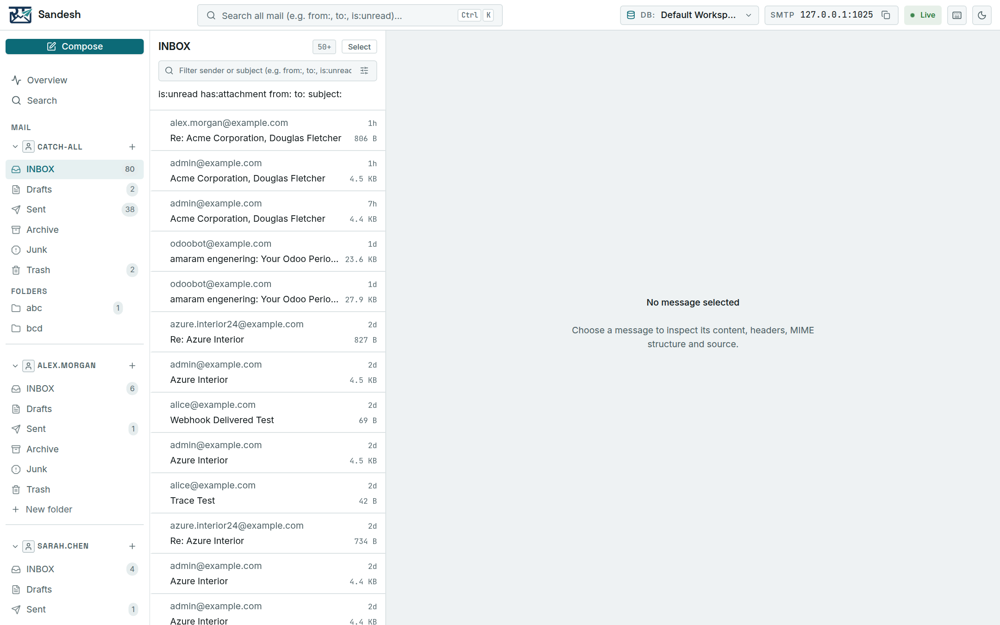

**Purpose:** The primary mail inspection interface. Displays messages in a folder as a list; clicking a message opens the inspector on the right. New messages appear in real time — no refresh required.

#### UI Map — Toolbar

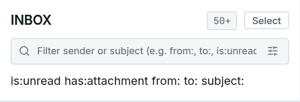

| Element | Type | Description |
| :--- | :--- | :--- |
| **Mailbox name & icon** | Header | Current folder name and icon |
| **Filter input** | Text field | Type-ahead filter within the mailbox. Supports tokens: `from:`, `to:`, `subject:`, `is:unread`, `has:attachment` |
| **Filter Options** (⚙ sliders icon) | Popover toggle | Opens a structured filter builder (From, To, Subject, Unread, Attachment fields) |
| **Syntax Helper** | Toggle | Shows a token cheat-sheet inline below the filter bar |
| **Unread** pill | Toggle button | Appends / removes `is:unread`. Turns blue when active |
| **Has attachment** pill | Toggle button | Appends / removes `has:attachment`. Turns blue when active |
| **Select mode** (☐ icon) | Toggle | Enters multi-select mode; rows gain checkboxes |
| **Mark all read** (✓ envelope) | Bulk action | Sets `\Seen` on all filtered messages |
| **Mark all unread** (✗ envelope) | Bulk action | Removes `\Seen` from all filtered messages |
| **Move** button | Bulk action | Moves selected messages to another mailbox (shown in select mode) |
| **Delete** (🗑) button | Danger action | Permanently deletes selected messages |
| **Clear filter** (×) | Button | Resets all filters |

#### UI Map — Message List Rows

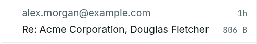

| Element | Type | Description |
| :--- | :--- | :--- |
| **Unread dot** | Blue indicator | Filled blue circle on the left edge for unread messages |
| **Sender** | Text | Display name or email from the `From:` header |
| **Subject** | Text | Bold for unread; normal weight for read messages |
| **Timestamp** | Relative time | Age of the message (e.g. "2 min ago") |
| **Paperclip icon** | Indicator | Shown when the message has attachments |
| **Tag / label badge** | Coloured badge | Auto-tags applied by message rules at delivery time |
| **Row checkbox** | Checkbox | Visible in multi-select mode only |

#### Workflow: Read a message

1. Click a mailbox in the sidebar (e.g. **Inbox**).
2. Click any message row — it opens in the inspector panel on the right and is marked as read.

#### Workflow: Filter messages

1. Click inside the **Filter input** at the top of the list.
2. Type a token expression:
   - `is:unread` — unread only
   - `has:attachment` — with attachments only
   - `from:alice` — from a specific sender
   - `subject:invoice` — by subject
   - `from:alice is:unread` — combine tokens (AND logic)
3. The list updates instantly. Click **×** to clear.

#### Workflow: Bulk-delete messages

1. Click the **Select mode** checkbox icon in the toolbar.
2. Check individual messages, or **Shift+Click** to select a range.
3. Click the **Delete** (🗑) button.
4. Confirm in the dialog.

---

### 3.3 Message Inspector

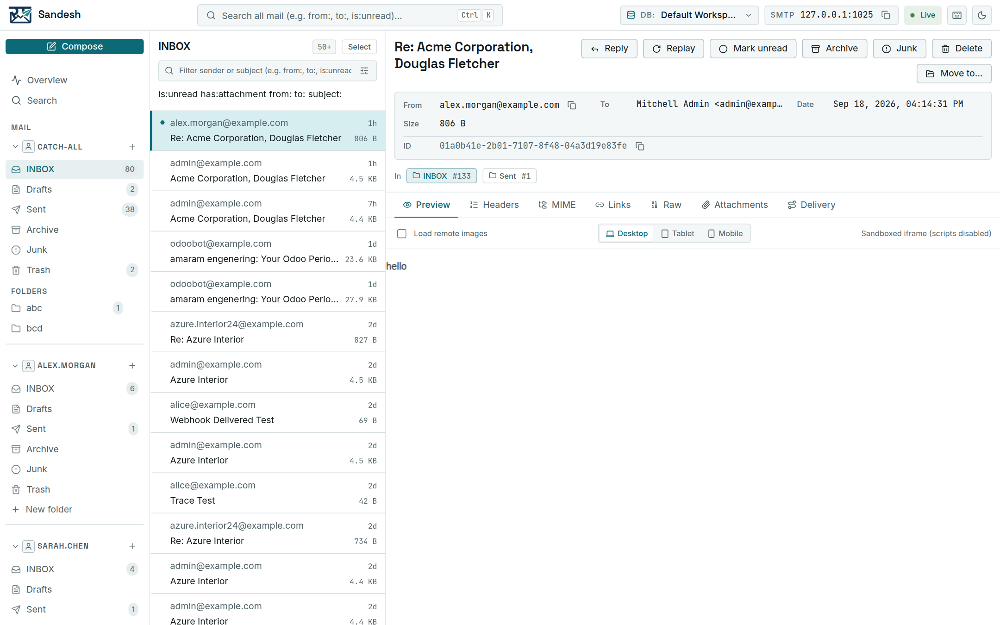

**Purpose:** A complete diagnostic view of a single email, accessible from multiple angles via tabs.

#### Inspector Tabs

| Tab | What it shows |
| :--- | :--- |
| **Headers** | Full RFC 5322 header block + a `Received:` hop timeline showing per-hop delay and parsed DKIM / SPF / DMARC results (displayed, **never verified**) |
| **Body** | The rendered message body. HTML is displayed in a sandboxed `<iframe>` — no external images or tracking pixels are ever fetched |
| **MIME** | Interactive tree of every MIME part: content type, encoding, and byte size. Click any part to inspect its raw bytes |
| **Raw** | The byte-exact original message as received over SMTP |
| **Transcript** | The SMTP conversation between your application and Sandesh, line by line |
| **Links** | Every URL in the HTML body, classified and grouped by domain. URLs are **never fetched** by Sandesh |
| **Attachments** | All attachments with filename, MIME type, and size. Click to download |

#### Inspector Action Buttons

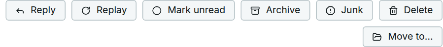

| Button | Action |
| :--- | :--- |
| **Reply** | Opens the composer pre-filled with the original message |
| **Mark as unread** | Removes the `\Seen` flag |
| **Move to** | Moves the message to another mailbox |
| **Delete** | Permanently deletes the message |
| **Replay** | Re-delivers this message through the SMTP pipeline, recording new delivery metadata with provenance |

> **HTML Safety:** The sandboxed `<iframe>` prevents tracking pixels and eliminates any risk of SSRF — exactly the behaviour needed in a development environment.

---

### 3.4 Composing & Replying

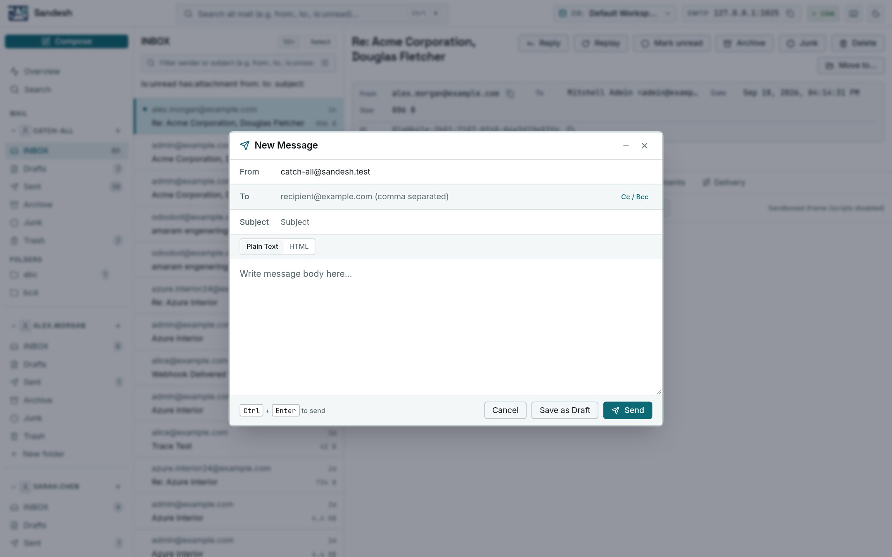

**Purpose:** Send test messages directly from the Sandesh console without a separate mail client.

#### Open the Composer

- Click **Compose** in the top of the left sidebar.
- Press **`c`** from anywhere in the app.
- Click **Reply** on any open message.

#### UI Map

| Field / Button | Description |
| :--- | :--- |
| **To** | Recipient address(es). Separate multiple with commas |
| **From** | Sender address; defaults to the first address of the active account |
| **Subject** | Email subject |
| **Body** | Plain-text message body |
| **Send** button | Delivers through Sandesh's internal SMTP pipeline |
| **Close (×)** | Discards the draft and closes the modal |

#### Workflow: Send a test message

1. Press **`c`** or click **Compose**.
2. Enter a **To** address (e.g. `developer@example.com`).
3. Fill in **Subject** and **Body**.
4. Click **Send**.
5. The message appears immediately in the recipient's Inbox.

---

### 3.5 Search

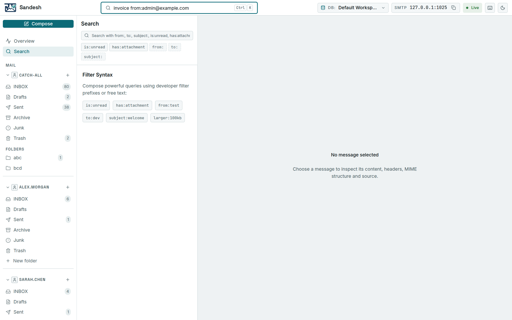

**Purpose:** Full-text search across **all** mail in Sandesh, regardless of which mailbox the message is in. Powered by an FTS5 trigram index for instant results.

#### Open Search

- Click **Search** in the sidebar.
- Use the header search bar and press **Enter**.
- Press **`/`** or **`Ctrl+K`** / **`⌘K`** from anywhere.
- Press the chord **`g`** then **`/`**.

#### UI Map

| Element | Type | Description |
| :--- | :--- | :--- |
| **Search input** | Text field | Primary query. Accepts plain text and token syntax |
| **Unread** pill | Toggle button | Appends / removes `is:unread` |
| **Has attachment** pill | Toggle button | Appends / removes `has:attachment` |
| **From:** pill | Button | Appends `from:` and focuses the input |
| **To:** pill | Button | Appends `to:` and focuses the input |
| **Subject:** pill | Button | Appends `subject:` and focuses the input |
| **Results list** | Message list | Matching messages from all mailboxes, newest first |
| **Explain panel** | Diagnostic | Shows how the server interpreted your query (FTS5 explain plan) |
| **Mark all read** | Bulk action | Marks all current results as read |
| **Select all** | Bulk action toggle | Selects all visible results for bulk operations |
| **Delete selected** | Danger bulk action | Permanently deletes selected results |

#### Search Token Syntax

| Token | Example | What it matches |
| :--- | :--- | :--- |
| Plain text | `invoice` | Any field containing "invoice" |
| `from:` | `from:alice` | From address contains "alice" |
| `to:` | `to:bob` | Any To recipient contains "bob" |
| `subject:` | `subject:reset` | Subject contains "reset" |
| `is:unread` / `is:unseen` | `is:unread` | Messages without the `\Seen` flag |
| `has:attachment` | `has:attachment` | Messages with attachments |
| Combined | `from:alice is:unread` | Multiple tokens are ANDed |

#### Workflow: Find all unread messages from one sender

1. Click **Search** (or press `/`).
2. Click the **From:** pill — the cursor moves into the search bar with `from:` prepended.
3. Type the sender's address, e.g. `from:noreply@example.com`.
4. Click the **Unread** pill — `is:unread` is appended automatically.
5. Press **Enter** — results appear instantly.

---

### 3.6 Protocol Traces

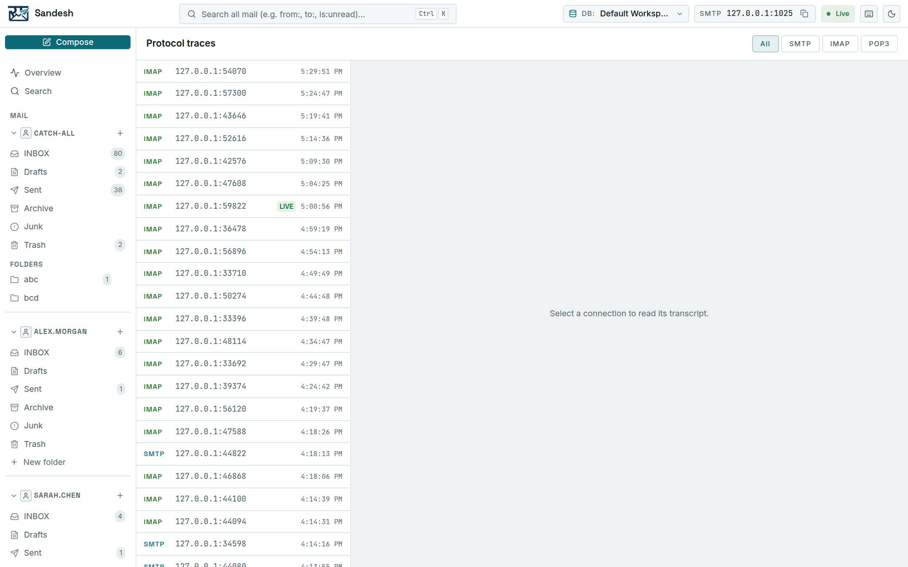

**Purpose:** Shows the raw protocol conversation (transcript) for every SMTP, IMAP, and POP3 connection. Use it to debug connectivity failures, verify your app speaks the correct protocol dialect, or understand exactly what a mail client sent and received.

> **Privacy guarantee:** Credentials are **redacted at capture time** — they never appear in a transcript. Message bodies are replaced with a byte count. A trace cannot leak one-time codes or password-reset links.

#### UI Map — Connection List

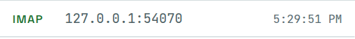

| Element | Type | Description |
| :--- | :--- | :--- |
| **Protocol filter** (All / SMTP / IMAP / POP3) | Toggle buttons | Filters the list to one protocol. **All** shows every connection |
| **Connection row** | Clickable list item | One row per connection, newest first |
| **Protocol badge** | Coloured label | `smtp` / `imap` / `pop3` colour-coded |
| **Peer address** | Text | IP:port of the connecting client; `local` for loopback connections |
| **"live" badge** | Animated label | Connection is still open — transcript is growing in real time |
| **TLS badge** | Label | Shown if the connection used encryption |
| **Timestamp** | Time | When the connection opened |

#### UI Map — Transcript Detail Panel

| Element | Description |
| :--- | :--- |
| **← Back to traces** | Returns to the connection list (prominent on narrow screens) |
| **Live indicator** (pulsing dot) | Shown when the connection is still open; transcript updates appear automatically |
| **Metadata facts** | Peer / Opened / Lasted / Ended / Transport |
| **Transcript lines** | `→` client sent · `←` server replied · `·` informational note |
| **Truncation notice** | Shown if the transcript hit its capture cap |

#### Workflow: Debug an SMTP connection failure

1. Click **Traces** in the sidebar.
2. Click the **SMTP** filter button.
3. Click the most recent connection row from your application.
4. Read the transcript:
   - `→` lines = commands your app sent.
   - `←` lines = Sandesh's responses.
   - Look for `5xx` response codes — these indicate errors.

---

### 3.7 API Console

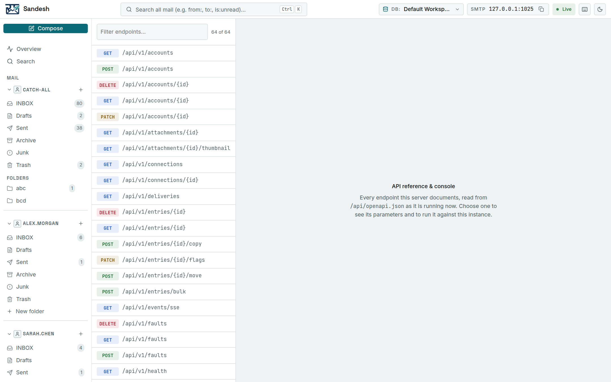

**Purpose:** A live, executable reference for every REST API endpoint Sandesh exposes. Try any endpoint directly against the running server — no Postman or `curl` required.

#### UI Map

| Element | Type | Description |
| :--- | :--- | :--- |
| **Endpoint list** | Sidebar | All documented endpoints grouped by resource |
| **Method badge** | Coloured label | `GET` (blue), `POST` (green), `DELETE` (red), etc. |
| **Endpoint path** | Text | URL path with parameter placeholders (e.g. `/api/v1/messages/{id}/raw`) |
| **Description** | Text | Plain-language explanation of the endpoint |
| **Parameters form** | Input fields | Path params, query params, and request body rendered as form fields |
| **Execute** button | Action | Sends the request to the running server |
| **Response panel** | Code block | HTTP status code + formatted JSON response |
| **cURL snippet** | Code block | Equivalent `curl` command, ready to copy |

#### Workflow: Retrieve a message's raw MIME bytes

1. Click **API Console** in the sidebar.
2. Find `GET /api/v1/messages/{id}/raw` in the endpoint list.
3. In the **id** field, paste a message ID (visible in the URL when a message is open).
4. Click **Execute**.
5. The raw RFC 5322 bytes appear in the response panel.

---

### 3.8 Logs

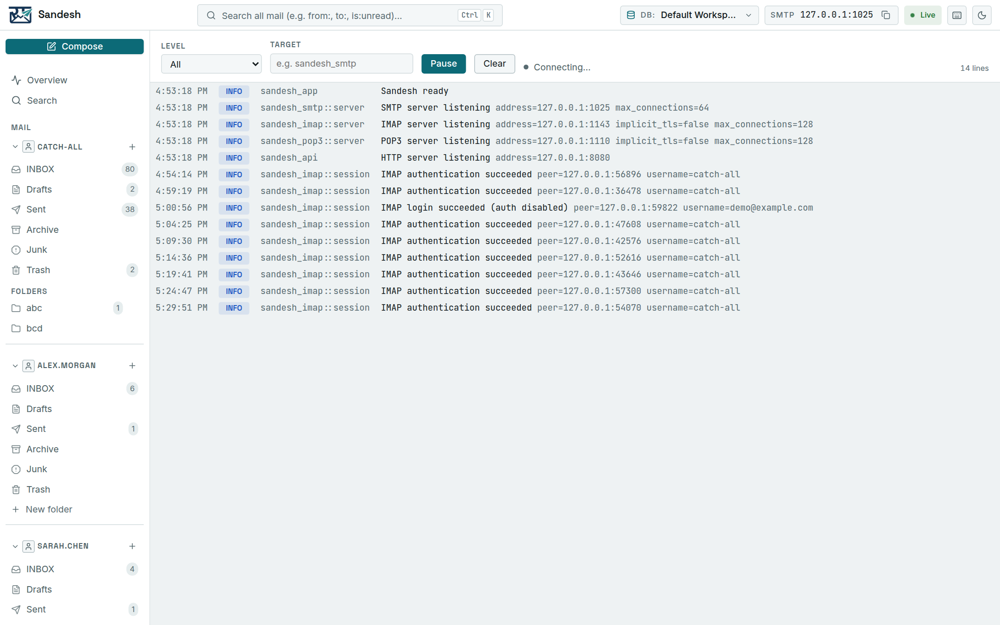

**Purpose:** The server's structured log stream in real time, directly in the browser — without needing a terminal or SSH. Filter by severity or component to narrow down an issue.

> **Privacy guarantee:** Log lines never contain message content or credentials. This is enforced at the logging source — not filtered at display time.

#### UI Map

| Element | Type | Description |
| :--- | :--- | :--- |
| **Level** dropdown | Select | Minimum severity: `All`, `trace`, `debug`, `info`, `warn`, `error` |
| **Target** input | Text field | Filter by internal component (e.g. `sandesh_smtp`). Leave blank for all |
| **Pause / Resume** button | Toggle | Pauses or resumes the live stream. Blue = live |
| **Clear** button | Action | Clears all displayed lines |
| **Status indicator** | Dot + text | `Streaming` (green) / `Connecting…` (grey) / `Paused` |
| **Line count** | Text | Total lines displayed, with error count summary |
| **Log table** | Scrollable table | Columns: time · level badge · target · message · fields |
| **Level badge** | Coloured label | `trace` (grey) · `debug` (blue) · `info` (green) · `warn` (yellow) · `error` (red) |
| **Jump to newest** | Floating button | Appears when scrolled up; snaps back to the latest line |

> The view keeps the **most recent 1,000 lines**. Oldest lines are dropped automatically to prevent memory growth.

#### Workflow: Watch SMTP activity in real time

1. Click **Logs** in the sidebar.
2. Set **Target** to `sandesh_smtp` and **Level** to `debug`.
3. Send a test email from your application.
4. Watch the entries appear as Sandesh processes the connection.

---

### 3.9 Webhooks

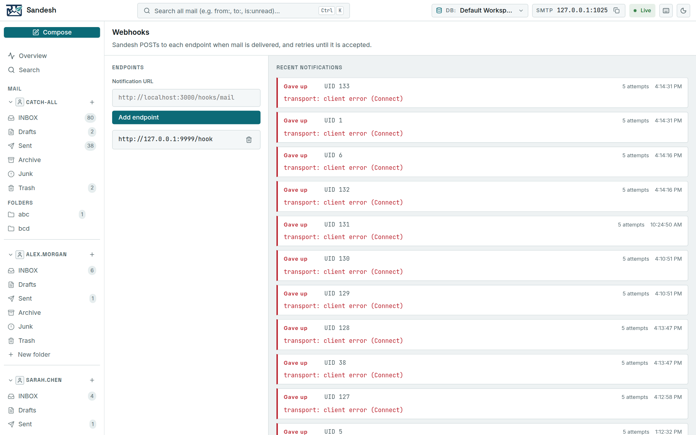

**Purpose:** Register HTTP endpoints that Sandesh will POST to every time a new message is delivered. Sandesh retries failed deliveries with exponential backoff and keeps a permanent audit trail.

#### UI Map — Endpoints Rail

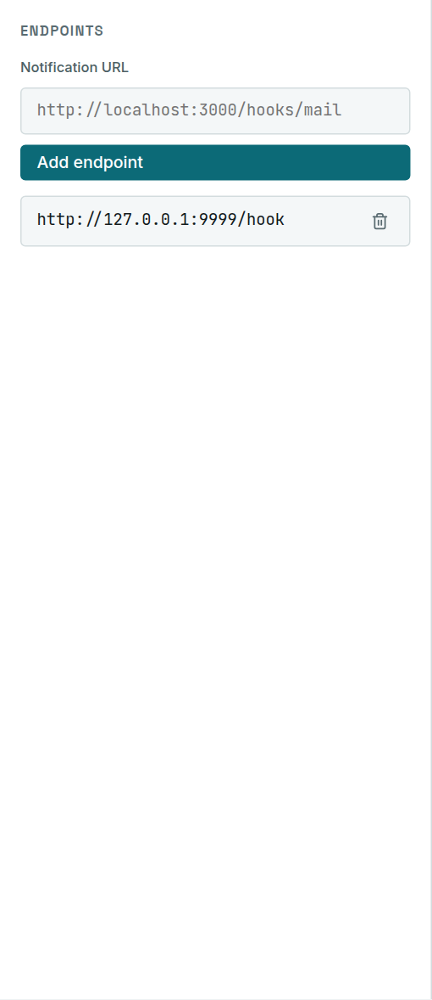

| Element | Type | Description |
| :--- | :--- | :--- |
| **Notification URL** label | Label | Labels the URL input |
| **URL input** | Text field | Full HTTP(S) URL of the endpoint (e.g. `http://localhost:3000/hooks/mail`) |
| **Add endpoint** button | Submit | Registers the URL. Disabled if the input is empty. URL is validated server-side — a 400 error appears inline for invalid URLs |
| **Endpoint URL** | Text | Registered URL; truncated if long (full URL on hover) |
| **Remove** (🗑) button | Danger action | Opens a confirmation dialog before unregistering |

#### UI Map — Outbox / Recent Notifications

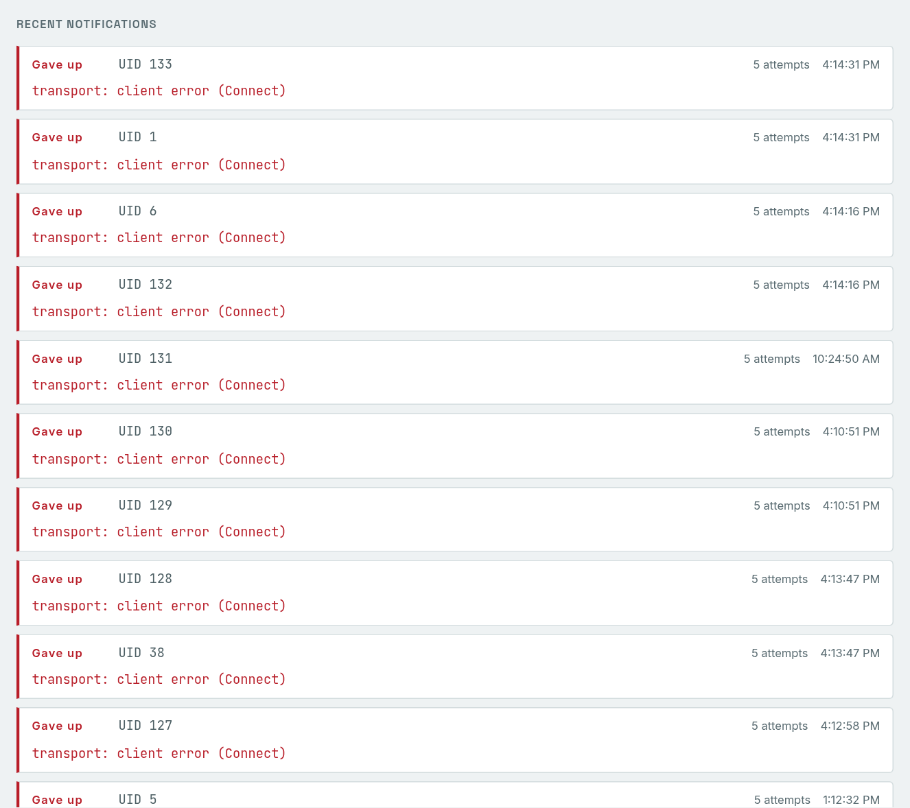

| Element | Type | Description |
| :--- | :--- | :--- |
| **Status badge** | Coloured label | `Queued` (blue) · `Delivered` (green) · `Gave up` (red) |
| **Description** | Text | What triggered the notification (e.g. `UID 42`) |
| **Attempt count** | Text | How many delivery attempts were made |
| **Timestamp** | Time | When the notification was first queued |
| **Error message** | Red text | Shown inline on failed rows — explains exactly why it failed |
| **Payload** (expanded) | Code block | Full JSON body that was posted. Click the row to expand / collapse |

> **Why failed entries are kept:** A `Gave up` entry is preserved — not deleted — so you can read exactly what went wrong. Hiding failures would defeat the purpose of an audit trail.

#### Workflow: Register a webhook and test it

1. Start a local HTTP server (e.g. `python3 -m http.server 3000`).
2. Click **Webhooks** in the sidebar.
3. Enter `http://localhost:3000/hooks/mail` in the **Notification URL** field.
4. Click **Add endpoint** — the URL appears in the list.
5. Send a test email via SMTP.
6. Watch the **Recent notifications** panel — a `Delivered` row appears.
7. Click the row to expand and inspect the full JSON payload.

#### Signed payloads

Signing is **off by default** — a webhook pointed at a local test receiver has nothing to spoof, and
requiring a key there would add a step to the case Sandesh exists to serve. It is configured through
the REST API rather than this view, because the secret is shown exactly once and a UI that displays
it would keep putting it on screen.

Register a signed endpoint by setting `sign`, and Sandesh generates the secret and returns it in the
create response — the only response that ever carries it:

```bash
curl -X POST http://127.0.0.1:8080/api/v1/webhooks \
  -H 'Content-Type: application/json' \
  -d '{"url":"http://localhost:3000/hooks/mail","sign":true}'
```

**Store the `secret` from that response now.** It cannot be recovered afterwards, only replaced by
registering the endpoint again; a listing reports `has_secret` — a boolean, never the key — because
an endpoint listing is the sort of thing that ends up in a log or a screen share. To point Sandesh at
a receiver that already knows a key, send that key as `secret` alongside `sign`.

Signed deliveries carry an `X-Sandesh-Signature` header:

```
X-Sandesh-Signature: t=<unix seconds>,v1=<hex HMAC-SHA256>
```

The signed material is `"<t>.<body>"` — the timestamp is *inside* what is signed, not merely
alongside it. Signing the body alone would let anyone who captured one delivery replay it verbatim
forever; binding the timestamp lets a receiver reject anything outside its tolerated clock skew. `v1`
names the scheme so a second one can be added later without a receiver having to guess.

Verifying a delivery, in Python:

```python
import hashlib, hmac, time

def verify(secret: str, body: bytes, header: str, tolerance: int = 300) -> bool:
    fields = dict(f.split("=", 1) for f in header.split(","))
    t = int(fields["t"])
    if abs(time.time() - t) > tolerance:   # reject a replayed capture
        return False
    expected = hmac.new(
        secret.encode(), f"{t}.".encode() + body, hashlib.sha256
    ).hexdigest()
    return hmac.compare_digest(expected, fields["v1"])
```

> **Compare in constant time.** `hmac.compare_digest` above is not a stylistic choice: a byte-by-byte
> `==` on a digest leaks, through timing, how much of a forged signature was correct.

Each retry is signed afresh, so a receiver enforcing a skew tolerance does not reject a legitimate
redelivery on the basis of the first attempt's timestamp. An unsigned endpoint sends **no** signature
header at all, rather than an empty or zero-key one a receiver could mistake for a real signature.

---

### 3.10 Import / Export

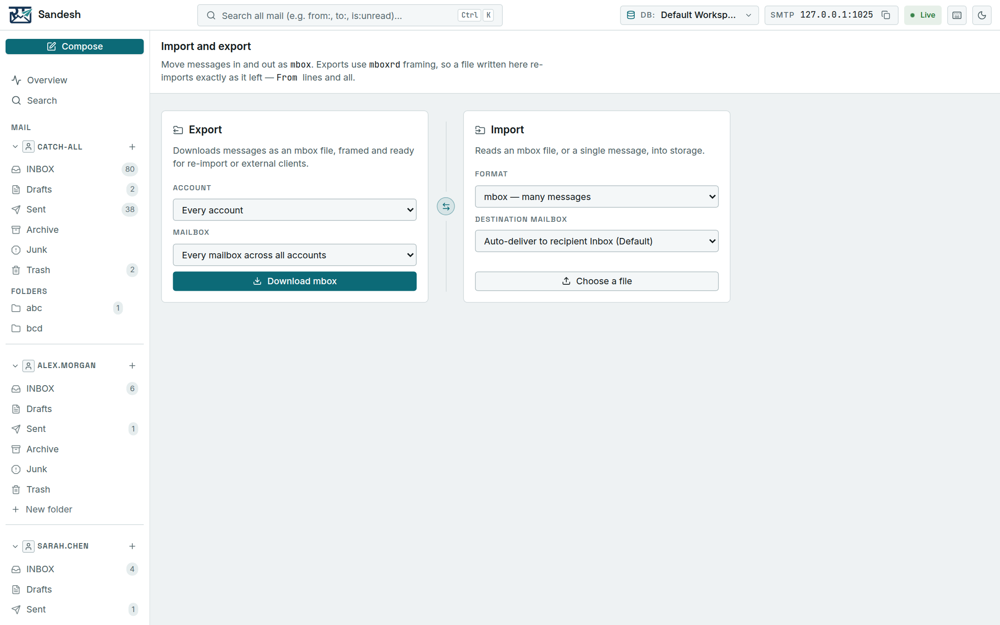

**Purpose:** Move mail corpora in and out of Sandesh as standard `mbox` files or individual `.eml` files. Useful for seeding a workspace with test data, creating backups, or verifying round-trip fidelity.

> **Round-trip guarantee:** Exports use `mboxrd` framing. A file written by Sandesh re-imports byte-identically — `From ` lines and all. This avoids the silent line corruption of `mboxo`.

#### UI Map — Export Card

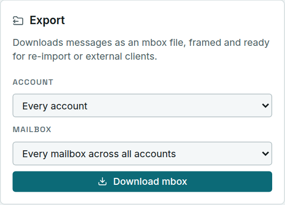

| Element | Type | Description |
| :--- | :--- | :--- |
| **Account** dropdown | Select | Scope to a specific account. Shown only when multiple accounts exist. Default: `Every account` |
| **Mailbox** dropdown | Select | Scope to a specific folder or export all. Default: `Every mailbox` |
| **Download mbox** button | Download link | Downloads the selected scope. Filename reflects the selection (e.g. `inbox.mbox`) |

#### UI Map — Import Card

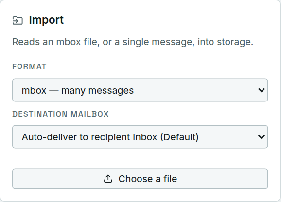

| Element | Type | Description |
| :--- | :--- | :--- |
| **Format** dropdown | Select | `mbox — many messages` (default) or `.eml — one message` |
| **Destination Mailbox** dropdown | Select | Where to place imported messages. Default: `Auto-deliver to recipient Inbox` (routes by `To:` address). Or choose a specific mailbox |
| **Choose a file** button | File input | Opens the OS file picker. Import begins immediately on file selection |

**Result banners:**
- 🟢 **Green banner** — "Imported N of M messages found in the file"
- 🔴 **Red banner** — Explains why the file could not be parsed

#### Workflow: Seed a test environment

1. Click **Import / Export** in the sidebar.
2. In the **Import** card: select `mbox — many messages`.
3. Leave **Destination Mailbox** on `Auto-deliver to recipient Inbox`.
4. Click **Choose a file** and select your `.mbox` file.
5. After import, navigate to **Inbox** to see the messages.

---

### 3.11 Workspaces

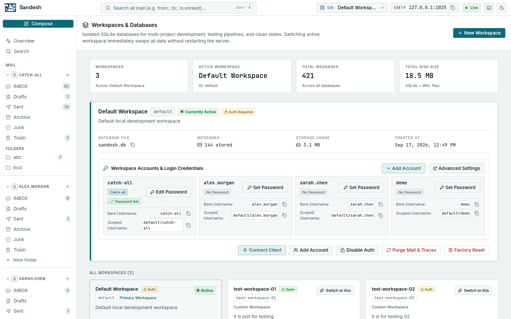

**Purpose:** Workspaces are isolated mail environments within one Sandesh instance. Each has its own accounts, mailboxes, and messages. Use them to separate projects, test suites, or teams without running multiple processes.

#### Key Concepts

| Concept | Description |
| :--- | :--- |
| **Workspace** | An isolated scope with its own accounts, mailboxes, and messages |
| **Active workspace** | The workspace currently in use, shown in the header Workspace Switcher |
| **Catch-all account** | An account that receives mail addressed to any unmatched address |
| **API authentication** | Optional password-based access control for a workspace's API |

#### UI Map — Workspace Card

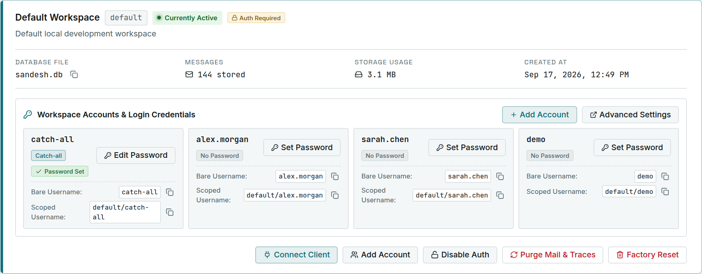

| Element | Type | Description |
| :--- | :--- | :--- |
| **Workspace name** | Header | Display name |
| **Workspace ID (slug)** | Subheading | Machine-readable identifier used in API paths |
| **Active badge** | Green label | Shown on the currently active workspace |
| **Auth badge** | 🔒/🔓 icon | Shown when API authentication is enabled |
| **Message count** | Stat | Total messages in this workspace |
| **Mailbox count** | Stat | Number of folders |
| **Storage size** | Stat | Disk space used |
| **Created date** | Stat | When the workspace was created |
| **Activate** button | Primary action | Switches to this workspace. The header Switcher updates immediately |
| **Connect** button | Secondary action | Opens a modal with pre-filled IMAP/POP3/SMTP settings for this workspace |
| **Edit** button (✏) | Action | Rename or update the description |
| **Purge** button | Danger action | Deletes all messages, keeps accounts intact |
| **Delete** button | Danger action | Permanently deletes the workspace and all its data |

#### UI Map — Create Workspace Modal

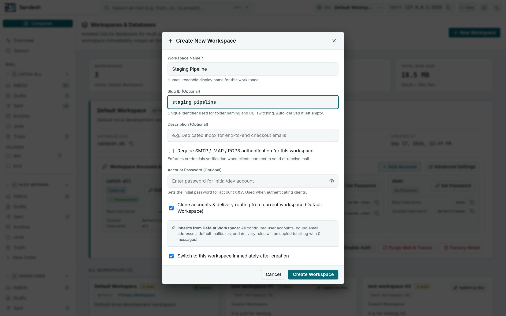

| Field | Description |
| :--- | :--- |
| **Name** | Display name (e.g. "E-Commerce Project") |
| **ID / Slug** | Auto-generated from name; can be manually edited |
| **Description** | Optional free-text description |
| **Set as active** toggle | Makes the new workspace active immediately |
| **Clone accounts** toggle | Copies accounts from the current workspace |
| **Require API auth** toggle | Enables password-based HTTP API auth |
| **Password** field | API password (visible only when auth is enabled) |
| **Initial username** | Username for the first account in this workspace |
| **Email addresses** | Addresses for the initial account |
| **Catch-all** toggle | Makes the initial account a catch-all receiver |
| **Create** button | Creates the workspace and closes the modal |

#### Workflow: Create a workspace for a new project

1. Click **Workspaces** in the sidebar.
2. Click **Create workspace** (top right).
3. Enter a **Name** — the **ID** auto-populates.
4. Leave **Set as active** enabled.
5. Click **Create**.
6. Navigate to **Inbox** — it is empty and ready.

---

### 3.12 Setup Guide (In-App)

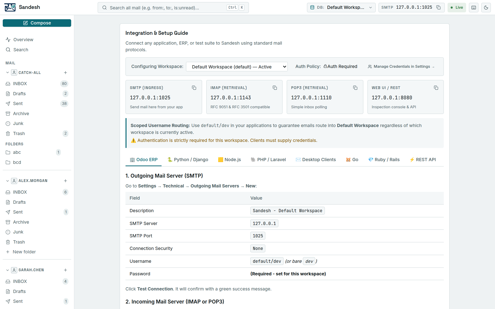

**Purpose:** The Setup Guide page (`/guide`) is a built-in, interactive walkthrough for connecting applications and email clients. It reads the **live server addresses** — not hardcoded values — so the guide remains accurate even with custom ports.

It covers:
- Sending mail from Python, Node.js, PHP/Laravel, and Ruby on Rails
- Connecting Thunderbird, Apple Mail, and Outlook over IMAP
- REST API test commands
- CI/CD integration patterns

---

## 4. Settings & Management

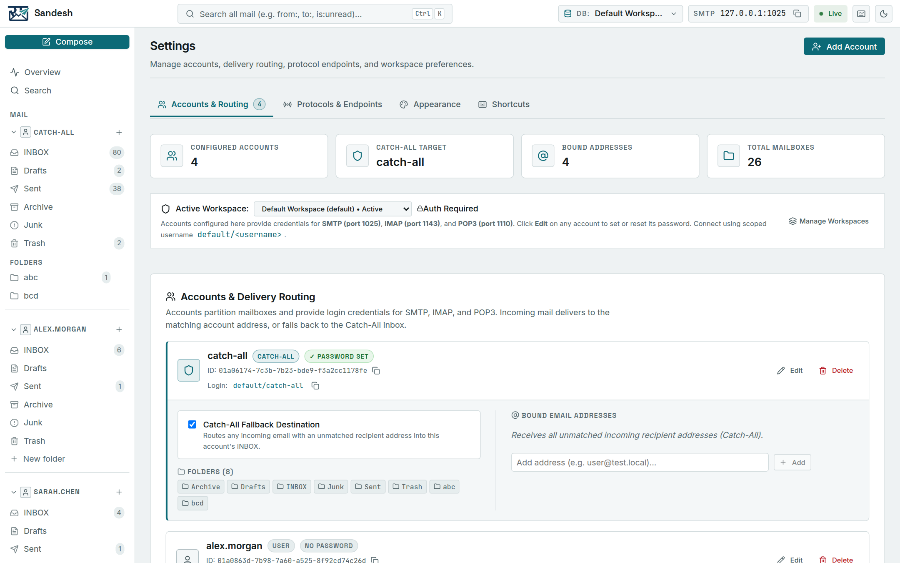

Navigate to Settings via the sidebar or deep-link directly to a tab: `/settings?tab=accounts`, `/settings?tab=protocols`, `/settings?tab=appearance`, `/settings?tab=shortcuts`.

---

### 4.1 Accounts Tab


**Purpose:** Create and manage mail accounts. Each account has one or more email addresses and a set of folders. One account can be the catch-all receiver.

#### Summary Metrics (top of tab)

| Metric | Description |
| :--- | :--- |
| **Total accounts** | Count in the active workspace |
| **Catch-all** | ✅ configured / ❌ not configured |
| **Identities** | Total email addresses across all accounts |
| **Mailboxes** | Total folders across all accounts |

#### UI Map — Account List

| Element | Type | Description |
| :--- | :--- | :--- |
| **Account card** | List item | Username, email addresses, catch-all badge, mailbox count |
| **Edit** (✏) button | Action | Opens the Account Edit modal |
| **Delete** (🗑) button | Danger action | Confirmation dialog before deleting the account and all its mail |
| **+ Add account** button | Action | Opens the Create Account modal |

#### UI Map — Account Modal (Create / Edit)

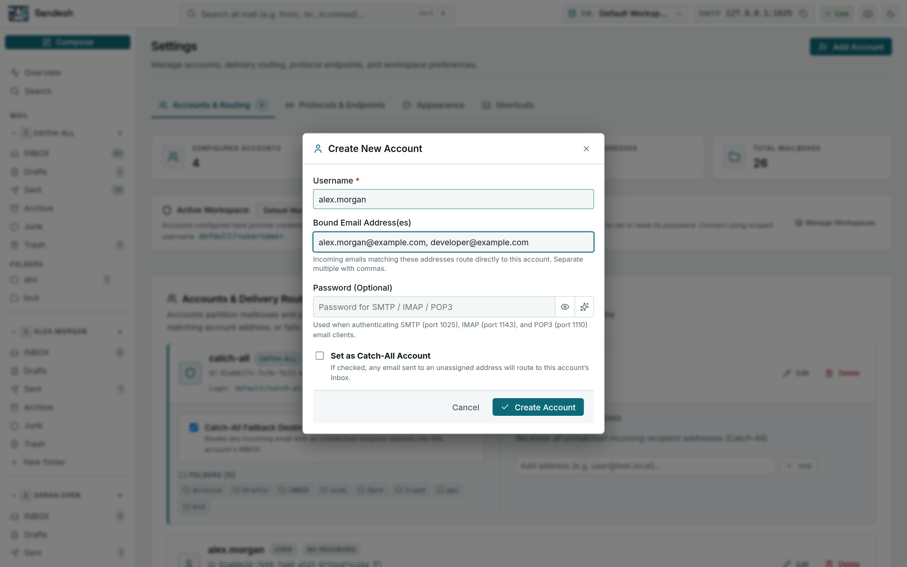

| Field | Description |
| :--- | :--- |
| **Username** | Internal identifier; must be unique in the workspace |
| **Email addresses** | Delivery addresses; mail sent here is routed to this account |
| **Catch-all** toggle | Makes this account receive mail not matched by any other account's addresses |
| **Password** | Optional. Used for IMAP/POP3 if auth is enabled. Stored as an Argon2id hash — never recoverable |
| **Save** button | Creates or updates the account |

#### Workflow: Create a new account

1. Go to **Settings → Accounts**.
2. Click **+ Add account**.
3. Enter a **Username** (e.g. `qa`).
4. Add one or more **Email addresses** (e.g. `qa@example.com`).
5. Enable **Catch-all** if needed.
6. Click **Save** — the account appears with its own Inbox, Sent, Drafts, and Trash folders.

---

### 4.2 Protocols Tab

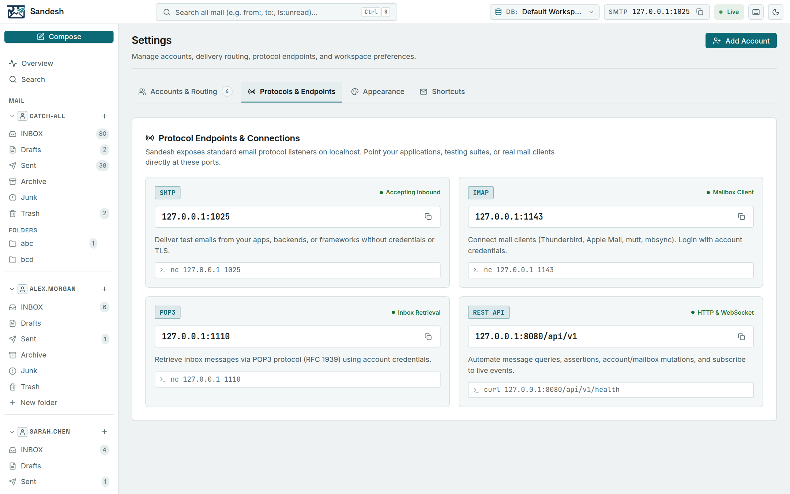

**Purpose:** A live reference showing the exact connection details for every service, with status badges and ready-to-use CLI snippets. Configuration is done via [environment variables](#6-configuration-reference) — this tab surfaces the live values from the running server.

| Card | Shows |
| :--- | :--- |
| **SMTP** | Host, port, security mode, auth status, `curl` test command, Python `smtplib` snippet |
| **IMAP** | Host, port, security mode, `mutt` and Python `imaplib` examples |
| **POP3** | Host, port, auth status, Python `poplib` snippet |
| **REST API** | Base URL, WebSocket URL, example `curl` calls |

Each card includes:
- A **status badge** (green `Active` / red `Disabled`)
- A **copy button** next to each address value

---

### 4.3 Appearance Tab

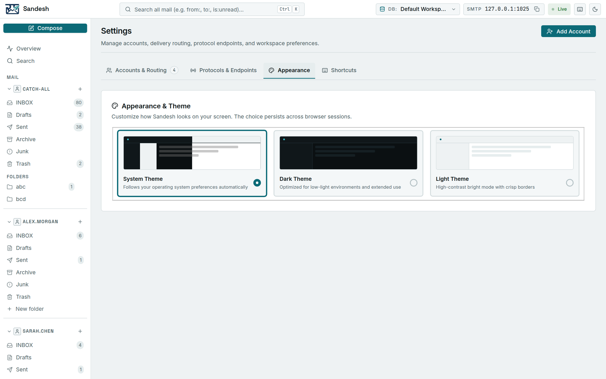

**Purpose:** Select the visual theme of the Sandesh console.

| Option | Description |
| :--- | :--- |
| **System Theme** *(default)* | Follows the OS light/dark preference automatically |
| **Dark Theme** | Dark background, light text — optimised for low-light and extended use |
| **Light Theme** | High-contrast bright mode with crisp borders |

Click any theme card to apply it immediately. The active theme has a highlighted border.

> **Quick toggle:** Click the ☀️/🌙 button in the header to switch light/dark without opening Settings.

---

### 4.4 Keyboard Shortcuts Tab

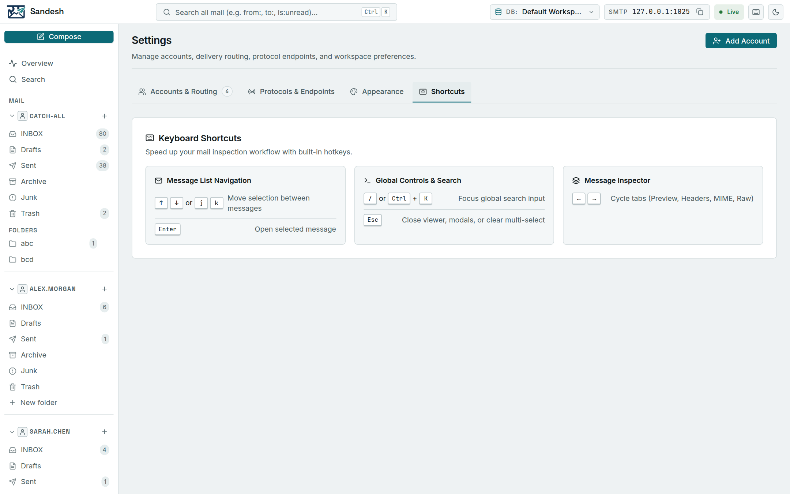

**Purpose:** A persistent, scrollable reference of all keyboard shortcuts grouped by category — the same content as the shortcuts modal (opened with `?` or the ⌨ header button).

See [Section 5](#5-keyboard-shortcuts-reference) for the full table.

---

## 5. Keyboard Shortcuts Reference

Press **`?`** or click **⌨** in the header to open the interactive shortcuts modal at any time.

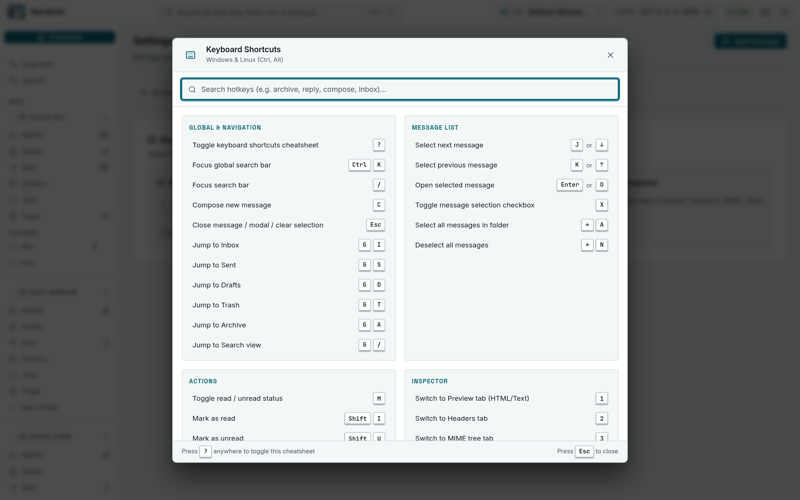

### Global & Navigation

| Shortcut | Action |
| :--- | :--- |
| `/` | Focus the search bar |
| `Ctrl+K` / `⌘K` | Focus the search bar (works from any input) |
| `c` | Open the message composer |
| `?` | Open this shortcuts modal |
| `Escape` | Close any open modal, popover, or drawer |
| `g` → `i` | Jump to Inbox |
| `g` → `s` | Jump to Sent |
| `g` → `d` | Jump to Drafts |
| `g` → `t` | Jump to Trash |
| `g` → `a` | Jump to Archive |
| `g` → `/` | Jump to the Search view |

### Message List

| Shortcut | Action |
| :--- | :--- |
| `j` | Move selection down to next message |
| `k` | Move selection up to previous message |
| `Enter` | Open the selected message |
| `u` | Mark selected message as unread |
| `e` | Archive the selected message |
| `#` | Delete the selected message |

### Message Viewer

| Shortcut | Action |
| :--- | :--- |
| `r` | Reply to the open message |
| `n` | Jump to the next message |
| `p` | Jump to the previous message |

---

## 6. Configuration Reference

Sandesh is configured entirely via **environment variables** — there is no configuration file to edit (except for `.deb`/`.rpm` installs which use `/etc/sandesh/sandesh.env`).

**Pass variables when starting Sandesh:**

```bash
# Linux / macOS
SANDESH_SMTP_ADDR=127.0.0.1:2025 SANDESH_DATA_DIR=~/.sandesh ./sandesh

# Windows PowerShell
$env:SANDESH_SMTP_ADDR = "127.0.0.1:2025"
.\sandesh.exe
```

### Full Variable Reference

| Variable | Default | Description |
| :--- | :--- | :--- |
| `SANDESH_SMTP_ADDR` | `127.0.0.1:1025` | SMTP listener (`host:port`) |
| `SANDESH_IMAP_ADDR` | `127.0.0.1:1143` | IMAP listener |
| `SANDESH_IMAP_TLS_ADDR` | *(off)* | IMAP implicit-TLS listener; setting this enables the port |
| `SANDESH_HTTP_ADDR` | `127.0.0.1:8080` | Web UI and REST API listener |
| `SANDESH_DATA_DIR` | `.` | Puts the database and blob store under one directory |
| `SANDESH_DATABASE_PATH` | `sandesh.db` | Path to the SQLite database file |
| `SANDESH_BLOB_PATH` | `sandesh-blobs` | Path to the raw message blob store |
| `SANDESH_LOG` | `info` | Tracing filter (e.g. `sandesh_smtp=debug`, `trace`, `warn`) |
| `SANDESH_SMTP_ENABLED` | `true` | Set `false` to disable the SMTP listener |
| `SANDESH_HTTP_ENABLED` | `true` | Set `false` to disable the HTTP listener |
| `SANDESH_IMAP_ENABLED` | `true` | Set `false` to disable the IMAP listener |
| `SANDESH_SMTP_AUTH` | `disabled` | `disabled` · `optional` · `required` |
| `SANDESH_SMTP_TLS` | `disabled` | `disabled` · `starttls` · `implicit` |
| `SANDESH_IMAP_AUTH` | `disabled` | `disabled` · `optional` · `required` |
| `SANDESH_IMAP_STARTTLS` | `false` | Offer `STARTTLS` on the IMAP cleartext port |
| `SANDESH_API_AUTH` | `disabled` | HTTP API auth: `disabled` · `required` |
| `SANDESH_API_TOKEN` | *(unset)* | Bearer token for API auth. Basic auth against an account password also works |
| `SANDESH_API_TLS` | `false` | Serve the API over HTTPS |
| `SANDESH_TRACING_ENABLED` | `true` | Record a protocol transcript per connection |
| `SANDESH_TRACE_RETENTION` | `1000` | Connection records kept before the oldest are evicted |

> **Binding off loopback:** Setting any address to `0.0.0.0:...` makes Sandesh reachable from the network. Sandesh warns you when you do this. If you bind off loopback, also enable API auth:
> ```bash
> SANDESH_HTTP_ADDR=0.0.0.0:8080 \
> SANDESH_API_AUTH=required \
> SANDESH_API_TOKEN=$(openssl rand -hex 32) \
> ./sandesh
> ```

> **TLS:** On first start with TLS enabled, Sandesh auto-generates a self-signed certificate for `localhost`, `127.0.0.1`, and `::1`, stores it beside the database, and prints its SHA-256 fingerprint. `AUTH` is **only advertised over an encrypted connection** — enabling auth without TLS does nothing (and Sandesh tells you so at startup).

> **Invalid variable values fail startup:** A value that is set but unusable (e.g. `SANDESH_HTTP_ADDR=8080` — a bare port instead of `host:port`) causes a startup error that names itself and suggests the fix — it is never silently ignored.

---

## 7. Troubleshooting

### General

| Problem | Likely Cause | Fix |
| :--- | :--- | :--- |
| Web UI not loading at `localhost:8080` | Sandesh is not running or is on a different port | Check the terminal/log where you started Sandesh. Look for the `HTTP:` line. Try `curl http://localhost:8080/api/v1/health` |
| Port already in use | Another process occupies `1025` or `8080` | `SANDESH_SMTP_ADDR=127.0.0.1:2025 ./sandesh` |
| Messages not appearing in the UI | App sending to wrong host/port | Confirm SMTP settings are `127.0.0.1:1025`. Check **Traces** for the SMTP connection |
| UI not updating in real time | WebSocket disconnected | Check the status dot in the header. Refresh to reconnect |
| Mail disappeared after restart | Data directory not persisted | Docker: ensure `-v sandesh-data:/data`. Binary: set `SANDESH_DATA_DIR` to a stable directory |
| `Permission denied: ./sandesh` | Binary not executable | `chmod +x sandesh` |
| `Exec format error` | Wrong architecture binary | Check `uname -m` and download the matching binary |

### Docker-Specific

| Problem | Fix |
| :--- | :--- |
| Container exits immediately | `docker logs sandesh` |
| Web UI not loading | Confirm `-p 1080:1080` (not `8080`) is in the `docker run` command |
| IMAP/POP3 connection refused | Confirm `-p 1143:1143` and `-p 1110:1110` are present |

### macOS-Specific

| Problem | Fix |
| :--- | :--- |
| `"sandesh" can't be opened` (Gatekeeper) | Right-click → Open, or `xattr -dr com.apple.quarantine ./sandesh` |
| Apple Mail won't connect to IMAP | Accept the "insecure connection" dialog, or use Thunderbird |
| `Exec format error` | Check `uname -m` — you may have downloaded the wrong `arm64` vs `x86_64` binary |

### Windows-Specific

| Problem | Fix |
| :--- | :--- |
| SmartScreen blocks the app | Click **More info → Run anyway**, or `Unblock-File` in PowerShell |
| Closing terminal kills Sandesh | Use Task Scheduler or NSSM for a background service |
| Firewall blocking ports | Allow `sandesh.exe` through Windows Defender Firewall |
| Web UI shows "connection refused" | Make sure the terminal running Sandesh is still open |

### Linux Desktop App

| Problem | Fix |
| :--- | :--- |
| Tray icon not visible | Install "AppIndicator" GNOME extension; check panel settings in KDE/XFCE |
| Desktop notifications not showing | `sudo apt install libnotify-bin` |
| AppImage won't run | `sudo apt install fuse libfuse2` |
| Port 1025 in use | `SANDESH_SMTP_ADDR=127.0.0.1:2025 sandesh-desktop` |

### Debian / Ubuntu `.deb` Service

| Problem | Fix |
| :--- | :--- |
| `systemctl status` shows failed | `sudo journalctl -u sandesh -n 50` |
| Web UI unreachable from another machine | Set `SANDESH_HTTP_ADDR=0.0.0.0:8080` in `/etc/sandesh/sandesh.env`, then restart |
| `Permission denied` to `/var/lib/sandesh` | Run as the `sandesh` service user via systemd — do not run as root |

### RHEL / Fedora `.rpm` Service

| Problem | Fix |
| :--- | :--- |
| Port refused by SELinux | `sudo semanage port -a -t http_port_t -p tcp 1025` then restart |
| Web UI unreachable from LAN | Set `SANDESH_HTTP_ADDR=0.0.0.0:8080` and `sudo firewall-cmd --add-port=8080/tcp --permanent && sudo firewall-cmd --reload` |

### IMAP / POP3 Client Issues

| Problem | Fix |
| :--- | :--- |
| Client demands a real password | Use **any** value — all credentials are accepted in developer mode |
| Thunderbird warns "unencrypted" | Click **I understand the risks** — expected for a local dev server |
| Client sees 0 messages | Verify delivery in the **Overview** or **Mailbox** view first |

---

*End of Sandesh Master User Manual — v0.1.0*

---

> **Document maintenance note:** This manual was generated from `docs/guides/` and the web UI source code in `web/src/routes/`. Screenshots live in `docs/images/` and are captured from the running UI. To update after a feature change, re-read the corresponding route component, update the UI Map table for that section, and re-capture any screenshot the change affects.
