# Sandesh — Roadmap

**Status:** Live, and open source since 2026-10-23. **Phases 0–9 are complete**; Phase 10 has five
increments — the container image (ADR-095), release binaries with reproducible checksums (ADR-096),
the `.deb` and `.rpm` server packages (ADR-097, ADR-098), and tag-driven release automation with
provenance attestations (ADR-103) — with Homebrew, Scoop, `cargo install` and key-based signing
outstanding.
Phase 4 was closed retroactively — two of its three
listed gaps turned out to have been built already, and closing the third found a backend pagination
defect (ADR-091).

Six earlier deliverables were found never to have been built; **all six are now resolved** — five
built (gaps 1–4 and 6), one struck by decision (gap 5). Each phase's own text marks what is
genuinely missing rather than implying it shipped — and that discipline has earned its keep twice:
this file has twice claimed a gap the code had already closed, both found by reading the code
rather than this document.

## Outstanding before Phase 7

Found by auditing every Phase 1–6 acceptance criterion and deliverable against the code, not
against this document. When written, none of these had a test that could fail, so the passing suite
said nothing about them — which is how the bugs behind gap 1 survived. All six are now resolved: gaps 1 to 4
and 6 were built and are covered by tests (ADR-067 to ADR-070, ADR-072 to ADR-075), and gap 5 was
struck as a decision rather than built (ADR-076). Nothing in this table blocks Phase 7.

| # | Gap | Phase | Note |
| --- | --- | --- | --- |
| ~~1~~ | ~~Domain services missing or misplaced~~ | 1 | **Closed** by ADR-068 to ADR-071: `AccountService`, `DeliveryService`, `MailboxService` and `MessageService` all live in `sandesh-core`, are constructed once at the composition root, and are used by every surface. `SearchService` is deliberately not planned — see the note in Phase 1 |
| ~~2~~ | ~~`testdata/` corpus is 22 fixtures across 3 categories~~ | 1 | **Closed** by ADR-072: 101 fixtures across all five categories, guarded by a test. Expanding it found and fixed a real defect in the `BODYSTRUCTURE` corpus test, which discarded everything after a literal |
| ~~3~~ | ~~No fuzz target for any parser (no `fuzz/` directory)~~ | 1, 2, 5 | **Closed** by ADR-073: `fuzz/` carries a libFuzzer target for all five parsers, run nightly in CI, with the assertions kept as stable library code so `fuzz/tests/corpus.rs` replays the whole `testdata/` corpus and every crash reproducer on every commit |
| ~~4~~ | ~~No FTS5 index and no `SearchIndex` trait~~ | 1 | **Closed** by ADR-074: `SearchIndex` lives in `sandesh-core`, `SqliteSearchIndex` implements it over an FTS5 **trigram** index, and both search surfaces narrow through it. Building it corrected the §7 design: the specified `unicode61` tokenizer would have made IMAP `SEARCH` silently miss matches |
| ~~5~~ | ~~No `--no-web` flag~~ | 3 | **Struck, by decision** (ADR-076). Not built and not planned: no consumer has asked for it, the embedded UI costs nothing to leave in place, and it is now behind authentication (ADR-075). Reinstate if a consumer appears |
| ~~6~~ | ~~API bearer/basic auth and HTTPS for the HTTP listener~~ | 4.5 | **Closed** by ADR-075: bearer and basic auth behind `SANDESH_API_AUTH`, HTTPS behind `SANDESH_API_TLS` reusing the existing certificate. Off by default (ADR-005). Building it found the UI fallback bypassing the middleware, and a second hand-copied Argon2 configuration in `sandesh-api` |

Also outstanding but already disclosed in place: Thunderbird/`mutt`
verification, which need a GUI or TTY harness.

Effort estimates are relative sizing, not calendar commitments.

---

## Sequencing rationale

The brief's proposed order is kept almost intact, with **two deliberate changes**:

1. **REST + WebSocket (Phase 3) comes before the Web UI (Phase 4)** — as proposed. Worth stating
   explicitly because it is load-bearing: the API must be designed for programmatic consumers first,
   or it becomes a UI backend and the CI-automation audience is served badly forever.

2. **Authentication + TLS moves from Phase 7 to Phase 4.5**, before IMAP. Reason: IMAP's state machine
   is deeply entangled with authentication (the Not Authenticated state, `AUTHENTICATE`, `STARTTLS`,
   `LOGINDISABLED`, SASL-IR). Building IMAP against a stubbed auth layer and retrofitting real SASL
   afterwards means writing the session state machine twice. Doing auth and TLS once in
   `sandesh-proto` — where SMTP can immediately use it too — is strictly cheaper.

Everything else follows the brief. The through-line is that each phase produces something
independently verifiable, and the cross-protocol test suite grows monotonically.

```mermaid
gantt
    dateFormat X
    axisFormat %s
    section Foundation
    P0 Architecture           :done, 0, 1
    P1 Core + Storage         :1, 3
    section Ingress
    P2 SMTP                   :3, 5
    P3 REST + WebSocket       :5, 7
    P4 Web UI                 :7, 10
    section Protocols
    P4.5 Auth + TLS           :10, 11
    P5 IMAP                   :11, 15
    P6 POP3                   :15, 16
    section Product
    P7 Diagnostics            :16, 17
    P8 Advanced testing       :17, 19
    P9 Desktop                :19, 21
    P10 Distribution          :21, 22
```



---

## Phase 0 — Architecture and specification

**Objective.** Establish a coherent technical blueprint before any code.

**Deliverables.** README plus the ten documents in `docs/`. Consistency audit performed.

**Dependencies.** None.

**Acceptance criteria.**
- A future contributor can answer, from the docs alone: what we are building, what protocols, what
  the canonical model is, how mail is stored, how protocols reach the core, how the API and UI
  connect, and what is built first.
- All ten §33 audit questions answer yes (see [DECISIONS.md](DECISIONS.md) §3).
- No contradictions between documents.
- Open decisions are marked, not hidden.

**Tests.** None (no code).

---

## Phase 1 — Core domain and storage ✅ **Complete**

**Status: complete.** Every deliverable is now built. The four Phase 1 gaps the audit found — the
domain services, the fixture corpus, the fuzz harness and the `SearchIndex`/FTS5 index — are closed
by ADR-068 to ADR-074, and each is covered by a test that can fail.

**Objective.** A working mail engine with no network surface.

**Deliverables.**
- Cargo workspace with every crate in ARCHITECTURE §3 (**ten** `sandesh-*` crates as built, plus
  `xtask`; the original estimate of nine predated `sandesh-config` being split out);
  `sandesh-core` compiles with no infrastructure dependencies
- Domain entities, value objects, invariants per CORE_SPEC
- Port traits: `MessageStore`, `MailboxStore`, `AccountStore`, `BlobStore`, `EventSink`
  (`DeliveryStore` and `ConnectionStore` were added by Phases 2 and 7). **`SearchIndex` is built**
  (ADR-074): search remains a pure domain plan (`sandesh-core::SearchQuery`) shared by the REST and
  IMAP surfaces, and the trait sits beside it as a *prefilter* that may narrow which messages a
  search loads and may never change which ones it returns. `NullSearchIndex` is the proof —
  removing the index leaves every result identical and only slower.
- Services: `DeliveryService`, `MailboxService`, `MessageService` and `AccountService`, all in
  `sandesh-core` — **complete** (ADR-068 to ADR-071). Every mailbox, placement, account and delivery
  operation on every surface goes through them, which closed seven latent bugs the hand-written
  copies had drifted into, including a cross-account isolation hole. `SearchService` is deliberately
  not planned: search has no domain rules to enforce beyond the plan itself, so the service would
  only forward to a port. (This no longer shares a reason with `SearchIndex`, which is now built.)
- MIME parsing pipeline over `mail-parser`, with byte-range extraction and diagnostics
- `sandesh-storage`: SQLite schema, migrations, hybrid blob store, and the **FTS5 index**
  (`migrations/0005_search_index.sql`, ADR-074), maintained inside the same transaction as the
  message it describes so "stored" and "indexed" are one event.
- `sandesh-events`: in-process bounded broadcast bus
- `sandesh-config`: layered configuration
- In-memory port implementations for testing
- `testdata/` corpus (≥100 `.eml` fixtures across the five categories) — **met** (ADR-072): 102
  fixtures across all five (`valid/` 26, `malformed/` 29, `encodings/` 18, `adversarial/` 16,
  `real_world/` 12), and a test now asserts the count and that every category is represented, so
  the corpus cannot shrink silently. Criteria phrased "for every fixture in the corpus" — notably
  Phase 5's `BODYSTRUCTURE` check — now run against 101.

**Dependencies.** Phase 0.

**Acceptance criteria.**
- A message can be delivered through `DeliveryService`, stored, and retrieved **byte-identically**
- One message delivered to three accounts produces three entries and one stored copy
- IMAP COPY semantics work at the domain level: two entries, distinct UIDs, independent flags
- UIDs are monotonic and unique per mailbox under concurrent delivery
- Every fixture parses without panic; malformed messages are stored and retrievable — met over the
  full corpus (102 fixtures)
- `sandesh-core` reaches no sqlx, axum, tokio or protocol crate — met, and enforced continuously by
  `tests/architecture.rs` walking the resolved dependency graph, which replaced the one-off
  `cargo tree` inspection this criterion originally described
- Events are emitted after commit, never before

**Tests.** Unit (domain, parsing); property (UID monotonicity, flag algebra, parser never-panics);
storage (round-trip, threshold boundary, concurrency, GC, cascades); the `architecture.rs`
dependency-graph test; the MIME-parser fuzz target — **built** (ADR-073), `fuzz/fuzz_targets/mime_parser.rs`,
which asserts more than never-panics: every reported `ByteRange` must lie within the input, and no
projected body or attachment path may name a part that does not exist.

**Effort:** Large. This phase determines whether everything after it is easy or painful.

---

## Phase 2 — SMTP ✅ **Complete**

**Objective.** Accept real mail from real clients.

**Outcome.** Delivered. `sandesh-proto`, `sandesh-config` and `sandesh-smtp` implemented; 135 new
tests; Python `smtplib` interoperability verified. See [SMTP_DESIGN.md](SMTP_DESIGN.md).

**Deliverables.**
- `sandesh-proto`: TCP accept loop, connection limits, line framing with byte caps, idle timeouts,
  per-connection tracing, `ProtocolServer` trait
- `sandesh-smtp`: command parser, session state machine, DATA handling with dot-stuffing reversal
- Commands: EHLO, HELO, MAIL FROM, RCPT TO, DATA, RSET, NOOP, QUIT, VRFY, EXPN, HELP
- Extensions: 8BITMIME, SIZE, PIPELINING, ENHANCEDSTATUSCODES *(CHUNKING added later, in Phase 8 A4)*
- Routing per CORE_SPEC §7 with the three unknown-recipient policies
- Full transaction traces persisted to `deliveries`
- `sandesh-app`: composition root, `Engine` type, CLI, graceful shutdown

**Dependencies.** Phase 1.

**Acceptance criteria.**
- `lettre` and `swaks` deliver successfully; the stored bytes match what was sent, exactly
- Line endings are preserved verbatim (bare LF stays bare LF)
- Malformed messages are accepted, not rejected
- Null reverse-path `<>` is accepted
- Multi-recipient delivery creates one message and N entries
- Messages over `max_message_size` are rejected with `552`
- Nothing is ever relayed
- `sandesh` starts, binds 1025, and shuts down gracefully on SIGTERM

**Tests.** Protocol conformance transcripts (`insta` snapshots) for every command in every state;
integration with `lettre`; fuzz the command parser; concurrency (N simultaneous deliveries → distinct
UIDs); premature-disconnect and oversized-input handling.

**Effort:** Medium.

---

## Phase 3 — REST API and WebSocket

**Objective.** Make the engine fully programmable. **This is the first genuinely useful release** —
send via SMTP, assert via API, in CI, with no UI.

**Deliverables.**
- `sandesh-api`: all endpoints in API_DESIGN §3
- Cursor pagination; RFC 9457 error mapping
- WebSocket at `/api/v1/events` with filtering, `seq` and lag handling — ~~**resume not built**~~
  **resume delivered** (ADR-103, closes OD-19): a `resume` frame replays from a bounded window in
  the bus, keyed on `bus_seq` because the per-connection `seq` restarts on reconnect, and reports
  `resume_gap` rather than handing back a partial history. **The UI uses it**: `events.ts` resumes on
  every reopen after the first, and a gap falls back to the refetch path it already had. Asserted
  end to end by `websocket_resume_replays_events_missed_while_disconnected`, which delivers mail
  over SMTP with no listener attached and reconnects a real socket
- SSE mirror
- OpenAPI 3.1 generation (`utoipa`); TypeScript generation (`ts-rs`) with a CI drift check
- Health and readiness endpoints; `/info` with connection strings
- Configurable CORS. Bearer/basic auth for the API moved to Phase 4.5 and **shipped there**
  (ADR-075)

**Dependencies.** Phase 2.

**Acceptance criteria.**
- Every endpoint is exercised by a test; every `CoreError` maps to the documented status
- `GET /messages/{id}/raw` returns byte-identical original content
- A message summary carries all its entries (multi-mailbox visible in one request)
- WebSocket events arrive within 100ms of delivery; `MessageReceived` never precedes queryability
- A lagging consumer receives `lagged` and can resync
- Cursor pagination is stable under concurrent insertion — **now tested.** Asserted and previously
  unasserted: `tests/messages` walked no cursor, and `GET /messages` in fact paginated the wrong
  way (fixed with Phase 4's virtualisation work; `tests/pagination.rs`)
- Generated TypeScript matches the checked-in file
- ~~`--no-web` runs API-only~~ — **struck by decision** (ADR-076), not merely unbuilt. The UI is
  embedded in the binary and served only on unmatched paths, so it costs nothing to leave in place,
  and an API-only mode has no consumer. Reinstate this criterion if one appears

**Tests.** API tests via `oneshot`; WebSocket ordering, filtering, lag and resume; OpenAPI schema
validation; cross-protocol cases 11 (event/fetch race) and 6 (REST delete visible elsewhere).

**Effort:** Medium.

**Delivered.** `sandesh-events` (bounded broadcast bus, total order, lag reporting), `sandesh-api`
(REST read surface, flag mutation, WebSocket with server-side filtering, RFC 9457 errors, UID-cursor
pagination), `sandesh-app` (composition root, lifecycle, graceful shutdown) and the first runnable
binary: `cargo run`. 378 tests pass, including a full SMTP → core → SQLite → bus → WebSocket/REST
end-to-end test over real sockets.

**Deferred at the time, with reasons in [API_DESIGN.md](API_DESIGN.md) §11.3 — most have since
shipped.** Now built: the write endpoints whose core operations arrived with IMAP (injection,
copy/move, bulk, account and mailbox mutation), search (`GET /search` and `/search/explain`, as a
pure domain plan rather than the storage-level filter syntax originally envisaged), the SSE mirror
(`GET /api/v1/events/sse`), OpenAPI and TypeScript generation with the CI drift gate, and static
assets, and API authentication (ADR-075, Phase 4.5). WebSocket resume is now delivered too
(ADR-103), which closes the last of these.

---

## Phase 4 — Web UI

**Status: delivered**, with the scope notes below.

**Objective.** The developer console.

**Deliverables.**
- React 19 + TypeScript + Vite; embedded in the binary via `rust-embed`
- Dashboard with copy-paste connection details and server status
- Message list: virtualised, live, keyboard-navigable, bulk actions
- Message inspector: HTML (sandboxed iframe + DOMPurify), Text, Headers, MIME tree, Raw,
  Attachments, Delivery
- **MIME-tree ↔ raw byte-range linkage**
- Search with filter syntax, autocomplete, chips
- Servers view; Settings
- Dark and light themes; full keyboard shortcuts
- Designed empty, loading, error and disconnected states

**Dependencies.** Phase 3.

**Acceptance criteria.**
- A message sent via SMTP appears in the UI within 1s, no refresh — **met**, verified by a browser
  test that loads the list, delivers over real SMTP, and asserts the row arrives with no navigation
- Every inspector tab renders correctly for every fixture category — **partially met**; the tabs are
  verified against live SMTP deliveries (plain, multipart/alternative, multipart/mixed with a binary
  attachment, and hostile HTML), not yet against all 102 `.eml` fixtures (ADR-072 grew the corpus
  from the 22 this line was written against)
- Selecting a MIME part highlights its exact bytes in Raw — **met**, and covered by a browser test
- HTML preview is sandboxed; a script in a test message cannot execute — **met and strengthened**
  (ADR-030: an empty sandbox rather than sanitisation inside a same-origin frame)
- The list stays smooth at 10,000 messages — **met.** The list is virtualised
  (`@tanstack/react-virtual`) over infinite scroll on the existing UID cursor, so rendering cost is
  flat in list size: verified in a browser against 10,000 real messages, where the DOM holds ~21
  rows at the last page exactly as at the first. Meeting it required fixing a backend pagination
  defect first — see the scope audit below

**Scope audit, corrected.** This list previously named search, bulk actions and virtualisation as
undelivered. Two of the three were **already built** and the text had simply not been updated — the
same documentation drift the Outstanding-before-Phase-7 audit was created to catch, found again by
reading the code rather than this file:

- ~~**Search.**~~ **Delivered.** `SearchRoute` provides full-mailbox search with the explain plan
  beside it, and `MailboxRoute` carries an in-mailbox filter field with `is:unread` /
  `has:attachment` / `from:` / `to:` / `subject:` chips and a structured filter builder
  (`filterUtils.ts`, with its own tests).
- ~~**Bulk actions.**~~ **Delivered.** Ctrl/Shift multi-select in the list, a bulk toolbar, and
  `MultiMessageViewer` for acting on a selection, all over `POST /api/v1/entries/bulk`.
- ~~**Virtualised lists and the 10,000-message target.**~~ **Delivered**, and building it found the
  reason the target had never been reachable: **`GET /api/v1/messages` paginated the wrong way.**
  The list is newest-first and UIDs ascend with age, but the cursor filter read `uid > after`, so
  page two returned the rows the client already held and then reported the list exhausted — every
  mailbox truncated at 99 messages regardless of size. No test anywhere walked a cursor to the end,
  which is how it survived; `tests/pagination.rs` now does, and three of its four cases fail if the
  comparison is reverted. With the cursor fixed, the list pages through all 10,000 while rendering a
  bounded window: verified in a real browser at 10,000 messages, where the DOM holds ~21 rows and
  ~457 nodes at the last page exactly as at the first, and scrolling costs one frame at 60fps.

  This also corrects a Phase 3 claim: "cursor pagination is stable under concurrent insertion" was
  listed as met and had no test. It now has one.

**Genuinely not delivered in Phase 4**, each because the backing REST endpoint does not exist rather
than for want of UI work:

- **Servers and Diagnostics views.** These describe IMAP, POP3, protocol traces and a log stream,
  none of which exist before Phases 5–7. The About view carries the subset that is real today:
  version, addresses, database location, storage health and event-stream state.
- ~~**Delivery tab.**~~ **Delivered in Phase 7 A1**, along with the indexed `by_message_id` lookup
  that replaced the record scan this note described.
- **Sparklines and message-over-time activity.** No endpoint reports historical counts.

**Delivered beyond the original plan.** The `OpenAPI` contract, the generated TypeScript and the
CI drift gate (ADR-026 to ADR-028), which `ROADMAP` had previously deferred into Phase 4 from
Phase 3.
- **Developer Mail Composer & Quick Reply.** Built-in modal composer in the Web UI supported by
  `POST /api/v1/send`, dual placement into recipient INBOX and sender Sent folders, and contextual
  reply pre-fill (headers, subject prefix, quoted body) for fully self-contained local testing.

**Accessibility and responsive criteria — now all three asserted.** These were listed as acceptance
criteria and went a long time with **no test behind them**; they were also mis-filed under the
"delivered beyond plan" list above, which overstated them. Closing them was not paperwork: two of
the three failed the moment they were measured, which is the argument for measuring rather than
asserting. Structural rules run under jsdom in `web/src/test/a11y.test.tsx`; the two that need a
real engine run in `web/e2e/a11y.spec.ts`. Both gates were mutation-checked — each was made to fail
on purpose before being trusted:

- ~~`axe-core` reports no violations on any principal view~~ — **met**:
  `web/src/test/a11y.test.tsx` runs axe over seven principal views in their *loaded* state, gated on
  WCAG 2.0/2.1 A and AA. `color-contrast` and `target-size` are switched off there because jsdom
  resolves neither the cascade nor layout, so leaving them on would report "incomplete" forever and
  read as a pass; those two belong in the browser suite below. The gate was mutation-checked — an
  unlabelled input makes it fail
- ~~Both themes meet WCAG 2.2 AA contrast~~ — **met, and it found three real failures.**
  `e2e/a11y.spec.ts` runs axe's `color-contrast` rule against a real engine in both themes, which
  is the check jsdom structurally cannot make. The light theme's status colours had been tuned
  against white, but they are painted on their own `--*-muted` tint over a pane: measured there,
  four of five were below AA (accent 4.17, ok 4.23, warn 4.28, error 3.89). All five now clear
  4.6:1 against that worst case
- ~~The UI works at 375px width~~ — **met, and it found a regression.** The header's status cluster
  is `flex: none`, so anything added to it must earn its width; the workspace switcher added in
  `bf1f369` carried a 200px trigger at every breakpoint and pushed the theme toggle 25px off a
  375px viewport. The suite asserts no horizontal overflow on every principal view, that the nav
  drawer opens and lists every destination, and that the header keeps the toggle in view.

  Two earlier defects of the same kind were fixed before this (Phase 8 A1, incidentally): the
  header overflowed, clipping the
  connection status and both toggles, and `.shell__nav` was `display: none` below 820px with
  nothing replacing it, so every destination — INBOX, Traces, Logs, the API console, Settings —
  was unreachable on a phone. The sidebar is now an off-canvas drawer behind a toggle. Verified
  in a real browser at 375px **and pinned by three tests** in `web/e2e/a11y.spec.ts`

**Tests.** Vitest component tests (294, across 32 files); Playwright E2E; an XSS-payload corpus
against the HTML preview.
**The two gaps this line used to record are closed:** `web/e2e/` now covers **all six** scenarios of
TESTING_STRATEGY §12 across `mail.spec.ts` and `a11y.spec.ts` (18 tests), and `axe-core` runs both
under Playwright and under jsdom. The last three scenarios — search, attachment bytes and delete —
were each mutation-checked: the assertion was made to fail before it was trusted to pass.

**Effort:** Large.

---

## Phase 4.5 — Authentication and TLS ✅ **Complete**

**Objective.** Shared auth and TLS in `sandesh-proto`, before IMAP needs them. *(Moved earlier — see
sequencing rationale.)*

**Status: complete.** All eight acceptance criteria below are met, and the final deliverable — API
bearer/basic auth and HTTPS for the HTTP listener — is now built (ADR-075). `crates/sandesh-api`
has an `auth` module applied to the whole router, and the same certificate the mail listeners use
is handed to axum when `SANDESH_API_TLS` is set. Both are **off by default** (ADR-005), which keeps
loopback frictionless while making the off-loopback case configurable rather than impossible.

A client can authenticate against Sandesh over an encrypted channel by either route:

| Mode | Behaviour |
| --- | --- |
| `disabled` | Plaintext SMTP, no `AUTH` advertised. The default (ADR-005) |
| `start_tls` | Cleartext until `STARTTLS`, then a fresh session over TLS (ADR-036) |
| `implicit` | `rustls` handshake before any SMTP; plaintext is never interpreted (ADR-037) |

`openssl s_client -starttls smtp` and `openssl s_client` (implicit, no flag) both complete TLSv1.3
handshakes. `AUTH PLAIN` and `AUTH LOGIN` succeed inside either, and mail delivered through an
authenticated session is stored — covered by tests driving real sockets and real `rustls` clients.

A TLS mode configured without a certificate now **fails startup** rather than degrading to
plaintext.

**The API half, as built (ADR-075):**

- **Bearer and basic authentication.** `SANDESH_API_AUTH=required` turns it on; `SANDESH_API_TOKEN`
  sets a shared bearer token, and basic auth verifies against the `accounts` table through the same
  Argon2id path SMTP and IMAP use. `SANDESH_SMTP_AUTH` still governs SMTP only — the two were long
  conflated, and `/info` now reports them separately so the distinction is visible from a running
  server.
- **HTTPS.** `SANDESH_API_TLS=true`, reusing the certificate from ADR-034. A TLS mode with no usable
  identity fails startup rather than serving plaintext on a port the operator believes is
  encrypted — the rule Phase 4.5 already applied to SMTP.
- **Only `/api/v1/health` is exempt**, because a container orchestrator has nowhere to put a
  credential and liveness discloses only that Sandesh is running. `/health/ready` and `/info` are
  *not* exempt: they report storage state and the deployment's addresses.

**Still not built, deliberately:** no client-certificate verification, and no CLI or UI for managing
account passwords — one must still be set through `POST /api/v1/accounts` or written into the table.
Neither is required by any acceptance criterion.

Runtime configuration (ADR-031) was a prerequisite, not a security deliverable. IMAP and POP3 will
reuse the same `sandesh-proto` primitives.

**Deliverables.**
- *(prerequisite, not a security deliverable)* runtime configuration — ADR-031
- ~~SASL in `sandesh-proto`: PLAIN, LOGIN~~ — **done**; CRAM-MD5 dropped, see ADR-032
- ~~Argon2id credential storage; timing-safe verification~~ — **done**, ADR-032
- ~~Self-signed certificate auto-generation, persisted to the data directory; supplied cert/key~~ — **done**, ADR-034
- ~~Auth posture surfaced in `/info` and on the dashboard~~ — **done**
- ~~`rustls` integration: STARTTLS upgrade over an established stream~~ — **done**, ADR-036
- ~~SMTP `AUTH` and `STARTTLS` commands~~ — **done**, ADR-036
- ~~implicit-TLS ports~~ — **done**, ADR-037
- ~~API bearer/basic auth; optional HTTPS~~ — **done**, ADR-075

**Dependencies.** Phase 3 (Phase 4 can proceed in parallel).

**Acceptance criteria.**
- STARTTLS on SMTP succeeds with `openssl s_client` — **met**, verified manually (TLSv1.3,
  `TLS_AES_256_GCM_SHA384`) and by a browser-free integration test using a real `rustls` client
- Plaintext pipelined across the upgrade is discarded — **met**, and guaranteed structurally rather
  than by a check (ADR-036); a test proves a server that skips the real upgrade fails
- Each SASL mechanism succeeds and fails correctly — **met** for `PLAIN` and `LOGIN`; CRAM-MD5 is
  refused by name (ADR-032)
- Auth remains **disabled by default** (ADR-005) — **met**, asserted at the config, API and
  protocol layers
- The generated certificate persists across restarts; its fingerprint is displayed — **met**; the
  reported fingerprint matches `openssl x509 -fingerprint -sha256` exactly
- Credentials never appear in logs or traces — **met** (ADR-035); a live server log was checked for
  the password and its base64 form
- Implicit TLS is encrypted before SMTP — **met** (ADR-037); `openssl s_client` receives the
  greeting inside TLS, and a plaintext client receives a TLS alert rather than a `220`
- A TLS mode without a certificate fails startup — **met**; `ServerError::MissingTlsAcceptor`

**Tests.** TLS handshake per protocol; SASL mechanism matrix; Argon2 verification; log-redaction
assertions.

**Effort:** Medium.

---

## Phase 5 — IMAP

**Status: complete, bar two environmental checks.** Increments 1–5 are done, and every acceptance
criterion is met and test-enforced except the manual Thunderbird and `mutt` runs, which need a GUI
and a TTY harness respectively — neither is a server defect. QRESYNC remains deliberately out of
scope (ADR-059). The crate, the RFC 9051 parser, the
session state machine, a real TCP server (cleartext, `STARTTLS` and implicit TLS), `CAPABILITY`,
`AUTHENTICATE`/`LOGIN` over the Phase 4.5 security foundation and `LOGOUT` (increments 1–2); the
**mailbox commands** (`SELECT`, `EXAMINE`, `LIST`, `STATUS`, `CREATE`, `DELETE`, `RENAME`,
`SUBSCRIBE`/`UNSUBSCRIBE`) with correct UIDVALIDITY/UIDNEXT and sequence-number semantics
(increment 3); **`FETCH`/`UID FETCH`** (4A), **`STORE`/`UID STORE`** (4B.1), **`SEARCH`/`UID
SEARCH`** (4B.2) and **`EXPUNGE`/`COPY`/`MOVE`** with their UID variants (4B.3); then `APPEND`,
`IDLE`, UIDPLUS, `NAMESPACE`, `ENABLE`, ESEARCH, LIST-EXTENDED, SPECIAL-USE and CONDSTORE/MODSEQ
(phase 5 increments 1–3) — all verified over real sockets.

**A fetching agent works end to end.** The `SELECT` → `SEARCH UNSEEN` → `FETCH` → `STORE +FLAGS
\Seen` loop that Odoo `fetchmail` performs completes against a running server and through
unmodified Python `imaplib`. SMTP-delivered mail is retrievable byte-exact, searchable by the
criteria real clients use, markable, movable and expungeable.

### The next work

```text
POP3 parity (Phase 6)   ← audited; the crate is largely built, see Phase 6 for the real gaps
Thunderbird / mutt full verification (needs a GUI or TTY harness)
```

**Every acceptance criterion except the client-binary one is now met and enforced by a test**
(ADR-063, ADR-064). The audit that closed them found three asserted only by inspection:
`BODYSTRUCTURE` was checked against 6 of the 22 fixtures that existed then, cross-protocol cases 4
and 5 had no test at all, and the IDLE latency bound was never measured. All three are now covered;
measured `EXISTS` latency is ~640µs against a 100ms budget. The corpus check now runs against all
102 fixtures (ADR-072, plus one added by ADR-078), which is what gave that criterion its intended strength.

The global `CAPABILITY` audit is **done** (ADR-060): it found `UNSELECT`, `SASL-IR` and
non-synchronising literals implemented but unadvertised, and added all three — the last as
`LITERAL-`, not `LITERAL+`, because `max_literal_size` bounds what this server will accept.

**Modified UTF-7 is done** (ADR-061), and it closed a real bug rather than merely adding an
encoding. Driving a live server turned up that `CREATE "Wichtig-&APw-ber"` from a rev1 client and
`CREATE "Wichtig-über"` from a rev2 client produced *two separate mailboxes for the same folder*.
Decoding inbound and encoding outbound collapses them onto one name.

**An automated client-sync cycle now runs in CI**, pinning the sequence `mbsync` and Thunderbird
issue — capability discovery, `LIST`, `STATUS` for `UIDVALIDITY`/`UIDNEXT`, `SELECT`, `UID FETCH`
headers then `BODY.PEEK[]` bodies, `UID STORE` writeback, and a resync pass that must agree. It
asserts `BODY.PEEK` leaves `\Seen` untouched, the classic sync bug, and that `UIDVALIDITY` holds
steady across the cycle.

**Real `mbsync` now completes a full sync** (ADR-062). The binaries turned out to be usable after
all — `apt-get download` plus `dpkg-deb -x` into a scratch prefix needs no root, which an earlier
note wrongly assumed. `mbsync` 1.4.4 mirrors all seven folders including a non-ASCII one, downloads
messages with matching UIDs, syncs incrementally, and propagates a local `\Seen` back to the
server, with exit 0 and no protocol errors.

It also earned its keep immediately: `mbsync` issues `CHECK` after propagating flags, and the
server answered `BAD unrecognised command` — a mandatory RFC 9051 §6.4.1 command that was missing
from the command enum entirely. The scripted `imaplib` cycle never asked for it, because a scripted
test only asks what its author thought to ask. `CHECK` is now implemented as `NOOP`, which §6.4.1
permits for a server with no deferred housekeeping.

`mutt` connects and authenticates cleanly but its browse and compose modes need a TTY and a local
sendmail; Thunderbird is a GUI client with no headless sync mode. Both remain manual checks.

Design notes: `docs/IMAP_DESIGN.md`.

**Objective.** A real IMAP server that real mail clients can use. The largest phase.

**Deliverables.**
- `sandesh-imap` with a hand-written RFC 9051 codec, session state machine and per-session
  sequence-number bookkeeping

  *Correction:* this entry previously read "over `imap-codec`". That contradicted ADR-002 and
  `tests/architecture.rs`, which ban `imap-codec`/`imap-types` on the grounds that protocol codecs
  belong in adapter crates we own. The parser is written here instead (ADR-040).
- All commands in PROTOCOL_CAPABILITIES §4.1
- All FETCH items in §4.2, including `BODYSTRUCTURE` and section fetches served from raw byte ranges
- All SEARCH keys in §4.3, compiled to the shared `SearchQuery` plan (done in 4B.2; ADR-048)
- IDLE wired to the event bus (done; ADR-053)
- UIDPLUS (`APPENDUID`, `COPYUID`), MOVE, SPECIAL-USE, NAMESPACE, ENABLE, ESEARCH, LIST-EXTENDED,
  CONDSTORE, UNSELECT, SASL-IR, `LITERAL-` (all done; ADR-054 to ADR-060)
- IMAP4rev2, advertising the rev1 name for client compatibility (ADR-042)
- Modified-UTF-7 mailbox names for rev1 clients (done; ADR-061)

**Dependencies.** Phases 1, 2, 4.5.

**Acceptance criteria.**
- **Thunderbird, `mutt` and `mbsync` connect, list, select, fetch and sync successfully**
- `UID FETCH BODY[]` returns byte-identical content to what SMTP received
- `BODYSTRUCTURE` is correct for every fixture in the corpus
- COPY produces a new UID with independent flags and one stored message
- UIDs never repeat; `uid_next` never decreases across expunge
- IDLE delivers `EXISTS` within 100ms of SMTP delivery
- Cross-protocol cases 1, 3, 4, 5, 10, 12, 13 pass

**Tests.** Conformance transcripts for every command in every state; `async-imap` integration;
`BODYSTRUCTURE` fixtures; SEARCH key matrix; concurrent-session EXPUNGE/FETCH; IDLE; fuzz the command
parser; manual client checklist.

**Effort:** Very large. Budget more than any other phase.

**Progress.**

| Deliverable | Status |
| --- | --- |
| `sandesh-imap` crate, wired into the workspace and architecture tests | Done |
| RFC 9051 command parser: tags, atoms, quoted strings, NIL, nested lists, literals (`{n}`, `{n+}`) | Done |
| Bounded parsing: literal limit, nesting depth, token count, no allocation before the bound | Done |
| Session state machine: four RFC 9051 §3 states, exhaustive command permissions, `EXAMINE` read-only enforcement | Done |
| ADRs 038 (state as a type), 039 (IDLE deferred), 040 (parser pauses at literals) | Done |
| TCP listener (two: cleartext and implicit TLS), clean shutdown, connection limits | Done |
| Greeting, `CAPABILITY` (truthful, recalculated per transport), `NOOP`, `ID`, `LOGOUT` | Done |
| `AUTHENTICATE` PLAIN/LOGIN + `LOGIN`, reusing Phase 4.5 SASL, Argon2id and `Secret` | Done |
| `STARTTLS` (session discarded across the upgrade) and implicit TLS, reusing Phase 4.5 rustls | Done |
| Literal continuation exercised over the real network; bounded before allocation | Done |
| Wired into `sandesh-app`: starts and stops with the application, alongside SMTP and HTTP | Done |
| ADRs 041 (two listeners), 042 (rev2-only), 043 (counted reads in `sandesh-proto`) | Done |
| Mailbox commands (`LIST`, `SELECT`, `EXAMINE`, `STATUS`, `CREATE`, `DELETE`, `RENAME`, `SUBSCRIBE`/`UNSUBSCRIBE`) | Done |
| Sequence-number ↔ UID mapping (`SequenceMap`), shared by the message commands to come | Done |
| UIDVALIDITY/UIDNEXT invariants: stable across rename, fresh epoch on recreate, UID 0 never issued | Done |
| Message commands (`FETCH`, `SEARCH`, `STORE`, `COPY`, `MOVE`, `EXPUNGE`, `APPEND`, and UID variants) | Done |
| `BODYSTRUCTURE` correct for every fixture in the corpus | Done (ADR-063) — corpus enumerated from disk, so it grew with it: all 102 |
| Cross-protocol cases 1, 3, 4, 5, 10, 12, 13 | Done (ADR-064) — 4, 5 and concurrent 3 added; 10, 12, 13 in the IMAP suite |
| `IDLE` delivers `EXISTS` within 100ms | Done (ADR-064) — measured ~640µs, asserted against the budget |
| Unsolicited responses over the event bus (`EXISTS`, `EXPUNGE`, `FETCH … MODSEQ`) | Done |
| Multi-session tests (independent selections, cross-session mailbox visibility) | Done |
| Real-client interoperability: `openssl s_client` (both TLS paths) | Done |
| Real-client interoperability: automated sync cycle through Python `imaplib` | Done — pins the LIST/STATUS/SELECT/FETCH/STORE/resync sequence |
| Real-client interoperability: real `mbsync` full sync | **Done** (ADR-062) — bidirectional, exit 0, no protocol errors |
| Real-client interoperability: `mutt` | Partial — connects and authenticates; TUI modes need a TTY |
| Real-client interoperability: Thunderbird | Not verified — GUI client, no headless sync mode |
| RFC 3501 (`IMAP4rev1`) semantics via `ENABLE` | Not planned — the rev1 *name* is advertised for client compatibility, not rev1 semantics (ADR-042) |
| `IDLE`, UIDPLUS | Implemented (ADR-053, ADR-054) |
| `NAMESPACE`, `ENABLE` | Implemented; `ENABLE` enables nothing yet (ADR-055, ADR-056) |
| ESEARCH, LIST-EXTENDED, SPECIAL-USE | Implemented (ADR-057, ADR-058) |
| `LITERAL-` (not `LITERAL+`), `SASL-IR`, `UNSELECT` | Implemented and advertised (ADR-060) |
| Global `CAPABILITY` audit | Done (ADR-060) |
| modified-UTF-7 mailbox names | Done (ADR-061) — decoded inbound, encoded outbound, at the adapter boundary |
| QRESYNC | Blocked on a durable expunged-UID record for `VANISHED (EARLIER)` (ADR-059) |

---

## Phase 6 — POP3

**Objective.** Complete the protocol triangle.

**Status: complete.** A pre-phase audit found `sandesh-pop3` already carried ~1,500 lines of
implementation and 466 lines of tests, delivered incidentally alongside earlier phases, with four
of the six acceptance criteria already met. The phase was therefore verification and gap-closing
rather than a build — and the verification earned its keep: pinning the two unasserted criteria
uncovered a silent message-truncation bug in the wire encoding (ADR-065) that no existing test
could see. All six criteria now hold and are test-enforced.

**Deliverables.**
- ~~`sandesh-pop3`: parser, session state machine, snapshot model~~ — **done**;
  `command.rs`, `session.rs`, `state.rs`
- ~~All commands in PROTOCOL_CAPABILITIES §5~~ — **done**; USER, PASS, STAT, LIST, RETR, DELE,
  NOOP, RSET, QUIT, TOP, UIDL
- ~~Session-scoped deletion applied only on QUIT~~ — **done**; rollback-on-disconnect tested
- ~~UIDL derived from INBOX UIDs; CAPA; STLS and SASL AUTH (reusing Phase 4.5)~~ — **done**

**Dependencies.** Phases 1, 2, 4.5.

**Acceptance criteria.** All six are now met and test-enforced.

- `RETR` returns byte-identical content, correctly dot-stuffed on the wire — **met** (ADR-065).
  Closing this found a real bug the audit had only half-seen: `dot_stuff` repaired the *final*
  terminator but left **interior** bare LFs untouched, so a bare-LF message went out with broken
  line framing — and a body line beginning with `.` after a bare LF was never stuffed at all,
  which truncates the message at the client. Bare LF is now canonicalised to CRLF across the whole
  payload, as the wire encoding requires
- `DELE` without `QUIT` leaves the message intact and visible to IMAP (case 7) — **met**
- `DELE` plus `QUIT` removes it (case 8) — **met**
- Message numbering is stable across mid-session delivery — **met**;
  `pop3_snapshot_isolation_across_deliveries`
- `STAT` octet counts match `RFC822.SIZE` totals — **met**; the totals were always correct, but
  every prior assertion checked the message *count* and ignored the octets, so the number was free
  to be anything. Now asserted for `STAT` and per-message for `LIST`
- The mailbox is *not* exclusively locked (ADR-006); the UI stays usable during a POP3 session —
  **met**; case 3 holds a POP3 session open across IMAP traffic

**Delivered.** `crates/sandesh-pop3/tests/octets.rs` (octet accounting, byte-exactness across four
message shapes, cross-session UIDL stability) and `tests/parser_robustness.rs` (the
never-panics property). 1642 → 1653 tests.

**One audit finding was wrong and is withdrawn.** The pre-phase audit reported that `handle_rset`
and `handle_stat` disagree after a `DELE`. They do not: `RSET` clears every `deleted` flag before
counting, so "all messages" and "undeleted messages" are the same set by the time it sums them.
No change was made.

**Deferred, deliberately.**

| Item | Reason |
| --- | --- |
| ~~`cargo-fuzz` target for the POP3 parser~~ | **No longer deferred** (ADR-073): `fuzz/fuzz_targets/pop3_command.rs` exists and runs nightly. The seeded generator in `tests/parser_robustness.rs` stays as a floor — 40,000 cases on every commit, needing no nightly toolchain — since it explores only the shapes its generator produces where the fuzzer is coverage-guided |

**Tests.** Conformance transcripts; full-session integration; abort-discards-deletes; UIDL stability;
cross-protocol cases 2, 3, 4, 7, 8; fuzz the parser. *(Cases 2, 3, 4, 7 and 8 all pass.)*

**Effort:** Small–medium. POP3's simplicity is real, but the session semantics are subtle.

---

## Phase 7 — Developer diagnostics

**Status: complete.** All six increments are built, every acceptance criterion is met and
test-enforced, and all seven Definition-of-Done items are satisfied — including the coverage floor,
measured and enforced for the first time (ADR-082). **Pass B** delivered the two items worth having
(ADR-083): live trace tailing, which closed the "live and historical" wording the trace-viewer
deliverable had left open, and shared loading/empty/error states across the new views. The four
remaining Pass B candidates are deferred to post-v1.

| Increment | State |
| --- | --- |
| A1 — Delivery explanation | **Done.** Indexed `by_message_id` lookup replacing a 500-record scan that returned 404 for older messages; `DeliveryDto` carries every stored field; oversize rejections recorded and reachable via `GET /api/v1/deliveries`; Delivery tab in the message viewer |
| A2 — Protocol trace capture | **Done.** Capture for SMTP, IMAP and POP3 (ADR-066); `GET /api/v1/connections` and `/connections/{id}` with protocol filtering, and a Traces view rendering each transcript as a directional exchange (ADR-077). Tracing disabled reports `503` rather than an empty list |
| A3 — Header analysis | **Done.** `sandesh-core::analysis` builds a `Received:` hop timeline with per-hop delay, parses DKIM/SPF/DMARC and surfaces `X-Spam-*`; `GET /api/v1/messages/{id}/headers/analysis` beside the untouched flat `/headers`; Route and Authentication panels in the Headers tab, captioned parsed-not-verified (ADR-078). Building it found three defects outside its scope: every `Received:` header decoded to empty, a wrong CSP hash that stopped the whole UI booting, and a shortcut-registration loop that froze React mid-navigation |
| A4 — Metrics endpoint | **Done.** `/metrics` in Prometheus text format, derived from storage through a new `MetricsSource` port rather than an in-memory registry (ADR-079); counters for deliveries by source/outcome and connections and commands per protocol, gauges for message, mailbox, entry and account counts, and a delivery-duration histogram in seconds. Authenticated like every other path — a scrape discloses more than `/info`, which ADR-075 already declined to exempt |
| A5 — API reference and console | **Done.** Hand-built from the design system rather than Scalar/Redoc/Swagger UI, because the CSP forbids CDNs and `unsafe-eval` and a test pins that (ADR-080). The operation list is derived from `/api/openapi.json` on the *running* server, so a new endpoint appears with no frontend edit; all 40 operations listed and executed live. The bearer token is held in memory and never persisted |
| A6 — Log stream | **Done.** A `tracing` layer copies each event into a bounded ring in `sandesh-events`, *alongside* the stdout layer rather than replacing it; `GET /api/v1/logs` serves the backlog and `/logs/stream` the live tail as SSE, both filtered server-side by level and target, both authenticated (ADR-081). No new disclosure: the log never carried bodies or credentials, and a test delivers a message with distinctive strings and fails if either reaches the endpoint |

**Objective.** Make Sandesh better at *explaining* mail than anything else available.

**Deliverables.** All six are built, and Pass B closed the one piece of wording Pass A had left
open (ADR-083).

- ~~Protocol trace viewer: per-connection transcripts, **live and historical**~~ — **done**
  (ADR-066 capture, ADR-077 retrieval, ADR-083 live tailing)
- ~~Delivery explanation: envelope, routing decision, per-recipient outcome~~ — **done** (A1)
- ~~Header analysis: `Received:` chain as a hop timeline; DKIM/SPF/DMARC header **display and
  parsing** (never enforcement); SpamAssassin-style header surfacing if present~~ — **done**
  (ADR-078)
- ~~Log stream with filtering~~ — **done** (ADR-081)
- ~~Rendered API reference with a try-it console~~ — **done** (ADR-080)
- ~~Metrics endpoint (Prometheus text format)~~ — **done** (ADR-079)

**Dependencies.** Phases 4, 5, 6.

**Acceptance criteria.**
- Every connection to every protocol produces a retrievable trace — **met** (ADR-066 for capture,
  ADR-077 for retrieval). Asserted through the assembled application over real sockets, on both
  halves: one test reads the store directly, and a second fetches the same traces over HTTP —
  which is what the word *retrievable* actually asks for
- The Delivery tab explains routing for every delivery, including rejections — **met**
- DKIM signatures are parsed and displayed with their fields; verification is explicitly not
  claimed — **met** (ADR-078). Both halves are enforced: the fields are asserted against a real
  fixture delivered over SMTP, and a test strips the payload's disclaimer and fails if any
  remaining byte claims `verified`, `authentic` or `trusted`. The UI gives a result no success
  colour and keeps the speaker visible — "mx.example reported pass", never a bare "pass"
- The API console can execute every documented endpoint — **met** (ADR-080). The list is derived
  from the served contract rather than hand-maintained, so it cannot fall behind the API; verified
  in a real browser against a running server, including creating a message through `POST /send`
  and fetching it back by id. Building it found every nullable field mislabelled `any` — OpenAPI
  3.1 writes nullability two different ways and the console read neither

**Tests.** Trace completeness per protocol; header-analysis fixtures; metrics scrape validity —
all written and passing, plus the two the increments added: the console's operation list is
checked against the real contract, and the log stream is asserted to exclude message content.

**Effort:** Medium.

---

## Phase 8 — Advanced mail testing

**Objective.** Move from *observing* mail to *exercising* application behaviour.

**Status: complete.** A1–A6 delivered. All four acceptance
criteria are met and test-enforced.

**Deliverables.**
- ~~**Fault injection**: configurable SMTP failures (reject at RCPT/DATA, temporary failures, slow
  responses, connection drops) for testing application resilience~~ — **done** (A1, ADR-084):
  runtime-mutable via `POST /api/v1/faults`, off by default, surfaced in `/info` and the UI
- ~~Webhooks on `MessageReceived`, with retry and a local outbox (OD-8)~~ — **done** (A2, ADR-085,
  ADR-086). **Closes OD-8.** A `sandesh-webhook` adapter crate owns outbound HTTP and a polling
  worker; the outbox is a SQLite table, so a pending notification survives a restart — the half of
  the criterion an in-memory queue would silently fail, and the half a test now closes by reopening
  the database from the same file
- ~~Message rules: auto-tagging by matching criteria~~ — **done** (A3, ADR-087). Rules persist,
  match on a header substring or the envelope sender/recipient, and every one that fires is
  recorded on the delivery with the name it had at the time — so a keyword never appears without
  an explanation
- ~~SMTP `BDAT`/CHUNKING~~ — **done** (A4, ADR-088). A second content path with no dot-stuffing,
  a declared octet count and a reply per chunk. `protocol.rs`'s assertion that `CHUNKING` is
  *absent* was inverted deliberately, keeping the rule it protects — never advertise what is not
  implemented — intact for the capabilities still unbuilt
- ~~Link and image checking in HTML messages~~ — **done** (A6, ADR-090). URLs are enumerated from
  the *decoded* HTML parts and classified by the role the markup gives them; **nothing is
  resolved**, and that half is asserted as an absence — a test points a message's links at a
  listener it owns and fails if a connection ever arrives. Scanning the stored bytes rather than
  the decoded part would have reported `?a=3D1` for every quoted-printable message, which is what
  real clients send
- ~~Message replay/resend~~ — **done** (A5, ADR-089). A lookup feeding the shared placement path,
  with a fresh `Message-ID` and provenance recorded **twice**: `X-Sandesh-Replay-Of` in the bytes,
  so the link survives export and IMAP `FETCH`, and `replay_of` on the delivery, so it is queryable
- ~~Bulk import/export of `.eml` and mbox~~ — **done** (A5, ADR-089). `GET /export` and
  `POST /import` in `mboxrd` framing — the variant chosen because `mboxo`'s quoting is not
  invertible and so cannot meet the round-trip criterion at all

**Dependencies.** Phase 7.

**Acceptance criteria.**
- ~~Each fault mode is triggerable by configuration and observable by the client~~ — **met** (A1).
  Every mode asserted over a real socket from the client's side, plus end-to-end tests configuring
  a fault over HTTP and observing it over SMTP
- ~~Webhooks retry on failure and survive a restart~~ — **met** (A2). Retry asserted against a real
  endpoint that returns `500`; restart asserted by closing the database and reopening it from the
  same file, which is what an in-memory queue could not pass
- ~~Rules apply at delivery and are visible in the delivery record~~ — **met** (A3). Both halves
  asserted together over real sockets, and each half mutation-tested: recording a rule without
  tagging, and tagging without recording, each fail the tests written for them
- ~~Export round-trips: exported messages re-import byte-identically~~ — **met** (A5). Asserted
  over the whole `testdata/` corpus through the real HTTP surface: all 102 fixtures exported as one
  mbox, re-imported and compared byte-for-byte, with the corpus enumerated from disk (ADR-063) so
  the test grows with it. It earned its keep immediately, finding two defects no unit test saw —
  a zero-byte fixture silently skipped on import (101 of 102 landed), and messages not ending at a
  line boundary gaining a byte from the synthetic terminator mbox framing requires. `>From `-quoting
  is pinned separately, since a corpus that happened to contain no such line would let `mboxo`
  asymmetry through

**Tests.** Fault-injection matrix; webhook delivery and retry with `wiremock`; rule evaluation;
export/import round-trip.

**Effort:** Medium.

---

## Phase 9 — Desktop (Tauri)

**Status: A1–A3 delivered** (ADR-092 to ADR-094). **The audit passed: the
boundary held.** `crates/sandesh-desktop` embeds the engine with **zero changes to the engine and
zero to the UI** — the criterion this phase exists to test. Verified by running the real window:
it opens, renders the identical UI, reports the engine's ephemeral loopback ports, receives SMTP
mail live, and stops the listeners when closed.

**Objective.** A native desktop application reusing the same engine and UI unchanged.

**Deliverables.**
- ~~Tauri shell embedding `sandesh-app`'s `Engine` as a library~~ — **done** (A1, ADR-092). The type
  is `Application`, not `Engine`: a naming mismatch with ARCHITECTURE §11, written in Phase 0 before
  the type existed. The shape §11 specified — construct-and-bind, serve, cancel — is exactly what
  `Application` provides, so the documents are corrected rather than renaming a type the CLI and
  eight test files use
- ~~The same React build~~ — **done**, and byte-identical by construction: the WebView loads the
  engine's own HTTP server, so there is one asset build rather than two. The *configurable base URL*
  §11 also asked for is **not** built and not needed under this transport (ADR-092); it becomes
  necessary only for a shell that bundles assets and calls the engine cross-origin
- ~~Native menus, tray icon, notifications on new mail~~ — **done** (A2, ADR-093). A tray-resident
  mail server: closing the window hides it and the engine keeps running, with Quit the only stop.
  Notifications report what the event carries — a count and a size, never a subject the bus does not
  hold — and a burst coalesces into one toast rather than one per message
- ~~OS-appropriate data directory~~ — **done** (A1): Tauri's platform app-data path, not the
  working directory, which is arbitrary for an app launched from an icon
- Signed builds for macOS and Windows — **partly done** (A3, ADR-094). **Linux `.deb` (13 MB) and
  AppImage (85 MB) are built and verified**: each was run from its bundle, bound all four listeners,
  opened its window and accepted mail over SMTP. `.dmg` needs macOS and `.msi` needs Windows, both
  need signing certificates, and none is available here — disclosed rather than written untested,
  as Phase 5 disclosed Thunderbird and `mutt`

**Dependencies.** Phases 4, 5, 6. **Requires zero changes to the engine or UI** — if changes are
needed, an earlier phase violated ARCHITECTURE §11.

**Acceptance criteria.**
- The desktop app runs the identical engine with no forked code — **met** (ADR-092). No engine file
  changed. `tests/architecture.rs` asserts the shell depends on *no* crate the app wires, so it
  cannot assemble its own; `tests/desktop.rs` delivers over SMTP and reads the same message back
  over IMAP, POP3 and the API under the desktop configuration
- The React build is byte-identical to the web build — **met**, structurally: one build, served by
  the engine the WebView loads
- The protocol listeners work identically — **met**; they are the same listeners, asserted across
  all four surfaces and confirmed against the running app with real Python `imaplib`
- Native notification on new mail — **met** (A2, ADR-093). Verified live against a real
  notification daemon: four messages delivered in a burst produced exactly one toast (`count=4`), a
  single message produced `count=1`, and mail delivered with the window hidden still notified
- Installers for macOS (`.dmg`) and Windows (`.msi`) — **not reachable here** (A3, ADR-094); the
  Linux equivalents are built and verified end to end. Building them found two defects: no icon was
  installed despite the `.desktop` entry declaring one, and the emitted GTK dependency is named for
  a pre-24.04 Debian

**Tests.** Smoke tests per platform; verify the shared UI build; confirm the engine test suite passes
unmodified in the desktop configuration.

**Effort:** Medium — small if the architecture held, large if it did not. **This phase is the audit
of every earlier phase's boundary discipline.**

---

## Phase 10 — Distribution and cross-platform

**Status: four increments delivered.** The container image (ADR-095): `docker build` produces a
**20.6 MB** `scratch` image carrying one static musl binary with the UI embedded, and
`scripts/docker_smoke.py` asserts the phase's image criteria against a *running* container in CI.
Then release artifacts (ADR-096): `scripts/release.py` builds a versioned archive with a
`sha256sum`-format checksum per target, `scripts/binary_smoke.py` runs the unpacked binary **outside
any container**, and a five-target `release` matrix in CI does both. Then the Linux server packages: the
`.deb` (ADR-097) and the `.rpm` (ADR-098), each **installed and run** in a container of its own
distribution by `scripts/deb_smoke.py` and `scripts/rpm_smoke.py`. Then release automation
(ADR-103): pushing a `vX.Y.Z` tag publishes a GitHub Release with every artifact, a multi-arch image
on GHCR, SBOMs and build-provenance attestations. Still outstanding: Homebrew, Scoop,
`cargo install`, and key-based signing.

**Objective.** Effortless installation everywhere.

**Deliverables.**
- ~~Static binaries: Linux (x86_64, aarch64, musl), macOS (x86_64, aarch64), Windows (x86_64)~~ —
  **built for all five in CI** (ADR-096), `scripts/release.py --target <triple>`. The Linux targets
  reuse the Dockerfile's build stage, so the shipped binary is the *same bytes* as the smoke-tested
  image rather than a second build of the same source; macOS and Windows build natively on their own
  runners, because cross-linking them needs an SDK that cannot be redistributed. Verified locally
  for `x86_64-unknown-linux-musl`: `static-pie linked`, and it runs on a glibc host
- ~~Docker images on a minimal base~~ — **done for `linux/amd64` and `linux/arm64`** (ADR-095,
  ADR-103): `scratch` plus a static musl binary, 20.6 MB, no shell and no package manager. CI builds
  and smoke-tests each architecture on its own native runner (`ubuntu-24.04-arm` for arm64), and
  the release workflow publishes both as one image, `ghcr.io/heliconiaio/sandesh`
- Package distribution: Homebrew, `cargo install`, ~~`.deb`/`.rpm`~~, Scoop — **both Linux packages
  done.** `.deb` (ADR-097) and `.rpm` (ADR-098) install the *headless server* with a systemd unit,
  distinct from Phase 9's desktop bundle (ADR-094), and declare no library dependencies because the
  binary is static. Each is asserted by **installing it** in a container of its own distribution —
  `debian:stable-slim` and `fedora:41` — which is what found the defects: the `.deb`'s postinst
  called `adduser`, a Perl script absent from minimal images, failing with exit 127; the `.rpm`
  carried a false `rtld(GNU_HASH)` dependency on glibc that rpm's ELF scanner invents for any
  executable, and a hard `systemd` requirement that made it uninstallable in a container.

  ADR-098 **withdraws ADR-097's disclosure** that `.rpm` was unreachable: `rpmbuild` is not on this
  host, but it runs in a Fedora container, which removes the reason for the refusal rather than
  working around it. Homebrew, Scoop and `cargo install` remain outstanding; the first two need a
  published release to point a formula at, which release automation (ADR-103) now produces
- ~~Release automation~~ with checksums and signatures — **automation and checksums done**
  (ADR-096, ADR-103): a `vX.Y.Z` tag runs `.github/workflows/release.yml`, which publishes every
  artifact with `SHA256SUMS`, CycloneDX SBOMs and a GitHub build-provenance attestation per file,
  verifiable with `gh attestation verify`. That attestation answers the provenance question a
  checksum cannot (who built this, from which commit) without a long-lived key. **Key-based
  signing (e.g. cosign or GPG) is still outstanding** and needs a key and a policy for holding it
- Getting-started documentation and per-language integration guides — **per-language guides were
  already delivered** and this line had not been updated to say so:
  [INTEGRATION_GUIDE.md](INTEGRATION_GUIDE.md) covers Python, Node.js, PHP/Laravel, Go and Rails,
  plus Odoo and desktop clients. **The getting-started half had a real gap, now closed:** every
  install path in the README and the guide assumed a *source checkout* (`cargo run`,
  `docker build`), so the release artifacts ADR-096 had just built were undocumented — nothing told
  a user how to download, verify and run one. The README now leads with that path. Auditing it also
  found the binary read no arguments at all: `sandesh --version` started a mail server and tried to
  bind 8080 (fixed, ADR-096 decision 4)

**Dependencies.** Phase 9 (may overlap).

**Acceptance criteria.**
- Every target builds in CI and runs a smoke test — **met** (ADR-096, ADR-103). The `release`
  matrix builds all five targets and smoke-tests every one by *running the unpacked binary*.
  `aarch64-unknown-linux-musl` was once the disclosed exception, built under QEMU on an x86_64
  runner that could not execute it; it now builds and runs on a native arm64 runner
- The Docker image starts, accepts mail, serves the UI — **met** (ADR-095), asserted against a
  running container: the embedded UI is served, SMTP mail is readable over the API, IMAP and POP3
  serve the same message, and mail survives a restart
- `docker run` ... reaches a working state in under 60 seconds — **met on both halves**: **0.75 s**
  for the container, and **0.02–0.27 s** for the downloaded binary, measured by `binary_smoke.py`
  against the same budget (ADR-096). The "downloaded binary" half is the one `docker_smoke.py`
  structurally could not test, because it runs the binary in the filesystem it was built for
- Reproducible checksums published per release — **met** (ADR-096): two independent builds produce
  **byte-identical** archives and one checksum. This replaces the previous note, and that note's
  "promising sign" was misleading — the image digest was stable while the tarball around the same
  binary was not. Normalising every tar entry was not enough; gzip stamps its own header timestamp,
  which is what `tarfile.open("w:gz")` hides and an explicit `gzip.GzipFile(mtime=0)` fixes

**Tests.** Per-platform smoke tests; Docker integration; install-path verification.

**Effort:** Medium.

---

## Post-v1 candidates

Not committed. Listed so they are not mistaken for oversights.

| Candidate | Note |
| --- | --- |
| PostgreSQL backend | For shared team instances. Architecturally prepared (STORAGE_DESIGN §1) |
| JMAP (RFC 8620/8621) | The most interesting future protocol; `mail-parser`'s model already aligns |
| QRESYNC | CONDSTORE shipped (ADR-059); QRESYNC needs expunge history |
| SORT / THREAD | RFC 5256 |
| Explicit opt-in relay | Deliberately gated: accidental relay is the worst possible failure |
| HTML compatibility linting | Needs a maintained dataset (OD-13) |
| Plugin/scripting hooks | Only with a concrete use case |

## Definition of done, every phase

1. Deliverables complete and reviewed
2. Acceptance criteria demonstrably met
3. Required tests written and passing in CI
4. Coverage thresholds held (≥85% on core and protocol crates) — **now mechanical** (ADR-082):
   `scripts/coverage_gate.py` runs in CI. It had never been measured before Phase 7, and the
   first measurement found `sandesh-pop3` below its own floor
5. Documentation updated — including moving items from **Planned** to **Implemented**/**Tested** in
   the README. Checked at the close of Phase 7, which found the README still describing Phase 4
6. No architectural invariant (ARCHITECTURE §12) violated
7. New open decisions recorded in DECISIONS.md; resolved ones closed
