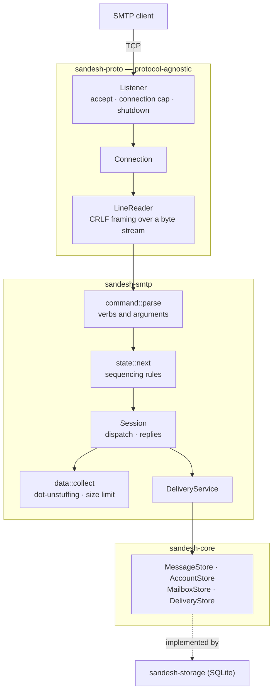
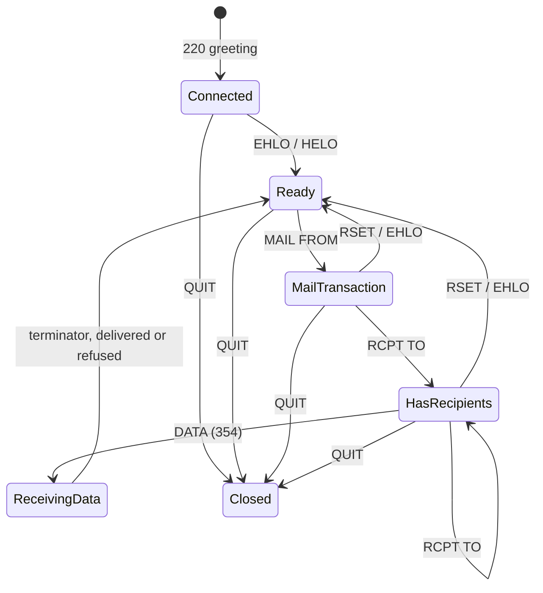
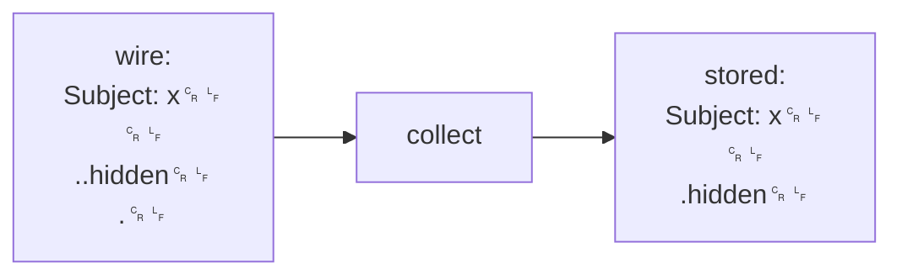
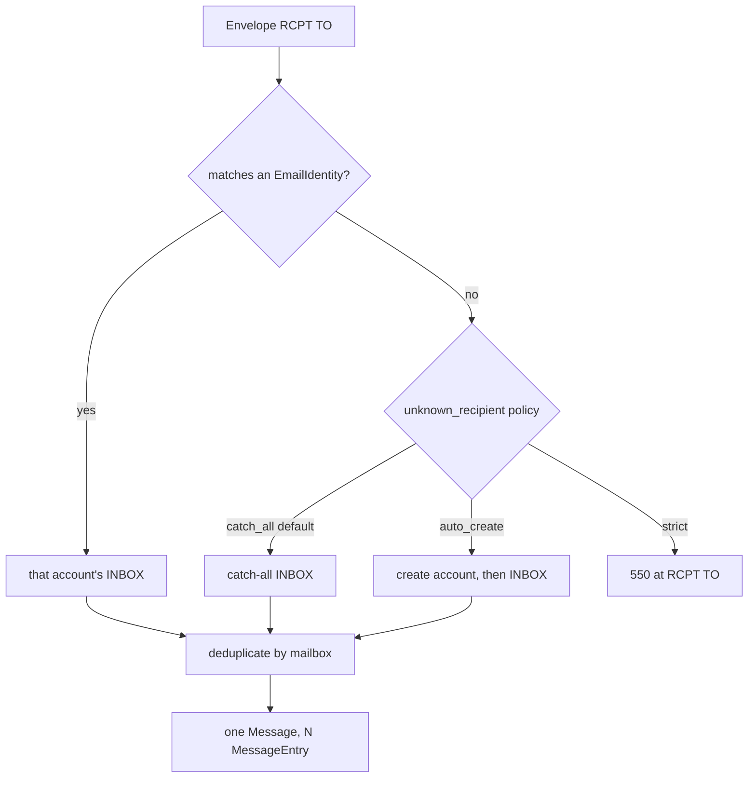

# Sandesh — SMTP Design

**Status:** Implemented and tested (Phase 2).

Sandesh's SMTP server is **ingress-only**. It accepts mail and hands it to the mail core, which
stores it locally. It is not an MTA, it has no queue, and it never relays — that last point is a
product safety property, not a missing feature.

---

## 1. Architecture



The SMTP crate has **no database dependency**. Every effect it has on stored mail goes through
`DeliveryService`, which calls the core's ports. `tests/architecture.rs` enforces this: adding
`sandesh-storage` or `sqlx` to `sandesh-smtp` fails the build.

### Layer responsibilities

| Layer | Owns | Deliberately does not own |
| --- | --- | --- |
| `LineReader` | Buffering, CRLF framing, line limits | Any notion of a command |
| `command` | Verb and argument syntax | Whether a command is allowed now |
| `state` | Sequencing rules | I/O, replies, side effects |
| `Session` | Dispatch, replies, transaction state | TCP buffering, SQL |
| `DeliveryService` | Routing, domain operations | Protocol vocabulary |

Separating framing from the state machine is what makes packet boundaries irrelevant, and it is the
shape IMAP and POP3 will reuse.

## 2. State machine



Sequencing lives in one pure function, `state::next(state, command) -> Transition`. Keeping it pure
means the whole matrix is testable with no socket, and every rejection is a visible decision rather
than a missing branch.

### Rules enforced

| Situation | Result | Authority |
| --- | --- | --- |
| Any transaction command before `EHLO`/`HELO` | `503` | RFC 5321 §4.1.4 |
| `RCPT TO` before `MAIL FROM` | `503` | RFC 5321 §3.3 |
| `DATA` with no accepted recipient | `503` | RFC 5321 §4.1.1.4 |
| `MAIL FROM` inside an open transaction | `503` | RFC 5321 §4.1.1.2 |
| `EHLO`/`HELO` mid-transaction | Accepted; transaction discarded | RFC 5321 §4.1.4 |
| `RSET` in any state | Accepted; returns to `Ready` | RFC 5321 §4.1.1.5 |
| `QUIT` in any state | `221`, connection closes | RFC 5321 §4.1.1.10 |

After a completed `DATA` — delivered *or* refused — the transaction is cleared and the session
returns to `Ready`. The reset happens before the delivery attempt, so no failure path can leave a
half-open transaction behind.

## 3. Commands

| Command | Reply | Notes |
| --- | --- | --- |
| `EHLO` | `250` multi-line | Capability list; resets any transaction |
| `HELO` | `250` single line | No capability list |
| `MAIL FROM` | `250` | `<>` accepted (bounce testing); `SIZE`, `BODY` honoured |
| `RCPT TO` | `250` / `550` / `452` | Multiple recipients; `550` only under `strict` |
| `DATA` | `354` then `250`/`552`/`451` | See §5 |
| `RSET` | `250` | Discards the transaction, keeps the connection |
| `NOOP` | `250` | Argument permitted and ignored (RFC 5321 §4.1.1.9) |
| `QUIT` | `221` | Closes |
| `VRFY` | `252` | Non-disclosing; see below |
| `EXPN` | `502` | Sandesh has no mailing lists |
| `HELP` | `250` | Brief command list |
| `BDAT` | `250` per chunk | CHUNKING (RFC 3030), Phase 8 A4 (ADR-088) |
| `ETRN`, `TURN`, `SEND`, … | `502` | Recognised, not implemented |

**`VRFY` returns `252` regardless of whether the address exists.** Confirming which addresses are
local would make the server an address-harvesting oracle, and Sandesh accepts mail for unknown
recipients anyway, so the answer carries no information worth disclosing.

**Recognised-but-unimplemented verbs get `502`, unknown verbs get `500`.** The difference tells a
client whether to stop asking or to report a bug.

### Parsing

The parser splits the verb from its arguments *before* comparing, so `MAILBOX` is not mistaken for
`MAIL`. `MAIL FROM:` and `RCPT TO:` are delimited by a colon rather than a space, and both are
handled explicitly. Verbs and keywords are case-insensitive throughout.

Command lines must be ASCII; a non-ASCII line is a syntax error rather than a panic or a lossy
conversion. Message *content* is unrestricted — see §6.

## 4. Capabilities

`EHLO` advertises exactly what works:

```text
250-sandesh greets client.test
250-SIZE 26214400
250-8BITMIME
250-PIPELINING
250-ENHANCEDSTATUSCODES
250-CHUNKING
250-AUTH PLAIN LOGIN
250 STARTTLS
```

(A cleartext connection with STARTTLS configured and auth offered; `AUTH` and `STARTTLS` are
conditional, see below.)

| Capability | Why it is honest |
| --- | --- |
| `SIZE` (RFC 1870) | Enforced during `DATA`; a declared `SIZE=` over the limit is refused at `MAIL FROM` |
| `8BITMIME` (RFC 6152) | Content is stored as bytes, so 8-bit is native |
| `PIPELINING` (RFC 2920) | The line reader buffers whatever arrives; batched commands work by construction |
| `ENHANCEDSTATUSCODES` (RFC 2034) | Every reply carries an enhanced code |
| `CHUNKING` (RFC 3030) | `BDAT` is implemented (ADR-088) |

**`AUTH` and `STARTTLS` are conditional.** `STARTTLS` appears only when the TLS mode advertises it
and the connection is not already encrypted (RFC 3207 §4.2). `AUTH PLAIN LOGIN` appears on an
encrypted connection, or on cleartext when `allow_cleartext_auth` permits it; otherwise it is
withheld until the upgrade (ADR-033). Advertising a capability that cannot succeed is the worst
failure mode an SMTP server has, so each line is gated on the same predicate that serves it.

Pipelining deserves a note: multiple commands arriving in one TCP segment must work *whether or not*
`PIPELINING` is advertised, because TCP does not preserve message boundaries. The capability is
advertised because the behaviour is genuinely correct, not the other way round.

## 5. DATA handling

Two transformations separate the wire from what is stored. Getting either wrong corrupts every
message.

**Termination.** Content ends at `<CRLF>.<CRLF>`. The terminator is framing and is never stored.

**Dot-unstuffing (RFC 5321 §4.5.2).** A client prefixes any content line beginning with `.` with a
second `.`. The server removes exactly one. A wire line `..hidden` is content `.hidden`; a wire line
`...` is content `..`.



**Size enforcement happens during collection, not after.** Otherwise a client could exhaust memory
before the rejection arrived. Once the limit is passed the buffer is dropped but reading continues
to the terminator, so the connection stays framed and the session can answer `552` and carry on
rather than disconnecting.

**Line endings are preserved.** A client sending bare LF gets bare LF back from storage. Normalising
would destroy the fidelity that justifies the product.

## 6. Bytes, not strings

Message content is never converted through `String`. A body may be 8-bit MIME, a binary attachment,
or deliberately invalid UTF-8 that a developer is testing. `LineReader` yields `&[u8]`, `data::collect`
builds `Vec<u8>`, and `RawMessage` stores those octets verbatim.

Command lines are the exception: they must be ASCII to name a verb at all.

The raw-fidelity test sends every fixture in `testdata/` — valid, encoded and malformed — through a
real TCP connection and asserts the stored bytes equal the transmitted bytes exactly.

## 7. Delivery semantics



Following `CORE_SPEC.md` §7:

1. **Envelope recipients decide placement**, never `To:`/`Cc:`. This is the only way `Bcc` testing
   works.
2. **One message, several placements.** Three recipients produce one stored message and three
   entries; the bytes are stored once.
3. **Two recipients resolving to one mailbox produce one entry.** Deduplication happens before the
   insert; both addresses still appear on the delivery record.
4. **Nothing is relayed, ever.**
5. **Delivery is atomic.** The message, its placements and their UIDs are one transaction.

### When a recipient resolves to nothing

Under the default `catch_all` policy with no catch-all account configured, the message is **stored
with no placement** and the delivery record says why. Accepting a message with `250` and then
silently discarding it would be worse: the sender believes it was delivered, and a developer
debugging a missing message has nothing to find.

### The delivery record

Every transaction writes a `deliveries` row plus one `delivery_recipients` row per envelope
recipient, recording what each resolved to and which placement it produced. This is where Phase 1's
**OD-16 is resolved**: `Message` carries an envelope whose `rcpt_to` comes back empty from
`MessageStore::get`, because recipients are multi-valued and belong to the delivery rather than to
immutable message content. `DeliveryStore` supplies them.

## 8. Reply codes

| Code | When |
| --- | --- |
| `220` | Greeting |
| `221` | `QUIT` |
| `250` | Command accepted; message delivered |
| `252` | `VRFY` — cannot verify, will accept |
| `354` | `DATA` invitation |
| `421` | Idle timeout; shutting down |
| `451` | Internal failure — client may retry |
| `452` | Too many recipients |
| `500` | Unrecognised verb |
| `501` | Malformed arguments; oversized command line |
| `502` | Recognised but not implemented |
| `503` | Bad command sequence |
| `504` | Parameter recognised but unsupported |
| `550` | No such user (`strict` policy only) |
| `552` | Message exceeds the size limit |

All replies carry an RFC 3463 enhanced status code, since `ENHANCEDSTATUSCODES` is advertised.

**Internal error detail never reaches the client.** `451` carries a fixed message; the underlying
cause is logged. Exposing a storage error to a sender leaks implementation detail and tells them
nothing useful.

## 9. Limits and timeouts

| Setting | Default | Rationale |
| --- | --- | --- |
| `max_message_size` | 25 MiB | Matches the advertised `SIZE`; enforced during `DATA` |
| `max_line_length` | 64 KiB | Far above any legitimate command; bounds a client that never sends CRLF |
| `max_recipients` | 100 | RFC 5321 §4.5.3.1.8 requires at least this |
| `max_connections` | 64 | Enforced by semaphore permit, held for the session's life |
| `command_timeout` | 5 minutes | RFC 5321 §4.5.3.2 |
| `data_timeout` | 10 minutes | RFC 5321 §4.5.3.2 |

The connection cap is applied **before** accepting: waiting for a permit leaves excess connections
in the kernel backlog, which is where backpressure belongs. Accepting and then rejecting would mean
the server creates the sockets it cannot serve.

Timeouts are generous by design. Aggressive defaults would break ordinary development — a developer
stepping through a debugger mid-transaction is a normal thing to do.

## 10. Error recovery

| Failure | Response | Connection |
| --- | --- | --- |
| Unknown verb | `500` | Stays open |
| Malformed arguments | `501` | Stays open |
| Bad sequence | `503` | Stays open |
| Oversized command line | `501` | Stays open, input resynchronised |
| Oversized message | `552` | Stays open, transaction reset |
| Recipient refused | `550` | Stays open, transaction intact |
| Storage failure | `451` | Stays open |
| Idle timeout | `421` | Closes |
| `DATA` read failure | `421` | Closes — the stream is desynchronised |
| Peer disconnect | — | Closes quietly |

A protocol error is answerable and the session continues. Only a desynchronised or dead stream
closes the connection, because after those the server can no longer tell content from commands.

## 11. Security

| Property | How |
| --- | --- |
| Loopback by default | `SmtpConfig::default().bind` is `127.0.0.1:1025` |
| External binding warns | `SmtpConfig::warnings()` reports binding externally without auth or TLS |
| No relay | Delivery is always terminal and local; no outbound path exists |
| No unbounded allocation | Line and message limits enforced during reading |
| No connection exhaustion | Semaphore cap, permit held for the session |
| No slow-client holds | Command and `DATA` timeouts |
| Message bodies not logged | Logs carry ids, counts and peers — never content |
| No SQL from SMTP | Enforced mechanically by the architecture test |
| Input treated as untrusted | Bytes throughout; no UTF-8 assumptions; no panics on malformed input |

Sandesh accepts mail without authentication (ADR-005), which is why the loopback default matters:
it is the thing standing between a developer and an open mail server.

## 12. Future AUTH and TLS

Phase 4.5 adds both. The seams already exist:

* `AuthMode` and `TlsMode` are in the configuration and consulted when building the capability list.
  Implementing a mechanism means changing `is_enabled` to consult the mode rather than returning
  `false` — the capability then appears automatically.
* The state machine needs no new state. An `AUTH`-required posture is expressed by making
  `MAIL FROM` return `Transition::rejected` for an unauthenticated session, which the type already
  supports.
* `Connection` is generic over its transport, so a TLS stream substitutes without touching any
  protocol code. `LineReader::into_parts` returns the stream *and* any buffered bytes, which is what
  a `STARTTLS` upgrade needs — note RFC 3207 §4 requires discarding buffered input across that
  boundary rather than trusting it.

## 13. Known limitations

| Limitation | Reason |
| --- | --- |
| ~~No `AUTH` or `STARTTLS`~~ | **Done in Phase 4.5** — `AUTH PLAIN`/`LOGIN`, `STARTTLS` (ADR-036) and implicit TLS (ADR-037) |
| No `SMTPUTF8` | Phase 7; rejected with `504` rather than silently accepted |
| ~~No `BDAT`/`CHUNKING`~~ | **Done in Phase 8 A4** (ADR-088). A second content path: no dot-stuffing, a declared octet count, a reply per chunk. A test compares the bytes stored by `DATA` and by `BDAT` for the same message, because a second ingestion path is a second chance to corrupt content |
| No `DSN` | Deferred |
| Shutdown does not drain sessions | Accept stops immediately; in-flight sessions finish on their own, bounded by their timeouts. Cutting an in-progress `DATA` would lose a message the client believes is being accepted |
| ~~No per-connection protocol trace persisted~~ | **Done in Phase 7** (ADR-066). Transcripts live on a `connections` table, not `deliveries.trace`, which was dropped: one connection can carry many deliveries or none. Commands and replies are recorded; `DATA` becomes a byte count and credentials never enter the buffer |
| No rate limiting | Beyond the connection cap; Phase 0 does not require it |

## 14. Testing

| Layer | Location | Count |
| --- | --- | --- |
| Unit — parsing, state, replies, framing | `src/*.rs` | 56 |
| Transport — framing, listener, limits | `sandesh-proto/src/*.rs` | 21 |
| Configuration | `sandesh-config/src/lib.rs` | 7 |
| Delivery over TCP | `tests/delivery.rs` | 11 |
| Protocol behaviour over TCP | `tests/protocol.rs` | 23 |
| Concurrency and framing | `tests/concurrency.rs` | 8 |
| Real client (Python `smtplib`) | `tests/real_client.rs` | 3 |
| Architecture isolation | `tests/isolation.rs` | 2 |

Every integration test binds an **ephemeral port**, so the suite is parallel-safe and has no fixed
port collisions. Servers are cancelled on drop, leaving no orphaned tasks.

The `smtplib` tests matter disproportionately: driving our server with our own client would let a
shared misreading of the specification pass unnoticed. An independent implementation makes them
interoperability tests rather than self-consistency tests.
