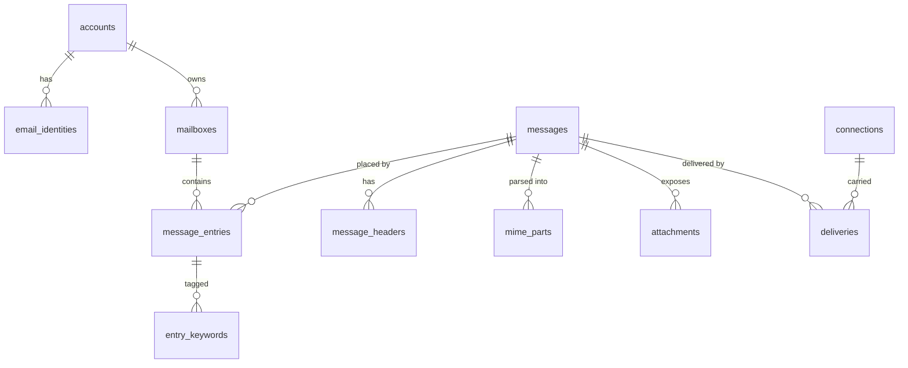

# Sandesh — Storage Design

**Status:** Implemented (Phase 1 onward), through migration `0009_webhook_signing.sql`. The SQL
here is the specification and is kept current with `migrations/`; where the two differ the
migrations win. Message retention (§5) is specified but **not yet implemented**; only the
connection-record cap is — see §10.

---

## 1. Decisions

| Decision | Choice | Reason |
| --- | --- | --- |
| Database | SQLite (WAL) | Zero-configuration, embeddable, single-file — matches the single-binary product. Correct for a local tool |
| Access layer | `sqlx` with compile-time-checked queries | Verifies SQL against the real schema at build time; async; no ORM abstraction over a schema that must be shaped by IMAP semantics |
| Raw message storage | **Hybrid**: inline BLOB below 256 KiB, filesystem blob above | §4 |
| Attachments | Byte ranges into the raw message; decoded bytes cached only on demand | Never store the same bytes twice |
| Search | SQLite FTS5, external-content table | §7 |
| Migrations | `sqlx::migrate!`, forward-only, embedded in the binary | §8 |

**Why not an ORM.** The schema's shape is dictated by IMAP (per-mailbox UIDs, entry-level flags,
message sharing). An ORM's object graph would fight that. `sqlx` gives type safety without hiding SQL.

**PostgreSQL later.** Every query goes through the `MessageStore`/`MailboxStore` traits, so a Postgres
backend is an additive crate. Concretely, we avoid SQLite-only constructs in schema design where a
portable equivalent exists, and isolate FTS5 behind the `SearchIndex` trait — that is the only piece
that would need a real rewrite (to `tsvector`). No further Postgres accommodation is made now.

## 2. Schema



### 2.1 Accounts and identities

```sql
CREATE TABLE accounts (
    id              BLOB PRIMARY KEY,          -- UUID v7 (time-ordered)
    username        TEXT NOT NULL UNIQUE,
    credential_hash TEXT,                      -- Argon2id; NULL = no credential set
    credential_plain TEXT,                     -- only when CRAM-MD5 is enabled for this account
    is_catch_all    INTEGER NOT NULL DEFAULT 0,
    created_at      INTEGER NOT NULL           -- unix micros, UTC
) STRICT;

CREATE TABLE email_identities (
    id          BLOB PRIMARY KEY,
    account_id  BLOB NOT NULL REFERENCES accounts(id) ON DELETE CASCADE,
    address     TEXT NOT NULL,                 -- normalised: local@lowercased-domain
    address_raw TEXT NOT NULL,                 -- as supplied
    is_primary  INTEGER NOT NULL DEFAULT 0
) STRICT;

CREATE UNIQUE INDEX idx_identity_address ON email_identities(address);
CREATE INDEX idx_identity_account ON email_identities(account_id);
```

`STRICT` tables (SQLite 3.37+) enforce column types — worth having, given every message boundary is a
place a type error could silently corrupt mail. Only one account may be `is_catch_all`; enforced by a
partial unique index.

### 2.2 Mailboxes

```sql
CREATE TABLE mailboxes (
    id            BLOB PRIMARY KEY,
    account_id    BLOB NOT NULL REFERENCES accounts(id) ON DELETE CASCADE,
    name          TEXT NOT NULL,               -- full path, '/' delimiter, Unicode NFC
    parent_id     BLOB REFERENCES mailboxes(id) ON DELETE CASCADE,
    uid_validity  INTEGER NOT NULL,
    uid_next      INTEGER NOT NULL DEFAULT 1,
    attributes    TEXT NOT NULL DEFAULT '',    -- CSV: \Sent,\Trash,\Noselect,...
    subscribed    INTEGER NOT NULL DEFAULT 1,
    created_at    INTEGER NOT NULL,
    -- CONDSTORE high-water mark (migration 0002, ADR-059). RFC 7162 §3 requires
    -- a non-zero HIGHESTMODSEQ for any mailbox ever reported, so the base is 1.
    highest_mod_seq INTEGER NOT NULL DEFAULT 1
) STRICT;

CREATE UNIQUE INDEX idx_mailbox_name ON mailboxes(account_id, name);
CREATE INDEX idx_mailbox_parent ON mailboxes(parent_id);
```

`uid_next` lives here, not in a global sequence — UIDs are per-mailbox (RFC 9051 §2.3.1.1). It is
updated in the same transaction that inserts an entry, which serialises UID assignment per mailbox.

### 2.3 Messages — immutable content

```sql
CREATE TABLE messages (
    id             BLOB PRIMARY KEY,
    sha256         BLOB NOT NULL,
    size           INTEGER NOT NULL,           -- RFC822.SIZE, authoritative
    raw_inline     BLOB,                       -- set iff size <= threshold
    raw_blob_ref   TEXT,                       -- set iff stored externally (blob store reference)
    received_at    INTEGER NOT NULL,

    -- envelope (SMTP transaction, distinct from headers)
    env_mail_from  TEXT,                       -- NULL = null reverse-path <>
    env_helo       TEXT,
    env_peer       TEXT,
    env_tls        TEXT,
    env_auth_ident TEXT,

    -- denormalised parsed fields, for list rendering and search without reparsing
    hdr_subject    TEXT,
    hdr_from       TEXT,
    hdr_to         TEXT,
    hdr_cc         TEXT,
    hdr_bcc        TEXT,
    hdr_date       INTEGER,
    hdr_message_id TEXT,
    hdr_in_reply_to TEXT,

    has_attachments INTEGER NOT NULL DEFAULT 0,
    has_inline      INTEGER NOT NULL DEFAULT 0,
    parse_version   INTEGER NOT NULL,          -- invalidates derived data on parser upgrade
    parse_ok        INTEGER NOT NULL DEFAULT 1,

    CHECK ((raw_inline IS NULL) != (raw_blob_ref IS NULL))
) STRICT;

CREATE INDEX idx_messages_received ON messages(received_at DESC);
CREATE INDEX idx_messages_sha256   ON messages(sha256);
CREATE INDEX idx_messages_msgid    ON messages(hdr_message_id);
```

The `CHECK` constraint enforces the storage invariant: raw bytes live in exactly one place, always.
The denormalised `hdr_*` columns are a deliberate, documented duplication — rendering a 500-row inbox
must not require parsing 500 messages. They are derived and rebuilt on reparse; the raw bytes remain
authoritative.

`env_rcpt_to` is *not* a column here: recipients are multi-valued and recorded per-delivery (§2.7).

### 2.4 `message_entries` — the linchpin

```sql
CREATE TABLE message_entries (
    id             BLOB PRIMARY KEY,
    message_id     BLOB NOT NULL REFERENCES messages(id) ON DELETE CASCADE,
    mailbox_id     BLOB NOT NULL REFERENCES mailboxes(id) ON DELETE CASCADE,
    uid            INTEGER NOT NULL,
    flags          INTEGER NOT NULL DEFAULT 0,  -- bitmask: system flags
    internal_date  INTEGER NOT NULL,            -- IMAP INTERNALDATE
    added_at       INTEGER NOT NULL,
    mod_seq        INTEGER NOT NULL DEFAULT 1,  -- CONDSTORE; drawn from the mailbox (0002)

    CHECK (uid > 0)
) STRICT;

CREATE UNIQUE INDEX idx_entry_uid       ON message_entries(mailbox_id, uid);

-- Added in Phase 1 (ADR-013): a message may be placed in a mailbox only once.
-- CORE_SPEC §7.3 specifies this as a routing rule; enforcing it in the schema
-- guards it against concurrent writers too.
CREATE UNIQUE INDEX idx_entry_unique_placement
    ON message_entries(mailbox_id, message_id);
CREATE INDEX        idx_entry_message   ON message_entries(message_id);
CREATE INDEX        idx_entry_flags     ON message_entries(mailbox_id, flags);
CREATE INDEX        idx_entry_intdate   ON message_entries(mailbox_id, internal_date);

CREATE TABLE entry_keywords (
    entry_id BLOB NOT NULL REFERENCES message_entries(id) ON DELETE CASCADE,
    keyword  TEXT NOT NULL,
    PRIMARY KEY (entry_id, keyword)
) STRICT;
```

**This table is why the brief warned against `messages.mailbox_id`.** IMAP `COPY` puts one message in
two mailboxes with two UIDs and two independent flag sets. A single-owner column cannot express that;
it would force duplicating the message row, which breaks the raw-bytes-stored-once guarantee and makes
"the same message" unidentifiable across mailboxes.

System flags are a bitmask (fixed set of five, per RFC 9051), and keywords are a side table (open set).
`idx_entry_uid` also serves IMAP's most common access pattern: UID range scans within a mailbox.

### 2.5 Parsed structure

```sql
CREATE TABLE message_headers (
    message_id  BLOB NOT NULL REFERENCES messages(id) ON DELETE CASCADE,
    ordinal     INTEGER NOT NULL,        -- order as received; significant for Received:/DKIM
    name        TEXT NOT NULL,           -- case preserved
    name_lower  TEXT NOT NULL,           -- for lookup
    raw_value   BLOB NOT NULL,           -- exact bytes, folding intact
    decoded_value TEXT,                  -- RFC 2047 decoded, best effort
    byte_start  INTEGER NOT NULL,
    byte_end    INTEGER NOT NULL,
    PRIMARY KEY (message_id, ordinal)
) STRICT;

CREATE INDEX idx_headers_name ON message_headers(message_id, name_lower);

CREATE TABLE mime_parts (
    message_id    BLOB NOT NULL REFERENCES messages(id) ON DELETE CASCADE,
    part_path     TEXT NOT NULL,         -- IMAP part number: "1", "2.1", "2.1.3"
    parent_path   TEXT,
    content_type  TEXT NOT NULL,
    charset       TEXT,
    encoding      TEXT NOT NULL,
    disposition   TEXT,
    filename      TEXT,
    content_id    TEXT,
    body_start    INTEGER NOT NULL,      -- byte range into raw
    body_end      INTEGER NOT NULL,
    header_start  INTEGER NOT NULL,
    header_end    INTEGER NOT NULL,
    decoded_size  INTEGER,
    is_attachment INTEGER NOT NULL DEFAULT 0,
    PRIMARY KEY (message_id, part_path)
) STRICT;
```

`part_path` uses IMAP's own part numbering, so `FETCH BODY[2.1]` is a direct lookup followed by a
byte-range read from the raw message. Bodies are never copied.

### 2.6 Attachments

```sql
CREATE TABLE attachments (
    id            BLOB PRIMARY KEY,
    message_id    BLOB NOT NULL REFERENCES messages(id) ON DELETE CASCADE,
    part_path     TEXT NOT NULL,
    filename      TEXT,
    content_type  TEXT NOT NULL,
    content_id    TEXT,
    size          INTEGER NOT NULL,      -- decoded size
    is_inline     INTEGER NOT NULL DEFAULT 0,
    cache_ref     TEXT,                  -- decoded bytes cached on disk, may be NULL/evicted
    FOREIGN KEY (message_id, part_path) REFERENCES mime_parts(message_id, part_path)
) STRICT;

CREATE INDEX idx_attach_message ON attachments(message_id);
```

An `attachments` row is a **view** over a `mime_parts` row, carrying only the metadata needed to list
and download without walking the tree. `cache_ref` is a pure cache: deleting it loses nothing,
because the bytes are always recoverable from raw.

### 2.7 Deliveries

```sql
CREATE TABLE deliveries (
    id            BLOB PRIMARY KEY,
    message_id    BLOB REFERENCES messages(id) ON DELETE CASCADE,
    source        TEXT NOT NULL,         -- 'smtp' | 'imap_append' | 'api'
    peer          TEXT,
    mail_from     TEXT,
    helo          TEXT,
    received_at   INTEGER NOT NULL,
    duration_us   INTEGER NOT NULL,
    -- The conversation that produced this delivery (ADR-066). Nullable: an API
    -- injection has no connection. The transcript itself lives on that row,
    -- because one connection can produce many deliveries or none.
    connection_id BLOB REFERENCES connections(id) ON DELETE SET NULL,
    -- Set when this delivery re-ran a stored message (migration 0008).
    replay_of_message_id BLOB REFERENCES messages(id) ON DELETE SET NULL
) STRICT;

CREATE TABLE delivery_recipients (
    delivery_id  BLOB NOT NULL REFERENCES deliveries(id) ON DELETE CASCADE,
    rcpt_to      TEXT NOT NULL,
    resolved_account_id BLOB REFERENCES accounts(id) ON DELETE SET NULL,
    entry_id     BLOB REFERENCES message_entries(id) ON DELETE SET NULL,
    outcome      TEXT NOT NULL,          -- 'delivered' | 'rejected' | 'catch_all'
    reason       TEXT,
    PRIMARY KEY (delivery_id, rcpt_to)
) STRICT;
```

`message_id` is nullable: a transaction the server refused outright — an oversize message — stores
no message and is still recorded, because "the message never arrived" is the question the delivery
view most often has to answer. Such a record is reachable through `GET /api/v1/deliveries` rather
than through a message.

This is what answers "why did this land here?" — the highest-value debugging question a mail tool
can answer, and one Sandesh should answer better than the prior art.

### 2.7.1 Message rules (migration 0007)

```sql
CREATE TABLE rules (
    id         BLOB PRIMARY KEY,        -- UUID v7, time-ordered
    name       TEXT NOT NULL,           -- shown in the delivery record
    conditions TEXT NOT NULL,           -- JSON array; see `sandesh-core::rules`
    action     TEXT NOT NULL,           -- JSON object
    enabled    INTEGER NOT NULL DEFAULT 1,
    created_at INTEGER NOT NULL         -- microseconds since the epoch
) STRICT;

CREATE TABLE delivery_rules (
    delivery_id BLOB NOT NULL REFERENCES deliveries(id) ON DELETE CASCADE,
    rule_id     BLOB NOT NULL,          -- not a FK
    rule_name   TEXT NOT NULL,          -- as it stood when it fired
    keyword     TEXT NOT NULL,          -- what was added
    PRIMARY KEY (delivery_id, rule_id, keyword)
) STRICT;
```

### 2.7.2 Webhooks (migrations 0006, 0009)

```sql
CREATE TABLE webhook_endpoints (
    id          BLOB PRIMARY KEY,          -- UUID v7, time-ordered
    url         TEXT NOT NULL,
    enabled     INTEGER NOT NULL DEFAULT 1,
    created_at  INTEGER NOT NULL,          -- microseconds since the epoch
    secret      TEXT                       -- signing secret (0009)
) STRICT;

CREATE TABLE webhook_outbox (
    id              BLOB PRIMARY KEY,      -- UUID v7, time-ordered
    endpoint_id     BLOB NOT NULL REFERENCES webhook_endpoints(id) ON DELETE CASCADE,
    payload         TEXT NOT NULL,         -- JSON body, built at enqueue time
    attempts        INTEGER NOT NULL DEFAULT 0,
    next_attempt_at INTEGER NOT NULL,      -- microseconds since the epoch
    status          TEXT NOT NULL,         -- 'pending' | 'delivered' | 'failed'
    last_error      TEXT,                  -- why the most recent attempt failed
    created_at      INTEGER NOT NULL,
    updated_at      INTEGER NOT NULL
) STRICT;
```

### 2.8 Connections

```sql
CREATE TABLE connections (
    id          BLOB PRIMARY KEY,
    protocol    TEXT NOT NULL,           -- 'smtp' | 'imap' | 'pop3'
    peer        TEXT,
    encrypted   INTEGER NOT NULL DEFAULT 0,
    opened_at   INTEGER NOT NULL,
    closed_at   INTEGER,                 -- NULL while the connection is open
    disposition TEXT,                    -- NULL while open
    transcript  TEXT,                    -- newline-separated protocol lines
    truncated   INTEGER NOT NULL DEFAULT 0
) STRICT;
```

One row per **accepted socket**, not per session: a `STARTTLS` upgrade runs a second session over
the same socket and appends to the same transcript, which is exactly the case a developer
debugging a handshake needs to see whole (ADR-066).

The row is written when the socket is accepted and upserted when it closes. That ordering is not
cosmetic — `deliveries.connection_id` is a foreign key onto it, and a delivery is recorded *during*
the session, so a row written only at close would leave every delivery pointing at nothing.

**A transcript is deliberately not a byte-exact recording.** Command and response lines only:
`DATA` payloads and IMAP literals are replaced with a byte count, and credentials never enter the
buffer at all. A developer mail server holds password-reset links and one-time codes, and a
transcript is a log (see the logging module's rationale). The message itself is retrievable through
the API, which is where it belongs.

Growth is bounded twice: per connection by line and byte caps, and across the table by a
connection-count cap pruned as connections close (`trace_retention`, default 1000). This is the
reasoning §5 applies to messages — note that here it is actually implemented, and there it is not.

### 2.9 Servers and metadata

```sql
CREATE TABLE server_state (
    name        TEXT PRIMARY KEY,        -- 'smtp' | 'imap' | 'pop3' | 'http'
    bound_addr  TEXT,
    started_at  INTEGER,
    status      TEXT NOT NULL
) STRICT;

CREATE TABLE meta (
    key   TEXT PRIMARY KEY,
    value TEXT NOT NULL
) STRICT;                                -- schema_version, instance_id, parse_version
```

## 3. Configuration for SQLite

```sql
PRAGMA journal_mode = WAL;        -- concurrent readers with one writer: exactly our shape
PRAGMA synchronous = NORMAL;      -- safe under WAL; a dev tool need not fsync every commit
PRAGMA foreign_keys = ON;         -- per connection; not the SQLite default
PRAGMA busy_timeout = 5000;
PRAGMA temp_store = MEMORY;
```

**Connection pooling:** a pool of readers plus **exactly one writer connection**. SQLite permits one
writer; serialising in the pool avoids `SQLITE_BUSY` under concurrent SMTP delivery, and gives the
per-mailbox UID serialisation the domain requires (CORE_SPEC §11).

## 4. Raw message storage — the hybrid decision

| Option | Assessment |
| --- | --- |
| Always inline BLOB | Simple, transactional, but bloats the DB and slows full scans when a 20 MB attachment sits in a row |
| Always filesystem | Keeps the DB small, but loses atomicity and creates orphan-file risk on crash |
| **Hybrid (chosen)** | Inline below **256 KiB**, external above |

Rationale: the overwhelming majority of test messages are small, and for those, inline storage keeps
delivery a single atomic transaction with no orphan risk. Large messages are rare and are exactly the
ones that hurt when inline. 256 KiB sits above typical HTML mail with inline images and below anything
that would strain a row read.

**External layout:** `<data_dir>/blobs/<sha256[0:2]>/<sha256[2:4]>/<sha256>` — content-addressed, so
writes are idempotent and identical bytes stored twice cost one file.

**Crash safety:** blob written and fsynced *before* the `messages` row is committed. A crash between
the two leaves an orphan file, never a dangling reference. Orphans are reclaimed by a startup sweep.

## 5. Deletion and retention

**Deletion order**, always: entries → check message references → GC message → GC blob.

```sql
-- a message becomes garbage when nothing references it
DELETE FROM messages WHERE id NOT IN (SELECT message_id FROM message_entries);
```

Message GC runs after expunge operations and on a periodic sweep, not synchronously in the delivery
path. Blob deletion is deferred to the same sweep, so a crash mid-delete leaves a reclaimable orphan
rather than a dangling reference.

**Retention.** Specified here; **only the two rows marked implemented exist in code today** (see
§10). The message caps are a design intent, not a current behaviour — nothing evicts messages yet,
so a long-running instance grows without bound.

| Policy | Default | Behaviour | State |
| --- | --- | --- | --- |
| Max messages | 5000 | Oldest entries evicted when exceeded | **Not implemented** |
| Max total size | unset | Oldest evicted when exceeded | **Not implemented** |
| Max age | unset | Periodic sweep | **Not implemented** |
| Max message size | 25 MiB | Rejected at SMTP with `552` | Implemented (`max_message_size`) |
| Max connection records | 1000 | Oldest pruned as connections close | Implemented (`trace_retention`) |

The intent behind a message cap being on by default is to stop a runaway test suite filling a
developer's disk; 5000 is generous for development while bounding worst-case growth. Until it is
built, that protection does not exist.

## 6. Indexing strategy

Every index is justified by a specific access pattern:

| Index | Serves |
| --- | --- |
| `idx_entry_uid` (unique) | IMAP UID FETCH/SEARCH ranges; enforces UID uniqueness |
| `idx_entry_mailbox` | SELECT/STATUS counts, sequence-number ordering |
| `idx_entry_flags` | `SEARCH UNSEEN`, unread badges |
| `idx_entry_intdate` | `SEARCH SINCE/BEFORE`, date sorting |
| `idx_entry_message` | Reverse lookup for GC and "which mailboxes hold this" |
| `idx_messages_received` | Inbox list, default ordering |
| `idx_messages_sha256` | Dedup and integrity checks |
| `idx_headers_name` | `FETCH BODY[HEADER.FIELDS (...)]`, `SEARCH HEADER` |
| `idx_identity_address` | Delivery routing — on the hot path of every RCPT TO |
| `idx_entry_mod_seq` | `CHANGEDSINCE` / `QRESYNC` scans within one mailbox (migration 0002) |
| `idx_deliveries_message` | "How did *this* message get here?" — the Delivery view's lookup |
| `idx_deliveries_connection` | Deliveries carried by one connection, for the trace view |
| `idx_connections_opened` | Recent-connections listing in the trace viewer |
| `idx_deliveries_replay_of` | Replays of one message (partial, migration 0008) |
| `idx_outbox_due` | The webhook worker's due-attempt scan (migration 0006) |
| `idx_outbox_endpoint` | Outbox listing per endpoint, newest first (migration 0006) |
| `idx_connections_protocol` | The same listing filtered to one protocol |

## 7. Search

**Built** (ADR-074), in `migrations/0005_search_index.sql`, with two corrections to what this section
originally specified — one of them a real defect:

```sql
CREATE VIRTUAL TABLE messages_fts USING fts5(
    message_id UNINDEXED,
    subject, from_addr, to_addr, cc_addr, body_text,
    tokenize = 'trigram'
);
```

**`trigram`, not `unicode61` — this section was wrong.** `unicode61` tokenises into *words*, and
RFC 9051 §6.4.4 defines the IMAP text keys as **substring** matches. A word index cannot answer a
substring query: the body `xfoobar` contains `foo`, but no token begins with it, so `SEARCH BODY
"foo"` would have excluded that message. That is a **false negative** — mail that exists and is not
found — and it is the one error an index may never make. `trigram` indexes every three-character
sequence and matches substrings case-insensitively, which is exactly the required semantics. The
cost is a larger index and a three-character minimum; shorter queries fall back to a scan.

**Not an external-content table.** `messages.id` is a 16-byte BLOB primary key, not a rowid alias,
so `content_rowid` would need a rowid→id join on every lookup and would depend on rowids surviving
`VACUUM`, which SQLite does not promise. `messages_fts_map` holds the id→rowid mapping instead, and
the index can be dropped and rebuilt from `messages` alone.

`body_text` is every non-multipart part, **decoded** — the same set and the same form
`SearchQuery::matches` compares against, so a base64 body cannot be indexed as base64 while being
searched as text. Index maintenance is explicit and happens **in the same transaction** as the
write it mirrors, so a committed message is never missing from the index.

Two search surfaces, one index:
- **REST/UI search** uses Mailpit-style filter syntax (`from:`, `subject:`, `is:unread`,
  `has:attachment`, `larger:`, `before:`) parsed into a query plan. Sandesh adopts this *syntax family*
  because it is the familiar convention among developer mail tools; the parser and implementation are
  our own.
- **IMAP SEARCH** compiles RFC 9051 search keys into the same plan. `BODY`/`TEXT` keys use FTS5;
  flag, date and size keys use the B-tree indexes. Both surfaces produce `SearchQuery`, a domain type,
  so results cannot diverge between UI and IMAP.

FTS5 is behind the `SearchIndex` trait — the one component a Postgres backend would genuinely
rewrite, since `tsvector` and FTS5 share no syntax.

**The trait is a prefilter, not an oracle.** `SearchIndex::candidates` returns `SearchCandidates`,
which is either `Candidates(set)` — a **superset** of the matches — or `Unsupported`, meaning "I
cannot narrow this; scan everything". `SearchQuery::matches` still decides every result. Making "I
don't know" a variant rather than an empty result is deliberate: a `Vec<MessageId>` would express
"nothing matched" and "I could not tell" identically, and the second silently becoming the first is
a search that quietly stops finding mail while every test still passes.

The index declines to narrow whenever it cannot guarantee a superset: values shorter than a trigram,
fields it does not store in their own column (`Bcc`, `Header(_)`, `Text`), any `Not` (complementing
a superset yields a *subset*, the forbidden direction), an `Or` with even one unnarrowable branch,
and — the repair path — whenever any message is missing from the index at all.

`NullSearchIndex` implements the trait by narrowing nothing, and is what the in-memory test doubles
use. Every search must return identical results with it in place; the parity tests in
`crates/sandesh-storage/tests/search_index.rs` assert exactly that against the real index over the
fixture corpus.

## 8. Migrations

- `sqlx::migrate!` with numbered, forward-only SQL files in `migrations/`, embedded in the binary.
- Applied automatically at startup; version recorded in `_sqlx_migrations`.
- **No down-migrations.** For a local dev tool, "delete the data directory" is a faster, more honest
  recovery path than maintaining reversibility.
- A schema-version check refuses to start against a *newer* database than the binary understands,
  rather than corrupting it.
- `parse_version` in `meta` is separate from the schema version: a parser upgrade triggers a
  background reparse of derived data (headers, MIME parts, FTS) from the untouched raw bytes.
  This is the payoff of keeping raw authoritative.

## 9. Open decisions

- **OD-4** Inline/external threshold of 256 KiB is a considered estimate, not a measured one.
  Benchmark in Phase 1 against a realistic corpus.
- **OD-5** Whether `body_text` for FTS should be stored (a column) or recomputed. Storing costs disk
  and duplicates content; recomputing costs CPU on reindex. *Leaning: store, in a `messages_search_src`
  view backed by a real column, and accept the duplication.*
- **OD-1** (from CORE_SPEC) Cross-delivery message dedup by `sha256`. The `idx_messages_sha256` index
  exists to make this possible later without a migration.

---

## 10. Implementation status (Phase 1; deltas noted through Phase 7)

The schema above is implemented in `migrations/0001_initial_schema.sql` and is
exercised by the storage integration tests. Deltas from the Phase 0 design, all
small and recorded here rather than applied silently:

| Change | Reason |
| --- | --- |
| `raw_blob_path` → `raw_blob_ref` | The value is a content-addressed reference the `BlobStore` resolves, not a filesystem path. A `PostgreSQL`/S3 backend would use the same column with a different resolution scheme. |
| `attachments.cache_path` → `cache_ref` | Same reasoning. |
| Added `idx_entry_unique_placement` | ADR-013 — enforces `CORE_SPEC` §7.3 in the schema. |
| Added `deliveries.helo` | The envelope's HELO domain had nowhere to go on the delivery record. |
| Added `CHECK` constraints throughout | Boolean columns constrained to `(0, 1)`, `uid > 0`, `length(id) = 16`, `length(sha256) = 32`, enumerations constrained to their permitted values. Cheap, and they turn a class of corruption into an immediate error. |
| `mime_parts` column order | `header_start`/`header_end` precede `body_start`/`body_end`, matching their order in the message. Cosmetic. |
| Not yet created: `server_state` | Nothing writes it until Phase 2 starts a listener. |

**Not yet implemented, by design:**

* ~~**FTS5 index** (§7)~~ — **built** (ADR-074). `SearchQuery` remains the one
  plan both the REST filter syntax and IMAP `SEARCH` compile into and remains
  the authority on every result; the index narrows which messages are loaded to
  evaluate it. It is still a *scaling* optimisation rather than a capability —
  nothing a user can ask for depends on it, which is what `NullSearchIndex` and
  the parity tests assert.
* **Retention policies** (§5) — no policy is enforced and nothing evicts
  messages. Not required by any phase's acceptance criteria (`ROADMAP.md` does
  not list retention as a deliverable); tracked here as design intent. The
  connection-record cap of §2.8 is separate and *is* implemented.
* **Message deduplication** (OD-1) — `idx_messages_sha256` exists so this can be
  added later without a migration.
* **Parse diagnostics persistence** — ADR-014.

**Verified by tests:** foreign-key enforcement, `STRICT` typing, the
inline/external `CHECK`, UID uniqueness, UID-0 rejection, single catch-all
account, transaction rollback leaving no partial state, and 40-way concurrent
UID assignment producing distinct contiguous UIDs.
