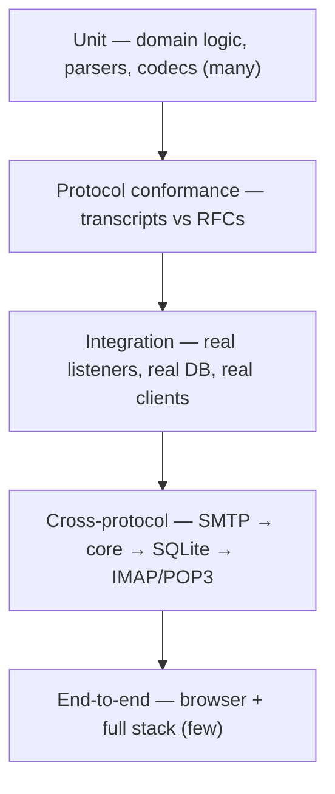
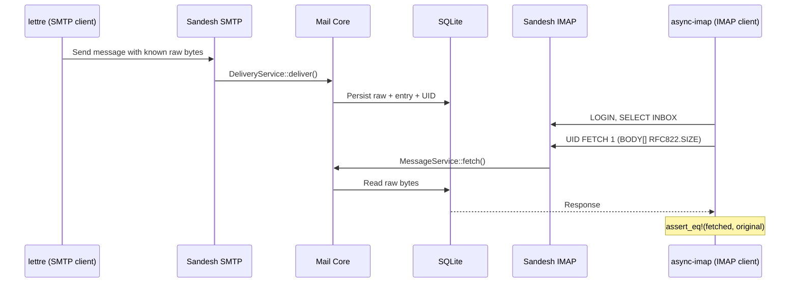

# Sandesh — Testing Strategy

**Status:** In force. The gates described here run in CI (`.github/workflows/ci.yml`).

---

## 1. Why testing is architectural here

Sandesh implements three network protocols from scratch (DEPENDENCIES §2). That decision is only
defensible if correctness is verifiable, so the test strategy is part of the architecture rather than
a follow-up activity. Two properties in particular have no acceptable failure mode:

1. **Byte fidelity.** What SMTP accepts is what IMAP and POP3 return, octet for octet.
2. **Protocol conformance.** Real mail clients must work, not just our own test client.

The architecture is shaped to make both testable: because adapters depend only on core services and
core depends only on traits, every layer can be exercised in isolation with in-memory doubles.

## 2. Test layers



| Layer | Location | Speed | Count |
| --- | --- | --- | --- |
| Unit | `#[cfg(test)]` in each crate | ms | Hundreds |
| Protocol conformance | `crates/sandesh-{smtp,imap,pop3}/tests/` | ms | Hundreds |
| Storage | `crates/sandesh-storage/tests/` | ms–s | Dozens |
| API | `crates/sandesh-api/tests/` | ms | Dozens |
| Cross-protocol | `tests/` (workspace) | s | Dozens — **the important ones** |
| E2E | `web/e2e/` (Playwright) | s | A handful |

## 3. Unit testing

**Core domain** — pure functions and invariants, no I/O, no async:
- `EmailAddress` parsing, including malformed input that must not panic
- Flag algebra: `+FLAGS`, `-FLAGS`, `FLAGS` replacement
- UID assignment monotonicity
- Mailbox name validation, hierarchy, `INBOX` case-insensitivity
- Routing rules (CORE_SPEC §7) against a table of address/policy cases

**MIME parsing** — a corpus of `.eml` files in `testdata/`:

| Category | Contents |
| --- | --- |
| `valid/` | Plain text, HTML, multipart/alternative, multipart/mixed, nested, inline images |
| `encodings/` | quoted-printable, base64, 8bit, 7bit, UTF-8, ISO-8859-1, Shift_JIS, UTF-7 |
| `malformed/` | Missing boundaries, unterminated headers, bad Content-Type, truncated base64, bare LF, missing MIME-Version, duplicate headers, 8-bit in headers |
| `adversarial/` | Deeply nested multipart, huge header counts, zero-length parts, boundary collisions |
| `real_world/` | Anonymised output from common senders and libraries (Nodemailer, PHPMailer, Django, Rails) |

The contract from CORE_SPEC §8 — **never panic, never reject, never lose bytes** — is asserted over
every fixture, along with `parse(raw).raw_bytes() == raw`.

**Current state:** 102 fixtures across all five categories (`valid/` 26, `malformed/` 30,
`encodings/` 18, `adversarial/` 16, `real_world/` 12), meeting the ≥100 target in `ROADMAP.md`
Phase 1. `crates/sandesh-storage/tests/raw_fidelity.rs` asserts the count and that every category
is represented, so the corpus cannot shrink without a test failing, and `common::CATEGORIES` is the
single list every corpus walker uses (ADR-072).

**Property tests** (`proptest`):
- UIDs strictly ascend under any interleaving of insert/delete
- Flag operations are idempotent for `+`/`-` and commutative for disjoint sets
- Any byte sequence parses without panicking (the parser's core safety property)
- Byte ranges into raw are always in-bounds and non-overlapping within a part

## 4. Protocol conformance testing

Each protocol crate is tested against **recorded transcripts** verified by hand against the RFCs. The
session state machine is driven over an in-memory duplex stream, with core services replaced by
in-memory doubles — no TCP, no database, so these run in milliseconds.

```text
C: EHLO client.test
S: 250-sandesh
S: 250-SIZE 26214400
S: 250-8BITMIME
S: 250-PIPELINING
S: 250 ENHANCEDSTATUSCODES
C: MAIL FROM:<sender@example.test>
S: 250 2.1.0 OK
...
```

Snapshot-tested with `insta`, so an unintended change to any server response fails CI visibly.

Coverage per protocol:

| Protocol | Focus |
| --- | --- |
| SMTP | Every command in every state; invalid sequencing; dot-stuffing; line-ending preservation; SIZE rejection; pipelining; oversized input; premature disconnect |
| IMAP | Every command in every state; UID vs sequence variants; literals; every FETCH item; every SEARCH key; untagged responses; tag correlation; `BODYSTRUCTURE` against known messages |
| POP3 | Full session; session-scoped DELE; RSET; QUIT-applies-deletes; **abort discards deletes**; TOP; UIDL stability; numbering stability across mid-session delivery |

`BODYSTRUCTURE` deserves its own note: it is the hardest FETCH item to get right and the one most
likely to break real clients, so it gets a dedicated fixture-driven suite.

## 5. Storage testing

Against real SQLite (temp file, not `:memory:`, so WAL behaviour is real):

- Migrations apply cleanly from empty; the schema matches expectations
- Round-trip fidelity: raw bytes stored and retrieved are identical, inline and external
- The inline/external threshold boundary (exactly at, just below, just above 256 KiB)
- Blob orphan handling: crash between blob write and row commit leaves a reclaimable orphan, never a
  dangling reference
- Cascade deletes leave no orphaned entries, headers, parts or attachments
- GC removes only genuinely unreferenced messages
- FTS5 index consistency after insert, delete and reparse
- **Concurrent UID assignment**: N tasks delivering to one mailbox produce N distinct, contiguous UIDs
- Retention eviction respects insertion order

## 6. Integration and interoperability testing

Real listeners on ephemeral ports, real database in a temp directory, driven by **independent
third-party clients**:

| Protocol | Driver |
| --- | --- |
| SMTP | `lettre` |
| IMAP | `async-imap` |
| POP3 | Hand-written client (no suitable crate; the protocol is trivial) |
| REST | `reqwest` |

Using third-party clients is deliberate: if we drove our server with our own client code, a shared
misreading of a spec would pass. These are interoperability tests, not self-consistency tests.

**Manual client conformance** (release checklist, not CI): Thunderbird, `mutt`, `isync/mbsync`, macOS
Mail, and `openssl s_client` for TLS. Real clients exercise command sequences no test suite predicts —
this is where protocol implementations actually get proven.

## 7. The cross-protocol test — the keystone

The test the whole architecture exists to enable:



```rust
#[tokio::test]
async fn smtp_to_imap_preserves_exact_bytes() {
    let sandesh = TestInstance::start().await;      // SMTP + IMAP + core + SQLite, no UI
    let original = testdata::load("valid/multipart_with_attachment.eml");

    smtp_client::send_raw(sandesh.smtp_addr(), "s@test", "dev@test", &original).await;
    sandesh.wait_for_event(EventKind::MessageReceived).await;

    let mut imap = imap_client::connect(sandesh.imap_addr()).await;
    imap.login("dev", "any").await;
    imap.select("INBOX").await;
    let fetched = imap.uid_fetch(1, "BODY[]").await;

    assert_eq!(fetched.body, original, "IMAP must return byte-identical content");
    assert_eq!(fetched.rfc822_size, original.len() as u64);
}
```

**No UI is involved.** That is the architectural point: the mail engine is complete and verifiable
without a frontend.

The full cross-protocol matrix:

| # | Scenario | Asserts |
| --- | --- | --- |
| 1 | SMTP → IMAP FETCH | Byte-exact retrieval, correct `RFC822.SIZE` |
| 2 | SMTP → POP3 RETR | Byte-exact retrieval, correct STAT octets |
| 3 | SMTP → IMAP + POP3 concurrently | Both see the same message; no interference |
| 4 | IMAP APPEND → POP3 RETR | Non-SMTP ingress is equally visible |
| 5 | IMAP STORE `\Seen` → REST API | Flag change visible through a different adapter |
| 6 | REST delete → IMAP EXPUNGE | Deletion propagates across adapters |
| 7 | POP3 DELE without QUIT → IMAP | Message **still present** — session-scoped deletion |
| 8 | POP3 DELE + QUIT → IMAP | Message gone |
| 9 | SMTP multi-recipient → per-account IMAP | One message, several entries, one stored copy |
| 10 | IMAP COPY → both mailboxes | Distinct UIDs, independent flags, one `Message` row |
| 11 | SMTP → WebSocket event → REST fetch | No race: the event never precedes queryability |
| 12 | SMTP malformed message → IMAP FETCH | Malformed mail is stored, retrievable, byte-exact |
| 13 | IMAP IDLE + SMTP delivery | `* n EXISTS` arrives on the idle connection |

Cases 7, 10 and 12 are the ones that would fail under a naive design — they are the direct tests of
CORE_SPEC's three shaping requirements.

## 8. API and WebSocket testing

**REST** — via `axum`'s `oneshot`, in-process, no TCP:
- Every endpoint: success, not-found, validation failure
- Pagination: cursor stability under concurrent insertion
- Problem Details shape and status mapping for each `CoreError`
- Raw endpoint returns exact bytes with the correct content type
- OpenAPI document validates against the 3.1 schema
- Generated TypeScript matches the checked-in file (drift check)

**WebSocket:**
- Subscribe/unsubscribe lifecycle; server-side filtering
- Events arrive for matching state changes, and not for filtered-out ones
- **Ordering:** `seq` is strictly increasing
- **Lag:** a slow consumer receives `lagged` and can resync
- Reconnect with `after_seq` replays or correctly demands resync
- Ping/pong keepalive and timeout close

## 8.5 Frontend and contract testing (Phase 4)

Four layers, each catching what the others cannot.

| Layer | Tool | What it proves |
| --- | --- | --- |
| Contract | `cargo test -p sandesh-api` | The `OpenAPI` document is valid 3.1, every route is documented, every `$ref` resolves, and generation is deterministic |
| Contract drift | `cargo xtask generate-api --check` | The committed document and TypeScript match what the Rust API produces now |
| Contract shape | `tests/http_surface.rs` | The documented response shape matches what handlers actually send |
| Component | `vitest` + Testing Library | Behaviour: selection, keyboard movement, unread state, event-driven invalidation, reconnection, byte-range highlighting |
| Browser | `playwright` | The whole pipe, against a real binary and real SMTP |

**The contract-shape layer exists because of a real defect.** `utoipa` cannot check an annotation
against its handler's return type, so `/messages/{id}/headers` was documented as a paginated
envelope while the handler returned a bare array. Everything downstream — the document, the
generated types, the API client — described a shape the server never sent, and it compiled and
passed CI. The test now compares documented shape against a live response for every endpoint.

**Mutation testing.** Each Phase 4 test suite was validated by deliberately breaking the code it
covers and confirming the test fails. This found three tests that passed for the wrong reason:

- a WebSocket disconnect test that passed even with the reconnect guard removed, because
  `disconnect()` detaches its handlers before closing and so never exercised the guard;
- a raw-viewer test that missed an off-by-one at a byte-range boundary — the precise thing the
  MIME-to-raw linkage depends on;
- event-sync tests written against snake_case event kinds, when the bus emits PascalCase.

That last one was not merely a weak test: the frontend had the same wrong assumption, so **every**
live update silently did nothing. The socket connected, frames arrived, and the switch fell
through. Component tests written against the same wrong constant agreed with the bug, and only the
browser test — driving a real server — exposed it. A test suite that shares an assumption with the
code it tests cannot find that assumption; a layer that talks to the real thing can.

## 9. Fuzzing

Non-negotiable for components consuming untrusted input, with `cargo-fuzz`:

| Target | Property |
| --- | --- |
| MIME parser | Never panics; never loses bytes; terminates |
| SMTP command parser | Never panics; bounded memory |
| IMAP command parser | Never panics; bounded memory |
| POP3 command parser | Never panics |
| Search query parser | Never panics; terminates |

Run nightly in CI; crashes become regression fixtures in `fuzz/artifacts/<target>/`, replayed on every commit.

**Current state: built.** `fuzz/` carries a libFuzzer target for all five parsers above, run
nightly by the `fuzz` job in CI (and on demand via `workflow_dispatch`), one matrix leg per target
so one crash never hides another.

Three details are worth knowing before touching it:

- **The crate is deliberately outside the workspace**, and the root manifest excludes it. Two
  reasons: `tests/architecture.rs` walks the resolved dependency graph from `cargo metadata`, and a
  fuzz crate would put `libfuzzer-sys` and `arbitrary` into it; and the targets need a nightly
  toolchain, which the stable `cargo check --workspace --all-targets` gate does not have.
- **Each target's body is ordinary library code**, in `fuzz/src/lib.rs`, not inline in the
  `fuzz_target!` macro. The binaries need nightly, so if the assertions lived inside the macro
  nothing in per-PR CI would ever compile them and they would rot between nightly runs. As
  functions they are typechecked on stable and, more usefully, replayable.
- **`fuzz/tests/corpus.rs` replays them on stable**, on every commit: all 101 `testdata/` fixtures
  through the MIME checks, a hand-written seed list through the four command parsers, and every
  committed crash reproducer under `fuzz/artifacts/<target>/`. This is the regression loop this
  section asks for — a crash becomes a committed artifact, and from then on it is checked by the
  ordinary test run rather than only by the nightly schedule.

The targets assert more than "did not panic", which a target that ignores its return value gets for
free. The MIME target checks that every reported `ByteRange` lies within the input it was given —
the parser describes a message by byte range, and an out-of-range span would fail not there but
later in a slice — and that no projected body or attachment path names a part that does not exist.
The IMAP target drives the *second* half of the parse path by resuming each `PendingLiteral`, which
a target stopping at `parse_line` would never reach, and asserts the literal cap is enforced before
allocation. The search target bounds the depth of the returned plan: `parse_filter_query` is
infallible by design, so an unbounded nesting would surface as a stack overflow in the evaluator
rather than as an `Err`.

`crates/sandesh-pop3/tests/parser_robustness.rs` remains: 40,000 seeded cases on every commit. It
is a floor rather than a duplicate, exploring only the shapes its generator was written to produce,
where the fuzzer is coverage-guided.

## 10. Concurrency testing

- N concurrent SMTP connections delivering to one mailbox → distinct, contiguous UIDs
- Concurrent IMAP sessions on one mailbox: EXPUNGE in one, FETCH in the other
- POP3 session open while SMTP delivers: the POP3 snapshot must not change mid-session
- WebSocket subscribers under high delivery rate: lag handled, no deadlock, no unbounded memory
- Graceful shutdown under load: in-flight deliveries complete or roll back cleanly
- Long-running soak test with `--test-threads` and Tokio's multi-thread runtime

## 11. TLS and authentication testing

Phase 7:
- STARTTLS upgrade on all three protocols; plaintext commands rejected after upgrade
- Implicit TLS ports
- Auto-generated self-signed certificate is created, persisted and reloaded
- Supplied certificate/key files are honoured
- `openssl s_client` handshake for each protocol
- Each SASL mechanism: PLAIN, LOGIN, CRAM-MD5 — success, failure, malformed
- `LOGINDISABLED` advertised on cleartext when credentials are required
- Auth-disabled default accepts any credentials, and the dashboard reports the posture accurately
- Argon2 verification; timing-safe comparison

## 12. End-to-end testing

Playwright, deliberately few — E2E tests are slow and brittle, and the engine is already covered.
**All six are built** (`web/e2e/mail.spec.ts`):

| # | Scenario | Covered by |
| --- | --- | --- |
| 1 | Start Sandesh → open UI → send via SMTP → message appears live (no refresh) | `a message sent over SMTP appears without a refresh` |
| 2 | Open a message → headers, HTML, text, raw, MIME tree all render | `opens a message and shows its content, headers, MIME and source`, plus `links a MIME part to its bytes in the raw source` |
| 3 | Search narrows the list correctly | `search narrows the list to matching messages` |
| 4 | Download an attachment; bytes match the API response | `downloads an attachment whose bytes match the API` |
| 5 | Delete a message; it disappears from the list and from IMAP | `deletes a message from the list and from IMAP` |
| 6 | Dashboard shows correct server status and copyable connection strings | `shows the connection details on first load`, `reports a live event stream` |

Two properties the list does not state, both asserted:

- **Scenario 4 pins the decoded bytes**, not just that the download equals the API response. The
  attachment travels base64-encoded, so two identically-broken reads would agree with each other;
  only comparing against the decoded content catches a server that never decoded it.
- **Scenario 5 reads back over IMAP**, not over REST. Checking the API would prove only that it
  agrees with the call the UI just made; IMAP holds its own per-mailbox UID and flag state, which is
  where the two can disagree. It asserts the message *moved* — absent from `INBOX`, present in
  `Trash` — because asserting absence alone would also pass if the delete had destroyed mail it was
  meant to keep.

Nothing here is seeded into the database: every message is delivered over a real SMTP conversation
(§67), so a break anywhere in the pipe fails the test rather than being papered over by a fixture.
`web/e2e/smtp.ts` and `web/e2e/imap.ts` are hand-rolled clients for this reason — each is a short
protocol exchange, and a dependency would add a maintenance surface for it.

Accessibility is checked with `axe-core` on each principal view (`web/e2e/a11y.spec.ts`): WCAG AA
contrast in both themes, and the 375px viewport.

## 13. Fixtures and harness

**`TestInstance`** — the central harness. Starts a full engine on ephemeral ports with a temp data
directory, exposes each bound address, provides `wait_for_event`, and tears down completely on drop.
Every integration and cross-protocol test uses it.

**Event-based synchronisation, never sleeps.** `wait_for_event` subscribes to the bus with a timeout.
Tests that sleep are flaky tests, and a protocol test suite full of `sleep(100ms)` is worthless.

**Builders** for domain fixtures: `MessageBuilder`, `AccountBuilder`, `MailboxBuilder`.

**In-memory port implementations** (`InMemoryMessageStore` etc.) live in a `sandesh-core` test-support
feature — they double as the proof that the port abstraction is real. If an in-memory store cannot
satisfy the traits, storage has leaked into the core.

## 14. CI

| Stage | Runs |
| --- | --- |
| Format / lint | `cargo fmt --check`, `cargo clippy -- -D warnings` |
| **Architecture** | `tests/architecture.rs` — asserts the dependency graph (ARCHITECTURE §12.1–2, §12.9) |
| Supply chain | `cargo-deny`, `cargo-audit` |
| Unit + protocol | `cargo test --workspace` |
| Integration | Cross-protocol suite |
| Coverage | `cargo-llvm-cov`; **≥85% on `sandesh-core` and protocol crates** — enforced in CI by `scripts/coverage_gate.py`, which rolls the per-file report up per crate and fails naming every crate below the floor |
| Frontend | `tsc --noEmit`, `vitest`, `eslint` |
| API contract | TypeScript drift check |
| E2E | Playwright (main branch and releases) |
| Fuzz | Nightly, time-boxed |

The architecture test is the notable one: dependency-direction rules that are not mechanically
enforced decay within months.

**The coverage gate makes the same point about itself.** The ≥85% floor was written here in
Phase 0 and nothing measured it until Phase 7's Definition-of-Done check — seven phases of a
threshold that could not fail. The first measurement found `sandesh-pop3` at **84.15%**, below
its own documented floor, with the SASL `AUTH` failure paths (unsupported mechanism, cleartext
refusal, wrong password, unknown account, cancellation, malformed payload) untested. Those are
now covered and the crate is at 85.22%. A threshold nothing measures is a threshold nothing
holds.

Measured at the close of Phase 7:

| Crate | Line coverage | Gated |
| --- | --- | --- |
| `sandesh-core` | 92.70% | yes |
| `sandesh-imap` | 93.60% | yes |
| `sandesh-proto` | 92.52% | yes |
| `sandesh-smtp` | 90.14% | yes |
| `sandesh-pop3` | 85.22% | yes |
| `sandesh-storage` | 91.83% | no |
| `sandesh-events` | 95.24% | no |
| `sandesh-config` | 89.69% | no |
| `sandesh-api` | 82.90% | no |
| `sandesh-app` | 72.88% | no |
| **Workspace** | **89.82%** | — |

**Running it locally.** `cargo llvm-cov --workspace --summary-only`. It builds the whole workspace
a second time with `-C instrument-coverage`, into `target/llvm-cov-target`, so expect a few
gigabytes and a couple of minutes on top of an ordinary test run. CI sets
`CARGO_PROFILE_DEV_DEBUG=line-tables-only` for it — coverage needs line mappings, not full DWARF,
and the difference is measured: one instrumented integration binary drops from 248MB to 76MB.
Without that the link of the largest test binary exhausted a hosted runner and died with
`ld terminated with signal 7 [Bus error]`, which reads like a compiler bug and is really a
resource limit.

**A note on `target/` growth.** Cargo never garbage-collects old artifacts, and this workspace
links 53 test binaries at roughly a quarter of a gigabyte each once instrumented. A `target/`
directory that has seen months of rebuilds accumulates dozens of stale copies of every one of them
— it reached 98GB here, against 13GB for a complete fresh build. `cargo clean` reclaims it, and
nothing under `target/` is tracked by git (`.gitignore:3`), so the repository itself stays around
18MB regardless.

`sandesh-api` and `sandesh-app` sit below 85% but are deliberately outside the gate: the floor
names the core and the protocol crates, where a silent regression is hardest to notice from the
outside. `sandesh-app` is the composition root, much of which is startup wiring exercised by the
integration suite through real sockets rather than by unit tests that would assert on
construction order.

## 15. What we do not test

- Third-party crate internals (`mail-parser`'s RFC conformance is its own suite; we test our use)
- Performance beyond a smoke benchmark — this is a local dev tool, not a throughput-critical MTA. A
  regression benchmark exists to catch pathological slowdowns, not to chase a number
- Every charset in `mail-parser`'s 41 — a representative sample plus anything a bug report surfaces

---

## Phase 3 additions

A new top layer: **whole-application tests**. Each starts a real `Application` — real SMTP listener,
real HTTP server, real event bus, real SQLite — in-process, on **ephemeral ports**, in its own
temporary directory. Nothing is stubbed, because what these tests exist to prove is that the
composition is correct rather than that five crates compile together.

| Suite | Covers |
| --- | --- |
| `crates/sandesh-app/tests/end_to_end.rs` | The authoritative path: WebSocket connect → SMTP conversation → `250` → event arrives → REST query → raw bytes byte-identical → clean shutdown |
| `crates/sandesh-app/tests/rest.rs` | Health, readiness, info, accounts, mailboxes, messages, headers, MIME, parts, flags, entry deletion, pagination, the error model, concurrent readers |
| `crates/sandesh-app/tests/websocket.rs` | Connect, fan-out to three clients, disconnect isolation, reconnect, server-side filtering, lag, and that a dead client cannot block SMTP |
| `crates/sandesh-app/tests/lifecycle.rs` | Startup ordering, invalid configuration, unusable database path, port clashes on both listeners, each listener running with the other disabled, shutdown, restart over an existing database |
| `crates/sandesh-events/src/lib.rs` | Bus unit tests: ordering under concurrency, fan-out, drop, overflow, lag accounting |
| `tests/architecture.rs` | Extended with the Phase 3 dependency rules (see below) |

### Determinism

No test sleeps for a guessed duration. The harness waits for **conditions** with a bounded timeout:
`await_ready` polls readiness, `await_event` waits for a named event kind, and `stop` joins the
application task under a timeout so a hang fails rather than blocking. Where a test must assert an
event *did not* arrive, it does so by ordering — send a `ping` and require the `pong` to be the next
frame — rather than by waiting and hoping. The application suites were run repeatedly to confirm.

### Architecture rules added

`sandesh-events` depends only on `sandesh-core` and imports no transport; `sandesh-api` reaches
storage only through core ports and depends on no protocol crate; `sandesh-smtp` and
`sandesh-storage` depend on no web layer; `sandesh-app` is the only composition root and nothing
depends on it; only one HTTP framework is present.

### Known gap

The WebSocket **lag notification** frame is exercised at the bus level, not end-to-end. The
connection task drains its queue into the socket eagerly, so a subscriber only falls behind once the
socket's own buffers fill — which is good behaviour, and makes the notification hard to provoke
deterministically. What is tested end-to-end is the property that matters more: a client that stops
reading entirely never blocks SMTP delivery.
