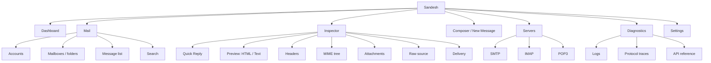

# Sandesh — UI/UX Direction

**Status:** Implemented (Phase 4); extended by each later phase that adds a view.

---

## 1. Positioning

The UI is a **Mail Development Console**, not a webmail client. This distinction drives every
decision below.

A webmail client optimises for *reading correspondence*: comfortable typography, generous whitespace,
content foregrounded, mechanism hidden. A development console optimises for *understanding a
message*: density, precise technical detail, mechanism exposed, and fast movement between the
rendered view and the bytes underneath.

**Self-contained testing affordance.** While Sandesh is an inspection console rather than a general-purpose
webmail client, true local developer autonomy requires being able to generate test messages and simulate
replies directly within the console. Sandesh includes a built-in **Developer Mail Composer & Quick Reply**
tool so developers never need to switch to third-party mail clients (like Thunderbird) or write scratch
scripts just to trigger a mail flow.

**On prior art.** Mailpit is studied as a benchmark for developer experience — its low-friction
onboarding, immediate live updates, and the fact that message inspection is the product rather than a
feature. Sandesh's information architecture, visual language, and interaction model are its own, and
the IA below is genuinely different because the product is: Sandesh has accounts, mailboxes, folders,
flags and three protocols, which a capture-only tool does not need to represent.

## 2. Design principles

1. **Density with clarity.** Developer tools earn their keep by showing a lot at once. Density comes
   from disciplined spacing and typography, not from cramming.
2. **The message is the product.** Everything is in service of understanding one message.
3. **Never hide the truth.** Every rendered view has a one-click path to the raw bytes behind it.
4. **Zero-friction onboarding.** The first screen answers "how do I point my app at this?" — the only
   question a new user actually has.
5. **Live by default.** Mail appears the instant it arrives. No refresh button, ever.
6. **Keyboard-first.** `j`/`k`, `/` to search, `?` for shortcuts, `Esc` to close.
7. **Honest state.** Empty, loading, error and disconnected states are designed, not afterthoughts.
   "Why is nothing here?" must always be answerable from the screen.

## 3. Information architecture



Six top-level areas, deliberately few. The brief's list (Dashboard, Inbox, Mailboxes, Message
Inspector, Search, Attachments, Raw MIME, Headers, MIME Tree, SMTP, IMAP, POP3, Accounts,
Diagnostics, API, Logs, Settings) is a list of *capabilities*, not of navigation destinations — most
belong inside the inspector or the servers view rather than as peers in a sidebar. Seventeen
top-level items would be a worse tool than six.

## 4. Layout

```text
┌────────────────────────────────────────────────────────────────────────────┐
│ Sandesh    [/ search................]     ● live   SMTP:1025 IMAP:1143  ⚙ │
├──────────────┬──────────────────────────┬──────────────────────────────────┤
│              │                          │                                  │
│  Dashboard   │  ○ Password reset        │   Password reset                 │
│              │    noreply@app.test      │   noreply@app.test → dev@ex.test │
│  MAIL        │    12:04 · 4.8 KB · 📎   │   1 Sep 2026 12:04 · 4.8 KB      │
│  ▾ dev@…     ├──────────────────────────┤                                  │
│    Inbox 42  │  ● Welcome aboard        │  ┌──────────────────────────────┐│
│    Sent      │    hello@app.test        │  │ HTML  Text  Headers  MIME    ││
│    Drafts    │    11:58 · 12 KB         │  │ Raw   Attachments  Delivery  ││
│    Trash     ├──────────────────────────┤  ├──────────────────────────────┤│
│  ▸ qa@…      │  ○ Invoice #4821         │  │                              ││
│              │    billing@app.test      │  │   [rendered message]         ││
│  Servers     │    11:40 · 88 KB · 📎    │  │                              ││
│  Diagnostics │                          │  │                              ││
│  Settings    │                          │  └──────────────────────────────┘│
└──────────────┴──────────────────────────┴──────────────────────────────────┘
```

A three-pane layout: navigation, message list, message detail. Conventional, because a developer
should not have to learn a novel layout to read their test mail — the originality belongs in what is
shown, not in where things are.

**Responsive collapse:** ≥1280px three panes; 768–1280px two panes (list + detail, nav as a drawer);
<768px single pane with stack navigation. The mobile case is real — checking a test message from a
phone during development happens.

These are the **only** widths a media query may use, plus 640px and 480px which thin the chrome and
never change the pane count. The rule is enforced by `npm run lint:breakpoints`, because the drift
it prevents is invisible in review: the table above had decayed to seventeen different values, and
the shell collapsed to two panes at 1100px while the route inside it still believed it had three
until 1024px — so between those widths the page held two contradictory layouts at once. Below the
three-pane threshold, control strips that cannot fit (the inspector toolbar, the tab row, the filter
pills) scroll horizontally with a fade at the trailing edge rather than wrapping onto extra rows;
the fade is what tells a phone user the row continues.

## 5. Dashboard

The first screen, and the answer to the onboarding question. Ordered by what a new user needs:

**1 — Connection details.** The single most valuable element in the product. Each protocol's host,
port, and a copy button, plus a copyable snippet in the user's language (`SMTP_HOST=…`, a `lettre`/
`nodemailer`/`smtplib` config). Fed by `GET /api/v1/info`.

**2 — Server status.** Four cards (SMTP, IMAP, POP3, Web): running/stopped, bound address,
connections, and the current auth/TLS posture stated plainly — a developer must never be confused
about whether auth is on.

**3 — Activity.** A sparkline of messages over time and a live feed of recent deliveries. Motion when
mail arrives is meaningful feedback: it confirms the pipe works.

**4 — Storage.** Message count against retention limits, disk usage, data directory path.

## 6. Message list

Each row: read indicator, subject, from, to, time, size, and badges for attachments, inline images,
and parse warnings. Multi-mailbox messages show a mailbox chip.

- **Live insertion at the top**, with a brief highlight. If the list is scrolled away from the top, a
  "N new messages" pill appears rather than shifting content under the cursor.
- Virtualised, for thousands of messages.
- Selection: click, shift-click ranges, `j`/`k`, `x` to select.
- Bulk actions map to `POST /api/v1/entries/bulk`.
- **A parse-warning badge is a feature**, not an error state. Surfacing "this message is malformed" in
  the list is precisely what the tool is for.

## 7. Message inspector

The heart of the product. Tabs, all over the same message:

| Tab | Contents |
| --- | --- |
| **HTML** | Rendered in a sandboxed iframe. Viewport width toggle (desktop/tablet/mobile). Blocked-remote-content notice with a load button |
| **Text** | `text/plain` part, monospace, with a link-detection overlay |
| **Headers** | Every header in received order, duplicates preserved. Raw and decoded toggle. Copy per header. `Received:` chain visualised as a hop timeline |
| **MIME** | Interactive tree: type, encoding, size, disposition per node. Selecting a node shows its exact bytes and highlights its range in Raw |
| **Raw** | The complete original message, monospace, line-numbered, searchable. Byte offsets shown; selecting a header or MIME part scrolls and highlights |
| **Attachments** | Grid with thumbnails for images, type icons otherwise. Size, type, download; inline resources marked with their Content-ID |
| **Delivery** | Envelope (MAIL FROM, RCPT TO, HELO, peer, TLS), routing outcome per recipient, and the full SMTP transcript |

**Toolbar actions.** The inspector header provides:
- **Mark read / unread** (`SEEN` flag toggle)
- **Delete** (removes placement from mailbox)
- **Reply** (opens the Developer Mail Composer prefilled with recipient, `Re: <subject>`, `In-Reply-To`, and quoted body history)

Two elements deserve emphasis as differentiators:

**The MIME tree ↔ Raw linkage.** Selecting a MIME part highlights its exact byte range in the raw
source, and vice versa. This is only possible because parts are stored as byte ranges into the
authoritative raw bytes (STORAGE_DESIGN §2.5) — the architecture directly enables the UI's best
feature.

**The Delivery tab.** Answering "why did this land here?" with envelope, routing decision and
transcript is the thing a developer most often needs and most rarely gets.

## 8. Search

A single input in the header, `/` to focus, with the filter syntax from STORAGE_DESIGN §7
(`from:`, `to:`, `subject:`, `is:unread`, `has:attachment`, `larger:1M`, `before:2026/09/01`).

- Autocomplete for filter names and known addresses
- Filter chips below the input, individually removable
- Empty results explain *why* and offer a relaxed query — a dead end is a design failure
- A "show query plan" affordance (`GET /api/v1/search/explain`) for when a search behaves unexpectedly

## 9. Servers and diagnostics

**Servers:** per-protocol detail — bound address, uptime, active connections, capability list as
advertised on the wire, start/stop, and TLS certificate fingerprint with an explanation of trusting a
self-signed certificate. That explanation prevents the most common and most frustrating support
question a local mail tool generates.

**Diagnostics:**
- **Logs** — live structured stream, filterable by level and component
- **Protocol traces** — per-connection transcripts, the killer feature for debugging a client that
  "doesn't work"
- **API** — rendered OpenAPI reference with a live try-it console, so the API is discoverable from
  inside the product

## 10. Visual identity

Distinct from the prior art by construction: a **precise, technical, calm** aesthetic — closer to a
debugger or observability tool than to an email client.

| Element | Direction |
| --- | --- |
| Type | Three roles, all self-hosted so they survive offline (ADR-095): **Space Grotesk** for chrome labels and titles, **Inter** for body, **JetBrains Mono** for data. Monospace is used generously — headers, raw, MIME, traces — because this is a tool for reading protocol data. The display face is mechanical rather than neutral: an instrument's chrome should not read like a document |
| Scale | 13px base for UI chrome, 14px content, 12.5px mono. Compact and readable |
| Labels | Structural labels (section headings, pane titles, table captions) are set in the display face, uppercase, tracked `0.08em`. This is the system's one typographic mannerism, and it marks a label as machine-addressable rather than prose |
| Colour | Cool graphite foundation; **one** accent for interaction, a cyan-leaning teal. Colour is reserved for meaning: green delivered, amber warning, red error, blue informational. A console that colours decoratively cannot use colour to signal. The accent is deliberately a different *hue* from `--info`, not a different shade of the same blue — otherwise "this is interactive" and "this is an informational signal" are indistinguishable |
| Density | 8px spacing grid, 32px list rows, 4px radii. Restrained |
| Depth | Borders and background steps, not shadows. Flat and precise |
| Motion | 120–160ms, functional only: new-message highlight, tab transitions, live-status pulse. No decorative animation |
| Theme | **Dark and light, both first-class**, with dark as the default. Tokens defined once; nothing hardcoded |
| Icons | One consistent set (Lucide), 16px, used sparingly |

## 11. Accessibility

A requirement, not a phase-later concern:

- WCAG 2.2 AA contrast in both themes — verified in CI with `axe-core`
- Full keyboard navigation; visible focus rings; a documented tab order
- ARIA landmarks; the message list as a proper `listbox`; live regions announcing new mail
- Screen-reader labels on every icon-only control
- `prefers-reduced-motion` honoured
- No information conveyed by colour alone — badges carry text or shape as well
- Minimum 44px touch targets on mobile, enforced once in `base.css` under `@media (pointer: coarse)`
  rather than control by control. Applied per-component it held only where someone remembered it: the
  Compose button, the preview viewport toggles and every copy button measured 22–26px on a phone.
  Keying it to the pointer type fixes the class rather than the instances, and costs a mouse user
  nothing because it never matches for them

## 12. Performance

- Virtualised lists; the message list must stay smooth at 10,000 rows
- Raw view virtualised by line; large messages must not freeze the tab
- HTML preview in an iframe, so a pathological message cannot lock the app
- Attachments fetched lazily; thumbnails server-generated
- Optimistic flag updates, reconciled against the WebSocket event
- Route-level code splitting; the initial bundle stays small. Overview and Mailbox stay in the entry
  chunk because one of them is what nearly every session opens first — deferring them would trade
  bytes for a blank frame on the common path. Everything else is fetched on entry.
- **The composer is split, and that is where the weight actually was.** TipTap and ProseMirror are
  ~1 MB of source, and `ComposerProvider` wraps every route, so no amount of *route* splitting could
  have moved them: the provider mounted the composer unconditionally, which meant every reader
  downloaded a rich-text editor to look at their mail. It now loads on the first Compose. Entry
  bundle 969 kB → 464 kB raw, 291 kB → 138 kB gzipped.
- The `Suspense` boundary lives inside `<main>`, around the outlet, not around the shell. A split
  route then resolves in the content pane with the header and navigation still on screen.

## 13. Error and empty states

| State | Treatment |
| --- | --- |
| No messages yet | The connection details, inline. The empty state *is* the onboarding |
| No search results | The parsed query, why it matched nothing, and a relaxed alternative |
| WebSocket disconnected | A persistent banner with reconnect status. Never silently stale |
| Message failed to parse | Shown with diagnostics, Raw tab preselected. A feature, not an error |
| Server stopped | Explicit card state with a start button and the reason |
| API unreachable | Full-page state explaining that the backend is down, with the expected address |

## 14. Open decisions

- **OD-10** Frontend router (DEPENDENCIES §6)
- **OD-13** Whether HTML-compatibility linting (a client-support score, as prior art offers) belongs
  in v1 or Phase 9. It needs a maintained compatibility dataset, which is an ongoing commitment.
  *Leaning: Phase 9.*
- **OD-14** Whether the UI should offer a compose/send affordance for generating test mail. Useful,
  but it makes Sandesh a mail *client*, which is a scope boundary worth defending. *Leaning: a
  "resend/replay this message" action only, no composer.*
